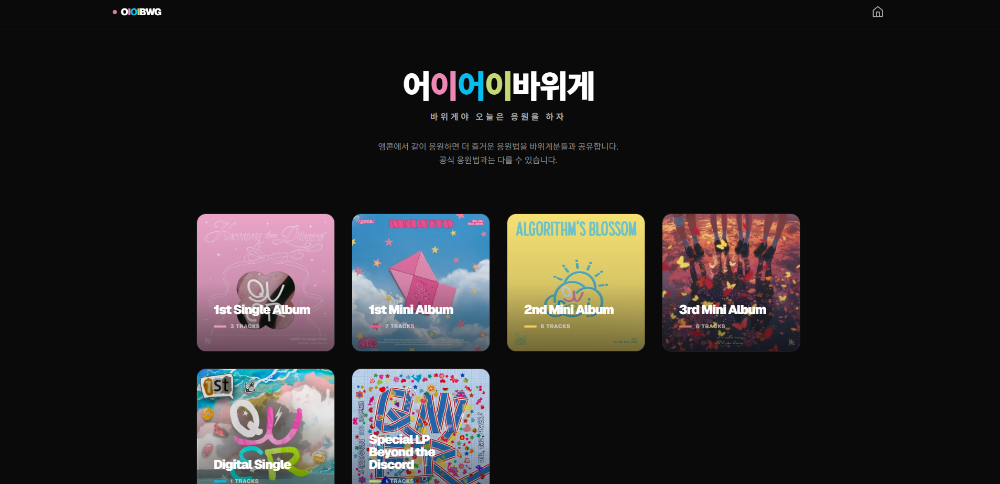
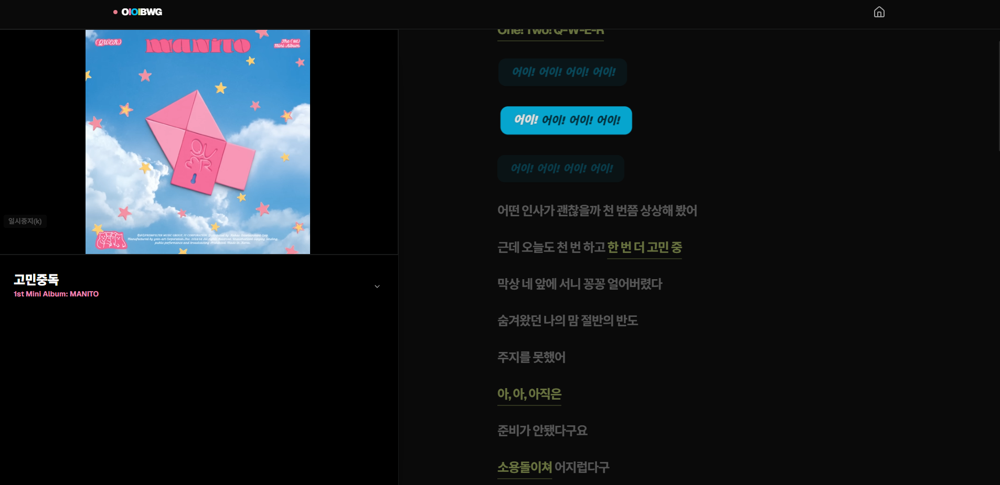
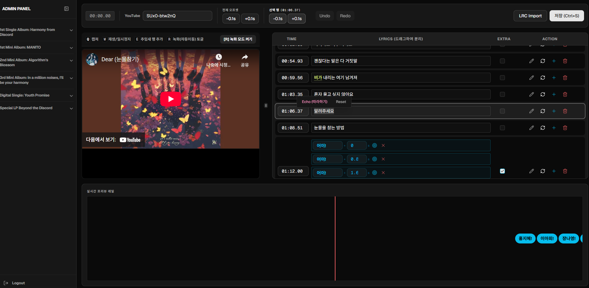

# 어이어이바위게 (OiOiBawige)

> **"바위게야 응원법을 알아보자"**

- **LIVE**: [oioibawige.com](https://oioibawige.com)

문서는 [문서 안내](docs/README.md)에서, 현재·보류 작업은 [WORK](docs/WORK.md)에서 확인합니다.



어이어이바위게(OiOiBawige) 는 QWER 팬덤 '바위게'를 위한 비공식 응원법 가이드 서비스입니다.

유튜브 영상과 실시간으로 동기화되는 가사 및 응원법 자막을 통해 누구나 쉽게 응원 리듬을 익힐 수 있습니다.
정답을 정의하기보다 모두가 각자의 방식으로 QWER을 더 즐겁게 응원할 수 있기를 바랍니다.

## 핵심 기능 (Key Features)

### 1. 사용자 응원법 뷰어 (User Sync Viewer)



- **실시간 유튜브 연동**: YouTube IFrame API를 활용하여 영상 재생 시간과 가사를 1/60초 단위로 정밀하게 동기화합니다.
- **스마트 스냅 (Smart Snap)**: 현재 재생 중인 가사 행이 화면 중앙에 오도록 GSAP 기반의 부드러운 자동 스크롤을 지원합니다.
- **응원 하이라이트**: 에코(Echo) 파트와 추임새(Extra) 파트를 시각적으로 구분하여 직관적인 응원 가이드를 제공합니다.
- **광고 감지 로직**: 영상 재생 중 광고 발생 시 가사 싱크를 일시 정지하는 휴리스틱 감지 기능을 포함합니다.

### 2. 어드민 가사 편집기 (Admin Editor)



- **라인 스플리터**: 드래그 앤 드롭과 플로팅 메뉴를 통해 단어 단위로 `Echo(함께 부르기)` 속성을 부여할 수 있습니다.
- **실시간 타임스탬프 캡처**: 단축키(Space)를 사용하여 영상 재생 중 즉시 `startTime`을 기록합니다.
- **엑스트라 행 관리**: 가사에 없는 네임콜이나 기합을 위한 전용 행을 빠르게 삽입하고 그룹화 할 수 있습니다.

---

## 기술 스택 (Tech Stack)

### Framework & Library

- **Framework**: Next.js 16 (App Router, standalone output), React 19
- **Styling**: Tailwind CSS 4, Shadcn UI
- **Animation**: GSAP
- **State & Form**: TanStack Query, ky, React Hook Form, Zod, nuqs

### Database & Backend

- **Database**: PostgreSQL 17 (OCI production / isolated local Docker)
- **ORM**: Drizzle ORM
- **Auth**: Console Auth.js Credentials + TOTP MFA / Web 비로그인 공개 조회
- **Runtime**: Node.js standalone server

### Infrastructure

- **Build**: Next.js standalone output
- **Monitoring**: Sentry (Error & Performance tracking)
- **Analytics**: Google Analytics & Google Tag Manager

### Test

- **stress / spike / load**: K6

---

## 프로젝트 구조 (Project Structure)

```text
cheer-rock-crab/
├── .github/workflows/  # 검증과 별도 Promotion
├── data/lyrics/        # 원본 가사
├── docs/               # active architecture·계획·실행 결과·개발 안내
├── drizzle/            # SQL migration 이력
├── apps/
│   ├── web/            # 비로그인 공개 조회 Next 앱, 자체 FSD·설정·정적 자산
│   ├── console/        # 독립 세션·MFA를 사용하는 관리 Next 앱
│   └── sentry-slack-relay/ # 독립 Cloudflare Worker, 자체 Node 검사·수동 배포
├── packages/
│   ├── config/         # 공통 tooling factory·preset·rule·marker mock
│   ├── contracts/      # serializable HTTP schema/DTO
│   └── server/         # 공통 service·repository·DB 및 전용 integration tests
├── ops/
│   ├── docker/         # 공통 개발 Dockerfile
│   └── oci/            # 운영 Compose·env 예제·호스트/배포 도구
├── tests/              # root 통합/운영 검증·fixture·k6 성능 테스트
├── scripts/            # guarded DB·로컬 launcher·검증 CLI·manual 수동 도구
└── package.json        # workspace 명령 진입점
```

Web/Console은 각 앱의 src에 FSD 레이어와 server boundary를 필요한 만큼 구성합니다.
앱 간 직접 import는 금지하며 공통 소스는 package 공개 entry를 사용합니다. 자동 탐색 설정 entry는
각 root/app에 유지하고 tooling은 `@oioi-bwg/config/*`로 소비합니다.

운영 Dockerfile은 `apps/web/Dockerfile`·`apps/console/Dockerfile`이 각 앱의 이미지를 소유합니다.
저장소 루트에서 `docker build -f apps/web/Dockerfile .`처럼 실행하며 기본 빌드 대상은 해당 앱입니다.
공통 개발 이미지는 `ops/docker/Dockerfile.dev`와 루트 Compose가 조합합니다.

---

## 서비스 운영 철학 (Philosophy)

본 서비스는 "응원법의 정답을 정의하는 곳"이 아니라, "함께 즐기기 위한 응원 법을 공유하는 서비스"입니다.

- **공식 응원법**: `OfficialBadge`를 통해 출처를 명확히 밝힙니다.
- **제안 응원법**: 개인적인 경험을 바탕으로 한 제안이며, 사용자의 자유로운 응원을 존중합니다.
- **비영리 프로젝트**: 본 서비스는 팬이 만든 비영리 프로젝트입니다.

---

## 시작하기 (Getting Started)

### 설치

```bash
pnpm install --frozen-lockfile
```

`pnpm dev`·`pnpm start`는 Web, `pnpm build`는 Turbo로 Web과 Console을 빌드합니다.
검증·DB 명령은 저장소 루트에서 실행합니다. 각 앱의 `.env.example`을 사용하고 기존 개인 env는 보존합니다.
예제는 값이 모두 빈 템플릿입니다. 실제 값은 앱별 개인 `.env.local` 한 파일에 입력합니다.
기존 `.env`는 값을 보존해 이관하고 원본을 별도 백업합니다. 개발 Compose와 Console 실행기도 이 경로를 읽습니다.
`NEXT_PUBLIC_APP_ENV`는 `local | production`만 허용합니다. 로컬 개발·production build·검증은
`local`, VM Promotion candidate는 `production`입니다. `NODE_ENV`로 앱 환경을 추론하지 않으며
별도 staging 환경을 운영하지 않습니다. local에서는 Sentry를 전송하지 않고 Web metadata는 localhost를 사용합니다.

Console MFA를 로컬에서 확인하려면 `apps/console/.env.example`의 주석대로 `.env.local`을 준비한 뒤
`pnpm dev:console:local`을 실행합니다. PostgreSQL 시작·migration·Console 실행을 한 번에 처리합니다.
등록과 로그인 순서는 [Console 로컬 확인 절차](docs/migration/implementation/LOCAL-DEVELOPMENT-ENVIRONMENT.md#console-mfa-로컬-확인-p05-이후)를 따릅니다.

### 로컬 Docker 개발환경

```bash
test -e apps/web/.env.local || cp apps/web/.env.example apps/web/.env.local
```

새 파일에는 먼저 `NEXT_PUBLIC_APP_ENV=local`과 로컬 `DATABASE_URL`을 채웁니다.
[로컬 입력값과 파일 우선순위](docs/migration/implementation/LOCAL-DEVELOPMENT-ENVIRONMENT.md#환경-파일의-역할과-작성-순서)를 확인한 뒤 실행합니다.

```bash
docker compose -f compose.dev.yml up -d postgres
docker compose -f compose.dev.yml up -d next
docker compose -f compose.dev.yml exec next pnpm db:migrate
```

브라우저에서 `http://localhost:3000`을 엽니다. 자세한 migration, reset, 운영 DB 안전 원칙은 [로컬 개발환경 문서](docs/migration/implementation/LOCAL-DEVELOPMENT-ENVIRONMENT.md)를 따릅니다.

팀에서 전달받은 `.local/` PostgreSQL dump가 있으면 전체 개발 데이터를 명시적으로 복원합니다. 저장소는 임의의 seed 데이터를 제공하지 않습니다.

```bash
pnpm db:restore-local
```

### 컨테이너 종료

```bash
docker compose -f compose.dev.yml down
```

### 테스트

```bash
# 두 앱 local 입력 준비 후 타입·lint·unit·harness·ops·format·build
NEXT_PUBLIC_APP_ENV=local pnpm verify

# 별도 승인된 외부 대상에만 수동 실행하는 k6 (일반 검증에 포함하지 않음)
pnpm test:load
pnpm test:stress
pnpm test:spike
```

unit/type/lint는 workspace가, root harness·ops·PG runner는 저장소가 실행 진입점을 소유합니다.
Worker unit도 root unit/coverage·Turbo에 포함되며 PG integration은 일반 unit에 포함하지 않습니다.
실제 local PG17 통합 검증은 `pnpm test:integration:postgres --local`을 사용합니다.
격리 DB·역할을 생성하고 정리하며 기존 개발 DB를 초기화하지 않습니다.
[k6 안내](docs/K6_TEST.md)는 기존 외부 target 이름과 수동 실행 책임을 구분합니다.

### 프로덕션 빌드와 로컬 실행

두 앱의 local env를 준비한 후 실행합니다. standalone runtime에 필요한 local DB 등 process 입력도 준비합니다.

```bash
NEXT_PUBLIC_APP_ENV=local pnpm build
pnpm start # Web standalone
```

### 설정·호환 자산의 소유권

[루트 파일별 소비자·배치 근거](docs/migration/implementation/ROOT-FILE-INVENTORY.md)에 자동 탐색 설정,
명시적으로 참조하는 운영 자산, 수동 도구·생성 파일을 구분했습니다. 설정 entry의 타입 검사는
루트 `tsconfig.config.json`이 소유하며 `pnpm type-check:config`로 실행합니다.

- `ops/oci/env/legacy/release.env.example`은 이전 단일 앱 release.env 형식의 호환 예제입니다. 현재 paired
  candidate 입력이나 로컬 앱 env가 아닙니다. `ops/oci/env/runtime-public.env.example`과
  `ops/oci/env/runtime-secrets.env.example`은
  host installer가 누락된 보호 설정의 초기 예제로 아직 소비하므로 rollback 지원과 함께 보존합니다.
  현재 배포 입력은 [active runbook §21](docs/migration/oioi-bwg-architecture-clean-v1/12-deployment-migration-runbook.md#21-cicd)을 따릅니다.
- `scripts/manual/create_issues.sh`는 `gh issue create`를 수행하는 기존 수동 도구입니다. 실제 발행할 내용·대상을
  확인하고 별도 요청이 있을 때만 실행하며 install·CI·정상화 과정에서 자동 실행하지 않습니다.
- root `next-env.d.ts`·`tsconfig.tsbuildinfo`는 비추적 생성/개인 산출물입니다. 앱의 현재 설정 소유권과
  혼동하지 않으며 자동 삭제하지 않습니다.
- 메일은 현재 Web/Console consumer가 없는 휴면 기능입니다. [Runtime 계약](docs/migration/oioi-bwg-architecture-clean-v1/11-content-i18n-assets-runtime-architecture.md)에
  따라 컨테이너 IMDS 차단을 유지하며 재활성화 인증 설계·실제 발송은 별도 범위입니다.

---

_Last Updated: 2026-10-23_
_Copyright © 2026 CheerRockCrab Team._
