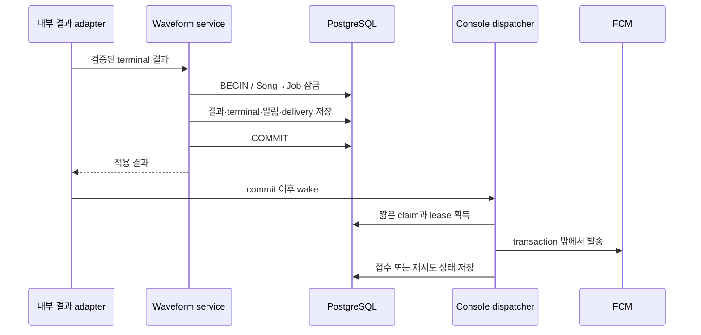

# 놓친 작업 결과까지 복구하는 알림: PostgreSQL과 FCM을 연결한 과정

파형 생성 계획을 세우다가 공통 알림을 먼저 만들었다. 사용자가 작업이 끝날 때까지 화면을 붙잡고 있지 않아도 되고, 토스트를 놓쳐도 결과를 다시 찾을 수 있어야 했기 때문이다. 이 요구를 따라가면서 알림 내역, 읽음 상태, 기기 등록, 발송 재시도, 관리자 권한 회수, 서비스 워커와 운영 Secret까지 연결했다.

이 글은 당시의 선택과 시행착오를 설명하는 개발 기록이다. 코드 기준은 위 `source_commit`, 운영 전환은 [Promotion #307][pr307]의 squash 커밋 `0457265163c6f3c3830f15deeefb67a1594b7766`이다. 실제 검증과 실패·복구의 상세 증거는 각 PR 본문이 소유한다. 현재 계약은 [Domain §15](../migration/DOMAIN_SPECIFICATION.md#15-notification), [설계 §6.1](../migration/implementation/console-guide-editor/DESIGN.md#61-공통-알림과-fcm), 반복 운영 절차는 [OCI 운영 안내](../../ops/oci/README.md#922-console-fcm-알림-활성화)를 따른다.

## 1. 시작은 파형 생성이었지만, 먼저 필요했던 것은 결과를 찾는 방법이었다

처음 대화에서는 P07과 P08 번호를 정정했다. P07은 이미 운영에 적용된 상태였고, 새로 계획할 대상은 P08 파형 생성이었다. 파형 분석처럼 오래 걸리는 작업을 설계하면서 “알림 시스템을 먼저 해야 할까?”라는 질문이 나왔다.

사용자가 기대한 흐름은 작업을 요청하고 다른 일을 하다가 완료 알림을 받는 것이었다. 잠깐 나타났다가 사라지는 토스트만으로는 부족했다. 알림을 보지 못했거나 브라우저를 벗어나 있던 사람도 내역에서 결과를 찾아야 했다. 이후 다른 비동기 작업에서도 같은 문제가 생길 수 있으니, 첫 producer를 연결하기 전에 공통 기반을 만들기로 했다.

동시에 OCI의 작은 VM에서 운영한다는 조건이 있었다. 화면마다 긴 연결을 유지하거나 주기적으로 요청하는 방식의 비용이 궁금했고, 서버 밖의 전송 인프라를 쓰는 선택지도 검토했다. 논의는 SSE·WebSocket·폴링에서 Pub/Sub 모델, Ably와 FCM으로 이어졌다.

여기서 알림을 세 책임으로 나눴다.

| 책임                                 | 이번 구현의 담당                   | 사용자가 얻는 것                  |
| ------------------------------------ | ---------------------------------- | --------------------------------- |
| 어떤 사건이 누구에게 발생했는지 보존 | PostgreSQL의 알림 내역             | 놓친 알림과 읽음 상태를 다시 조회 |
| 사건을 브라우저에 전달               | FCM과 기기별 발송 대기             | 화면 밖에 있어도 알림을 받을 경로 |
| 현재 화면에서 결과를 표현            | Query·토스트·종 아이콘·결과 페이지 | 즉시 확인하고 해당 결과로 이동    |

이 분리가 이후 설계의 기준이 됐다. 푸시 발송에 실패해도 결과와 내역은 남아야 했고, 토스트를 닫는 동작으로 읽음 상태가 바뀌어서는 안 됐다.

## 2. 후보를 비교할 때 무엇을 우선했나

사용자가 공유한 [SSE·WebSocket·폴링 비교 번역글](https://ykss.netlify.app/translation/2026/sse-vs-websockets-and-polling/)도 논의의 참고 자료였다. 최종 판단에서는 서버 자원뿐 아니라 화면이 열려 있는지, OS 알림이 필요한지, 놓친 결과를 누가 보존하는지를 함께 봤다.

| 후보                 | 당시 검토한 이점                          | 이번 요구에서 함께 풀어야 했던 일                                 |
| -------------------- | ----------------------------------------- | ----------------------------------------------------------------- |
| 주기적 브라우저 폴링 | 기존 HTTP API로 시작 가능                 | 변경이 없어도 요청 발생, 간격에 따른 반응 시간, 화면 밖 알림 경로 |
| SSE                  | 서버→화면의 단방향 사건 전달에 적합       | 연결·재연결 운영과 별도의 OS push, 영속 내역                      |
| WebSocket            | 양방향 상호작용을 확장하기 좋음           | 현재 알림에 필요한 범위보다 큰 연결·프로토콜 책임                 |
| Ably                 | 관리형 실시간 Pub/Sub 후보                | 내역·읽음·현재 권한과 OS push 구성을 별도로 설계                  |
| FCM                  | foreground 수신과 background OS push 경로 | 권한 허용·기기 등록·전송 실패·플랫폼별 표시 차이                  |

최종적으로 foreground와 background를 함께 지원하는 FCM을 선택했다. 당시 후보들의 실제 비용이나 VM 부하를 동일 조건으로 측정한 것은 아니다. 이 기록의 선택 근거는 사용자가 요구한 동작과 기존 PostgreSQL·Console 운영 구조다.

Pub/Sub는 사건을 전달하는 모델이고, 알림 내역의 저장 위치와는 별개의 결정이었다. 이번에는 별도 Redis나 메시지 브로커를 추가하지 않았다. DB에 사용자별 사건과 기기별 발송 대기를 먼저 남기고, FCM을 통해 브라우저로 전달했다. Firebase Auth·Firestore·Cloud Functions도 이 기능의 의존성으로 추가하지 않았다.

서버 자원이 완전히 사라진 것은 아니다. Console은 알림 저장·조회·발송 HTTP 요청을 수행하고 복구용 dispatch loop를 유지한다. 대신 브라우저마다 자체 SSE/WebSocket 연결이나 주기적 조회를 운영하는 경로를 만들지 않았다. 적은 인프라로 시작하되 남아 있는 서버 책임을 분명히 한 선택이었다.

## 3. DB에 남는 사실과 화면의 신호를 분리했다

알림 시스템을 만들 때 가장 먼저 구분한 상태는 다음 네 가지였다.

```text
작업이 끝났다
  → 알림이 DB에 저장됐다
    → FCM이 발송을 접수했다
      → 사용자의 기기에 표시됐다
        → 사용자가 알림을 선택하거나 모두 읽음을 실행했다
```

각 단계는 앞 단계의 성공만으로 추정하지 않았다. 발송의 `ACCEPTED`는 읽음이 아니고, 토스트가 닫혀도 `read_at`은 그대로다. 알림함을 열기만 해도 읽음 처리하지 않는다. 사용자가 항목을 선택하거나 명시적으로 모두 읽음을 실행할 때만 바뀐다.

[FCM의 메시지 수명 안내](https://firebase.google.com/docs/cloud-messaging/customize-messages/setting-message-lifespan)도 발송 접수와 실제 전달을 구분한다. 구현에서도 `notification_delivery.accepted_at`과 `notification.read_at`을 별도 필드로 보존했다.

현재 producer는 `WAVEFORM_SUCCEEDED`와 `WAVEFORM_FAILED` 두 종류다. 이후 알림 종류를 확장할 수 있는 기반을 만들었지만, 아직 consumer가 없는 모든 도메인의 알림을 미리 구현하지는 않았다.

## 4. 알림 세 테이블과 작업 세 테이블이 맡은 일

공통 알림에는 `notification`, `push_installation`, `notification_delivery`를 추가했다. 파형 작업과 연결할 준비에는 `waveform_job`, `waveform_job_requester`, `waveform`을 추가했다.

| 테이블                   | 보존하는 사실                          | 분리한 이유                                   |
| ------------------------ | -------------------------------------- | --------------------------------------------- |
| `notification`           | 수신자·종류·사건·대상·생성/읽음 시각   | 한 사용자가 내역에서 보는 알림의 정본         |
| `push_installation`      | FID·계정·MFA/binding version·활성/만료 | 브라우저 연결의 수명이 계정과 다름            |
| `notification_delivery`  | 알림/기기/binding·상태·시도·lease·만료 | 여러 기기의 성공과 실패를 독립 처리           |
| `waveform_job`           | 곡/영상·작업 상태·attempt·최종 오류    | 오래 걸리는 작업의 상태와 결과 식별           |
| `waveform_job_requester` | Job을 요청한 계정들                    | 같은 active Job을 공유한 요청자도 결과를 받음 |
| `waveform`               | 곡별 정상 파형 JSON과 source           | 재생성 실패가 직전 정상 데이터를 없애지 않음  |

브라우저가 여러 개라면 사용자 알림은 한 건이어도 delivery는 여러 건이다. 어떤 기기의 등록이 무효가 돼도 다른 기기의 정상 발송이나 사용자의 내역을 함께 실패시키지 않는다.

현재 SDK는 `firebase@13.1.0`이며 등록 코드는 `register()`와 `onRegistered()`로 FID를 얻는다. FID는 이 브라우저 등록을 가리키는 식별자다. 웹 앱의 공개 `apiKey`, 서버의 서비스 계정 개인키, 발송에 쓰는 OAuth access token과 역할이 다르다. 이후 재현할 때는 이 글의 [SDK 코드][code-client]와 [공식 시작 안내](https://firebase.google.com/docs/cloud-messaging/web/get-started)의 버전을 함께 확인해야 한다.

## 5. 작업 결과와 알림 사이의 유실 구간을 없앴다

작업 상태를 완료로 바꾼 뒤 별도 DB 작업으로 알림을 만들면, 그 사이에 프로세스가 종료됐을 때 결과는 있는데 알림이 없는 상태가 생긴다. 반대로 commit 전 FCM을 호출하면 DB가 rollback됐는데 외부에는 완료 알림이 나갈 수 있다.

[completeWaveformJob()][code-result]는 결과·terminal·요청자별 알림·기기별 발송 대기를 같은 transaction에 저장한다. transaction이 끝난 뒤 앱 adapter가 dispatcher를 깨운다. 네트워크 호출은 transaction 밖에서 수행한다.



같은 사건은 `(recipient_account_id, type, event_key)`의 unique constraint로 중복 생성하지 않는다. 파형 결과의 `event_key`는 Job ID다. 동일 Job을 여러 사람이 요청했다면 각 수신자에게 한 건씩 저장한다.

작업 쪽에는 active Job 재사용, 요청자 등록, 이전 attempt 결과 무시, terminal 재반영 방지가 있다. Song→Job→requester 순서로 잠가 요청과 완료의 경쟁을 조정한다. 현재 곡의 참조 영상과 다른 성공 결과는 `SOURCE_CHANGED` 실패로 남기고 JSON을 교체하지 않는다.

저장한 delivery는 “외부로 전달해야 하는 일”을 영속화한 outbox 역할을 한다. wake 신호 자체가 유실돼도 DB에 남은 발송 대기를 복구할 수 있다. 알림 저장 실패 시 결과와 terminal도 함께 rollback되는지는 실제 PostgreSQL 통합 테스트로 검증했다.

## 6. 발송을 한 번 호출하는 것에서, 중단 뒤 복구하는 것으로

[dispatcher][code-dispatcher]는 Console Node startup에서 시작한다. Sentry 활성 여부와 분리했고, push flag와 ephemeral build 조건을 확인한다. 프로세스 내부에서는 중복 loop를 막고, commit 직후 wake하며, 유휴 상태에서는 60초 뒤 다시 확인한다. 한 번에 처리한 20건이 꽉 차면 이어서 처리한다.

[delivery repository][code-delivery-repository]의 claim은 due 상태의 `PENDING` 한 건을 `FOR UPDATE SKIP LOCKED`로 고르고 lease token·2분 lease·시도 횟수를 함께 갱신한다. 이 token을 가지고 있는 발송자만 최종 상태를 반영한다. 이전 발송자가 늦게 돌아와도 새 소유자의 상태를 덮어쓸 수 없다.

```text
PENDING
  ├─ 유효한 대상 + FCM 접수 → ACCEPTED
  ├─ 일시 실패              → PENDING, 다음 시도 시각 갱신
  └─ 무효 대상·영구 오류·만료 → DISCARDED
```

일시 오류에는 지수 backoff와 jitter를 적용하고 `Retry-After`를 고려한다. 기본 backoff 상한은 1시간이며, 재시도 가능 시간은 알림 생성부터 24시간이다. FCM에 넘기는 TTL도 남은 유효 시간으로 제한한다. 무효 등록인 `UNREGISTERED`는 해당 binding의 등록을 해제한다.

FCM 접수 직후 프로세스가 죽어 DB에 성공을 기록하지 못하면 같은 메시지가 다시 발송될 수 있다. 따라서 외부 표시까지 정확히 한 번이라고 선언하지 않았다. DB 알림의 unique key, 화면의 `notificationId` 중복 억제, OS 알림의 동일 `tag`와 `renotify:false`로 중복 영향을 줄였다. 화면의 중복 기억은 메모리 상태이므로 영구적인 전달 보증으로 해석하지 않는다.

60초는 모든 알림을 일부러 기다리게 하는 시간이 아니다. 정상 결과 adapter는 commit 후 즉시 wake한다. 60초 loop는 미처리·중단·lease 만료 복구를 위한 경로다. 운영에서 이 loop를 실제로 장기 부하 측정한 것은 아니다.

## 7. 기기 등록을 현재 관리자 세션에 연결했다

FID만 저장해 두면 같은 브라우저의 계정 전환이나 로그아웃 후에도 예전 사용자의 알림이 갈 수 있다. [등록 service][code-binding]는 ACTIVE ADMIN·활성 MFA·현재 MFA version을 확인하고, 등록 만료를 세션 만료와 8시간 중 더 이른 시각으로 제한한다.

`mfa_version`은 현재 인증 증명의 세대이고, `binding_version`은 브라우저 연결의 세대다. 같은 유효 연결의 갱신은 binding을 유지하지만 계정 전환·해제·만료 후 재등록은 증가시킨다. delivery는 생성 당시 binding을 기억한다. 오래된 delivery가 새 계정의 연결을 따라가지 않도록 발송 직전 두 version과 계정 상태·기한·활성 여부를 다시 검사한다.

등록 mutation에는 현재 Console 인증과 Origin 검사가 적용된다. 해제는 해당 계정의 설치 ID만 다루며, logout 경로도 검증된 세션 subject에 속한 연결을 해제한다. 브라우저에서 해제 요청이 네트워크 오류로 실패하면 설치 ID를 남겨 focus/online 때 다시 회수한다.

이미 FCM에 접수된 일반 안내를 원격에서 되돌리는 것은 보장하지 않는다. 그래서 OS payload에는 작업의 상세 데이터·권한·인증 정보를 넣지 않았다. 일반 안내와 `notificationId`를 전달하고, 실제 내역과 결과는 현재 관리자 권한으로 다시 조회한다.

## 8. foreground·background·알림함이 같은 내역을 보게 했다

브라우저 권한은 사용자의 “브라우저 알림 켜기” 클릭에서 요청한다. 허용된 경우 SDK를 지연 로드하고, 서비스 워커를 등록한 뒤 FID를 서버에 연결한다. 사용자가 거부하거나 지원하지 않는 환경에서도 알림 내역은 조회할 수 있다.

[provider][code-provider]의 foreground 수신 흐름은 다음과 같다.

```text
onMessage
  → payload의 notificationId 검증·중복 확인
  → 계정별 알림 Query invalidate + 단건 알림 API 조회
  → 관련 파형 Query invalidate
  → 현재 화면 표시 조건 검사
  → 토스트와 결과 보기 동작
```

Query key에 account ID를 포함해 다른 사용자의 캐시를 섞지 않는다. browser API는 `ky` transport를 사용하고 응답 DTO를 Zod로 검증한다. 목록은 cursor와 미읽음 개수를 함께 반환한다. 동일 생성 시각의 항목도 누락·중복 없이 페이지를 넘기는 경우를 PostgreSQL에서 확인했다.

이미 읽은 항목, 보이지 않는 문서, 포커스가 없는 화면, 현재 선택해 보고 있는 동일 알림에는 토스트를 띄우지 않는다. Query 갱신은 그 조건보다 먼저 수행하므로 종 아이콘의 숫자는 갱신되면서 토스트는 표시되지 않을 수 있다.

background는 FCM notification payload의 자동 표시 경로를 사용했다. worker에서 같은 메시지에 `showNotification()`을 추가로 호출하지 않아 OS 알림을 중복 생성하는 경로를 피했다. foreground/background의 역할은 [Firebase 수신 안내](https://firebase.google.com/docs/cloud-messaging/web/receive-messages)와 구현을 함께 대조했다.

푸시를 놓친 경우에는 초기 조회·화면 복귀·네트워크 복구·알림함 열기 때 DB를 재조회한다. 주기적 브라우저 polling은 없다. 이 방식에서 푸시 권한을 끈 화면이 계속 활성 상태이고 다른 재조회 계기도 없다면 숫자가 즉시 변한다고 보장하지 않는다. 내역 복구와 실시간 표시의 조건을 구분해야 한다.

## 9. 서비스 워커와 Secret을 배포 이미지에 어떻게 연결했나

worker SDK는 [빌드 스크립트][code-worker-build]가 로컬 JS 번들로 만든다. `/firebase-messaging-sw.js`는 runtime 공개 설정을 넣고 그 번들을 불러온다. 응답은 `no-store`, scope는 `/`, 등록에는 `updateViaCache:"none"`을 사용한다. worker는 인증 API나 HTML을 캐시하지 않는다.

이 구조 덕분에 실제 Firebase 프로젝트 설정을 이미지 빌드에 넣을 필요가 없었다. 검증한 candidate digest를 그대로 승격하면서 VM runtime에서 공개 설정과 서버 credential을 연결할 수 있었다. 비활성화된 설정에는 기존 worker 등록을 해제하는 응답 경로도 있다.

| 항목                                      | 용도·보관 위치                                                        |
| ----------------------------------------- | --------------------------------------------------------------------- |
| Web 앱의 project/API key/app ID/sender ID | 브라우저 초기화용 공개 설정, Console runtime에서 제공                 |
| VAPID 공개키                              | 브라우저 push 등록에 사용                                             |
| 서비스 계정 JSON의 개인키                 | Vault에 보관하고 보호된 host helper가 Console server에만 주입         |
| OAuth access token                        | Console server가 발송 인증에 사용하며 로그·클라이언트에 노출하지 않음 |

GitHub 배포 계정에는 Run Command 권한만 유지했다. GitHub에 Firebase 개인키를 추가하거나 Vault 읽기 권한을 부여하지 않았다. Web·Runner·분석 worker에도 credential을 전달하지 않았다. 이번 기능은 Firebase 프로젝트의 Analytics나 Gemini를 켜야 동작하는 구성으로 만들지 않았다.

로컬 서비스 계정 파일과 환경 파일은 Git 제외 대상으로 두고 권한을 600으로 제한했다. 검토한 신규 Git blob 범위에서 실제 개인키와의 일치도 발견되지 않았다. 웹 초기화 설정과 서버 개인키를 같은 종류의 “Firebase 설정”으로 취급하지 않고, 브라우저에 필요한 공개값과 발송 권한을 가진 비밀값을 분리한 것이 운영 연결의 기준이었다.

## 10. 실제 화면에서 겪은 문제와 디자인 수정

### Chrome에서는 숫자만 바뀌고 토스트가 보이지 않았다

Codex 인앱 브라우저에서는 토스트가 보였지만 Chrome에서는 OS 알림과 미읽음 숫자만 갱신됐다. 이때 사용자는 Chrome 관리자 화면 대신 Codex 채팅을 보고 있었다. Chrome 화면을 직접 클릭해 포커스를 둔 뒤 새 알림을 보내자 토스트가 나타났다.

이 사례에서는 FCM 전송, Query 갱신, 토스트 표시 조건을 나눠 확인한 것이 도움이 됐다. 숫자까지 바뀐다는 관찰은 수신 경로와 상태 갱신이 작동한다는 단서였다. 포커스 조건을 무작정 제거하는 수정은 하지 않았다.

### 기능 확인 뒤에는 관리자 shell의 위계가 부족했다

첫 기능 검증 이후 배경이 구분되지 않고, 텍스트 위계가 약하고, 테이블에 가로 스크롤이 생긴다는 피드백이 나왔다. 알림 컴포넌트와 함께 관리자 shell도 다듬었다. 차콜 계열에서 배경·사이드바·카드·popover의 명도를 나누고 텍스트 위계를 정리했다.

모바일 토스트는 상단 중앙, 768px 이상은 우하단으로 옮겼다. 화면 크기마다 Toaster를 둘씩 만드는 대신 하나의 Toaster가 `matchMedia` 상태를 구독하도록 했다. 모바일 safe area 여백도 반영했다. 대시보드 메뉴와 기존 어이어이바위게 브랜드를 사용하고, 앨범·곡 ID 열은 표시에서 제거하되 내부 식별자는 보존했다.

알림 내역에는 읽음 상태와 생성 시각·결과 이동을 정리했고, 결과 페이지는 QUEUED/RUNNING/SUCCEEDED/FAILED 상태와 편집 복귀를 표현했다. 가사 편집으로 돌아가기는 해당 곡의 기존 편집 경로다. 이 화면에서 실제 파형 분석이나 P09 편집 도구를 실행하도록 확장하지 않았다.

### Chrome 모양의 작은 아이콘은 별도 설정이었다

운영 수신 뒤 작은 아이콘이 Chrome으로 보인다는 질문이 나왔다. 현재는 알림 본문의 `icon`만 지정했고 작은 단색 `badge`는 지정하지 않았다. Android Chrome의 이 차이는 [알림 시각 옵션 안내](https://web.dev/articles/push-notifications-display-a-notification#badge)에서 확인했다. 사용자는 파비콘 디자인 완료 후 badge를 연결하기로 했다. 종 아이콘의 미읽음 숫자와 OS의 작은 이미지 badge도 별개의 기능이다.

## 11. 로컬 성공을 운영 성공으로 연결하면서 확인한 것

### 새 Vault Secret이 존재해도 VM이 읽을 수는 없었다

사용자가 Firebase 프로젝트·Web 앱·VAPID 키·서비스 계정을 준비한 뒤 운영 설정을 시도했다. 첫 helper 결과는 `VAULT_OR_RUNTIME_VALIDATION_FAILED`였다. VM Instance Principal이 새 Secret을 읽을 때 404/권한 거부가 발생했고, 원인은 정확한 Secret OCID에 대한 IAM allowlist가 빠진 것이었다.

기존 Resource Manager Stack의 `runtime_secret_ocids` 목록을 보존하고 FCM Secret OCID를 추가했다. [iam.tf][code-iam]는 그 목록에서 Secret별 `read secret-bundles` 정책을 생성한다. 별도 Firebase 전용 Terraform resource를 만들거나 JSON 원문을 state에 넣지 않았다.

Plan에는 예상한 권한 한 줄 외에 Logging parser의 `time_type="string"` 변경도 나왔다. 저장소에 이미 선언된 값인지 확인하고, 두 변경 모두 in-place이며 VM·Vault·키의 삭제/교체가 없음을 검토한 뒤 사용자가 해당 Plan을 Apply했다. 이후 VM의 Secret 읽기와 설정 준비가 성공했다. 반복 절차는 기존 운영 안내에 보완했다.

설정 helper는 보호된 경로와 권한을 검사하고 기존 파일을 백업한 뒤 설정을 반영했다. 그 단계에서는 컨테이너를 재시작하거나 DB를 바꾸지 않았다. 현재 실행 중인 Auth/MFA·DB·R2 설정이 보존되는지도 비교했다.

### DB 준비에는 백업 범위를 별도로 확정했다

운영 전체 DB 백업은 계정 데이터를 포함하므로 일반적인 배포 승인과 구분해 범위를 확인했다. 사용자가 백업·같은 PostgreSQL의 임시 DB 복원·신규 테이블 적용을 명시적으로 승인한 뒤 진행했다. dump는 VM의 보호된 디렉터리와 파일 권한 600으로 보관했다.

임시 DB에 복원해 `0011`·`0012`를 적용하고 기존 11개 테이블의 데이터 지문이 보존되는지 확인했다. 같은 SQL을 운영에 적용해 신규 테이블 6개와 앱 권한을 준비했고 migration 이력은 11개에서 13개가 됐다. 검증용 DB는 삭제하고 복구용 백업은 보관했다. 이 글에는 개인키·원문 env·DB 연결 문자열·개인 환경 경로를 옮기지 않았다.

### 순서가 있는 PR을 squash하면서 중복 반영을 피했다

사용자가 우선 요청한 ID 열 제거 #294를 먼저 병합했다. 이어 계약·계획 #295, 저장소 #296, 조회/읽음 #297, 기기/회수 #298, 발송 #299, SDK/SW #300, 내역/토스트 #301, Job/terminal #302, 결과 이동/복구 #303, 시각 개선 #304~#306 순서로 통합했다.

각 선행 PR을 squash한 뒤 후속 PR의 원래 부모를 기준으로 고유 변경만 최신 `migration_main`에 rebase했다. 전체 선행 이력을 다시 가져오면 중복 적용이나 과도한 diff가 생기므로, 병합표의 원래 부모와 고유 커밋을 사용했다. 최신 base의 검증과 CI를 확인한 뒤 다음 PR을 진행했다.

중간 검증에서 오래된 Next 생성 타입 때문에 실패한 경우에는 소유한 dev 서버를 중지하고 해당 경로의 타입을 재생성해 복구했다. 생성 파일과 개발 중 첨부 이미지는 커밋 대상과 분리했다. 기능과 무관한 개발 산출물이 최종 PR에 들어가 있지 않은지도 확인했다.

### 검증한 이미지와 실제 실행한 이미지가 같아야 했다

통합 merge는 배포를 하지 않는다. 별도 `migration_main → migration_develop` Promotion에서 full verify를 수행하고 ARM64 후보를 게시했다. 정확한 두 digest를 pull해 같은 격리 DB에서 함께 실행한 뒤 native/readiness/browser smoke를 통과시켰다.

검증 source tree와 squash 결과 tree를 대조하고, 해당 candidate의 digest를 Run Command로 배포했다. 배포 시 이미지를 다시 빌드하지 않았다. 성공 receipt의 source·run/attempt·artifact·digest와 VM에서 실제 실행한 이미지 및 revision이 일치했다. 근거는 [후보 검증 run][verify-run]과 [실제 배포 run][deploy-run], [#307][pr307]에 연결했다.

Web/Console은 ARM64·Node 22.23.4·비특권 사용자 `node`로 healthy였다. 네 개 health/readiness 응답은 모두 200이었다. 기존 runtime 환경값 지문, PostgreSQL 컨테이너 ID/시작 시각, Caddy 설정 hash도 보존됐다. Console의 Firebase OAuth 인증과 Web의 credential 부재, 두 앱의 IMDS 차단도 확인했다.

추가 HTTP 점검에서 VM 자체의 외부 Console URL 호출은 403이었다. 접근 설정을 변경하지 않고 외부 작업 환경에서 동일 HTTPS URL을 확인해 로그인·worker·공개 Web 응답 200과 비로그인 관리자→로그인 이동을 확인했다. 이 403의 전체 원인을 규명한 것으로 기록하지는 않는다.

## 12. 무엇을 어떻게 검증했는가

| 검증 층                     | 확인한 동작                                                                                 | 이 검증만으로 확인하지 않은 것         |
| --------------------------- | ------------------------------------------------------------------------------------------- | -------------------------------------- |
| 실제 PostgreSQL 통합        | 동시 사건 중복·rollback·cursor·소유권·binding/MFA 회수·lease 경쟁·부분 실패·terminal 원자성 | 실제 브라우저와 FCM 전달               |
| unit/HTTP/dispatcher        | 오류 분류·권한/입출력·wake/재시도·화면 처리                                                 | 운영 IAM·실기기 표시                   |
| 컴포넌트 브라우저 preview   | 반응형·읽음/이동·상태 UI·토스트/중복 억제                                                   | 대체한 HTTP/FCM 경계를 넘는 실제 수신  |
| 로컬 실제 Firebase          | Windows Chrome/인앱 토스트·OS 알림·배지/내역·결과 이동                                      | 운영 설정과 모든 모바일 환경           |
| ARM64 candidate와 운영 배포 | 같은 digest 실행·readiness·기존 설정/DB 보존·OAuth·worker                                   | 사용자가 OS 알림을 실제로 봤는지       |
| 운영 사용자 수용            | 테스트 1건의 FCM 접수와 Chrome OS 알림 수신 확인                                            | 닫힌 탭·iOS·OS 클릭·회수 시나리오 전체 |

UI 검증에는 실제 컴포넌트와 production CSS를 사용하되 HTTP/FCM/인증 경계를 대체한 fixture가 있었다. 390~1920px 범위의 40개 확인과 로고의 4개 너비 확인을 실제 FCM 실수용으로 합산하지 않았다. 로컬 수용의 상세 기록은 [#303][pr303], 시각 수정은 #304~#306을 따른다.

단계별 `pnpm verify`에는 type·lint·FSD·harness·unit/ops·format·build가 포함됐다. 관련 PostgreSQL 통합 검증과 최신 CI를 통과시켜 병합했다. 이 글을 작성하면서 앱 테스트를 다시 실행한 것은 아니다. 위 표는 당시 실제 검증의 요약이며, 세부 명령·수치·기존 skip은 해당 PR에서 확인한다.

통합 테스트에서 다시 찾아볼 핵심 사례는 [delivery 테스트][test-delivery]와 [Job/알림 원자성 테스트][test-terminal]다. “FCM 접수 직후 crash”, “오래된 lease 소유자의 반영”, “알림 저장 실패 시 결과 rollback”처럼 성공 경로만으로 드러나지 않는 구간을 다뤘다.

## 13. 운영에서 처음 받은 알림과 시간의 해석

운영 전환 후 사용자가 실제 발송을 요청했다. 당시 운영에 등록된 유효 기기 1개를 확인하고 테스트용 실패 결과 알림을 한 건 만들었다. 결과 링크도 조회할 수 있도록 테스트 Job·요청자·알림·delivery를 기록했고, 실제 음원 분석이나 기존 콘텐츠 수정은 실행하지 않았다.

관측된 시각은 다음과 같다. 괄호 안은 같은 시각의 KST다.

| 사건             | 관측 시각                                                       |
| ---------------- | --------------------------------------------------------------- |
| 알림 DB 생성     | 2026-10-27 22:52:47.587228 UTC (2026-10-28 07:52:47.587228 KST) |
| FCM 첫 시도 접수 | 2026-10-27 22:52:47.950 UTC (2026-10-28 07:52:47.950 KST)       |
| 사용자 확인      | 이후 대화에서 Chrome OS 알림 수신을 확인                        |

생성에서 접수까지 약 0.36초였고 첫 시도는 `ACCEPTED`, 발송 오류는 없었다. 사용자는 처음에 모바일에서 오지 않는다고 했다가 Chrome 알림이 도착했다고 정정했다. 앞서 발송 전 준비 시간이 있었으므로 그 대기 전체를 FCM 지연으로 해석하지 않았다.

이 숫자는 한 번의 “DB 생성→FCM 접수” 관측이다. 서버와 단말의 표시 시각을 함께 계측한 종단 간 latency도 아니고, 평균이나 SLA도 아니다. 사용자 확인으로 운영 수신 한 건이 성립했지만 모든 기기와 조건의 수용 완료로 넓히지는 않았다. 당시 기록은 [#307의 운영 수신 확인][pr307]에 남겼다.

## 14. 다음에 같은 기능을 만들 때 먼저 확인할 것

이번에는 도메인 사건을 DB에 남기는 곳, 외부로 전달하는 곳, 화면에서 읽음과 이동을 결정하는 곳을 나눠서 문제를 찾을 수 있었다. 전송 방식부터 정하기 전에 “놓친 사람이 어디서 다시 찾는가”, “로그아웃 뒤 누구에게 보낼 수 있는가”, “commit과 전송 사이에 죽으면 어떻게 되는가”를 정의하는 것이 도움이 됐다.

현재 남은 수용 범위는 닫힌 탭·OS 알림 클릭·iOS 홈 화면 웹 앱·실제 기기/권한 회수와 전달 장애 복구다. iOS는 홈 화면 웹 앱 조건을 갖춰 검증해야 하며, manifest를 제공한 것만으로 성공 판정을 하지 않는다. 플랫폼 조건은 [WebKit 안내](https://webkit.org/blog/13878/)와 실제 기기에서 다시 확인한다.

파비콘 디자인 후 작은 OS `badge`를 연결하는 작업도 보류했다. 본문 `icon`은 이미 제공한다. 이 글에 기록했다고 새 아이콘을 배포한 것은 아니다. 현재·보류 상태는 [WORK](../WORK.md)의 알림 항목에 유지한다.

P08에는 Job/terminal·요청자 알림 저장 기반만 먼저 반영됐다. 생성 HTTP API·OCI Queue·Runner·ARM64 음원 실행·시간축 검증은 후속 범위다. 테스트용 실패 알림의 수신이나 이 devlog를 P08 파형 생성 완료 근거로 사용하지 않는다.

이 글은 위 source의 학습 기록으로 남기고 새로운 구현 변경 때마다 현재 사용법으로 고쳐 쓰지 않는다. 사실 오류는 원래 관측과 정정 이유를 구분해 보완하고, 새 운영 절차는 운영 안내, 새 계약은 Domain/설계, 남은 실행 항목은 WORK에 반영한다.

## 코드와 실행 근거 찾아보기

| 다시 읽을 질문                                | 근거                                                                                                                   |
| --------------------------------------------- | ---------------------------------------------------------------------------------------------------------------------- |
| 결과와 알림이 함께 저장되는 곳은?             | [waveform-service][code-result], [notification-service][code-notification]                                             |
| claim·lease·재시도는 어디서 동작하나?         | [delivery repository][code-delivery-repository], [delivery service][code-delivery], [dispatcher][code-dispatcher]      |
| 기기 등록과 현재 인증은 어떻게 연결되나?      | [push-installation-service][code-binding], [browser push client][code-client]                                          |
| 수신한 알림은 어떻게 화면을 갱신하나?         | [notification-provider][code-provider]                                                                                 |
| SDK worker와 IAM은 어떻게 구성했나?           | [worker build][code-worker-build], [iam.tf][code-iam]                                                                  |
| 실제 로컬·운영 수신과 배포는 어디에 기록됐나? | [로컬 수용 #303][pr303], [운영 전환/수신 #307][pr307], [상태 정리 #308](https://github.com/goldmayo/oioi-bwg/pull/308) |

[pr303]: https://github.com/goldmayo/oioi-bwg/pull/303
[pr307]: https://github.com/goldmayo/oioi-bwg/pull/307
[verify-run]: https://github.com/goldmayo/oioi-bwg/actions/runs/40562630554
[deploy-run]: https://github.com/goldmayo/oioi-bwg/actions/runs/40565687473
[code-result]: https://github.com/goldmayo/oioi-bwg/blob/5bed878e03edf05b00ce335059c361f7f46810cb/packages/server/src/services/waveform-service.ts
[code-notification]: https://github.com/goldmayo/oioi-bwg/blob/5bed878e03edf05b00ce335059c361f7f46810cb/packages/server/src/services/notification-service.ts
[code-delivery-repository]: https://github.com/goldmayo/oioi-bwg/blob/5bed878e03edf05b00ce335059c361f7f46810cb/packages/server/src/repositories/notification-delivery-repository.ts
[code-delivery]: https://github.com/goldmayo/oioi-bwg/blob/5bed878e03edf05b00ce335059c361f7f46810cb/packages/server/src/services/notification-delivery-service.ts
[code-dispatcher]: https://github.com/goldmayo/oioi-bwg/blob/5bed878e03edf05b00ce335059c361f7f46810cb/apps/console/src/server/notifications/dispatcher.ts
[code-binding]: https://github.com/goldmayo/oioi-bwg/blob/5bed878e03edf05b00ce335059c361f7f46810cb/packages/server/src/services/push-installation-service.ts
[code-client]: https://github.com/goldmayo/oioi-bwg/blob/5bed878e03edf05b00ce335059c361f7f46810cb/apps/console/src/app/%28admin%29/admin/_lib/push-client.ts
[code-provider]: https://github.com/goldmayo/oioi-bwg/blob/5bed878e03edf05b00ce335059c361f7f46810cb/apps/console/src/app/%28admin%29/admin/_ui/notification-provider.tsx
[code-worker-build]: https://github.com/goldmayo/oioi-bwg/blob/5bed878e03edf05b00ce335059c361f7f46810cb/apps/console/scripts/build-notification-worker.mjs
[code-iam]: https://github.com/goldmayo/oioi-bwg/blob/5bed878e03edf05b00ce335059c361f7f46810cb/infra/oci/iam.tf
[test-delivery]: https://github.com/goldmayo/oioi-bwg/blob/5bed878e03edf05b00ce335059c361f7f46810cb/packages/server/tests/integration/notification-delivery.postgres.test.ts
[test-terminal]: https://github.com/goldmayo/oioi-bwg/blob/5bed878e03edf05b00ce335059c361f7f46810cb/packages/server/tests/integration/waveform-notifications.postgres.test.ts
