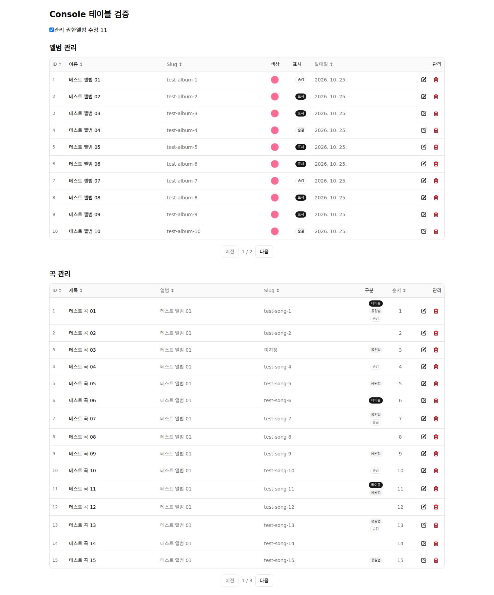
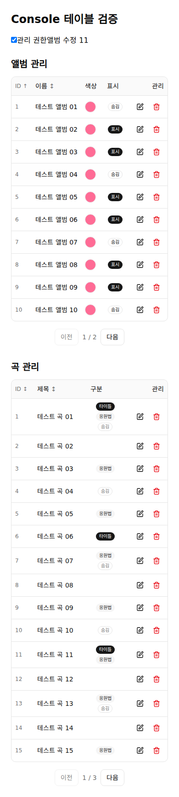

# Console Data Table 수용 심사와 적용 결과

## 범위와 기준

`goldmayo/oioi-bwg`의 `migration_main` `7f16a9d74e526f50a5f17e6821ed980d1057cabd`에서
`feature/console-tanstack-table`을 분기했다. 사용자 제공 원본은
`C:\Users\dudto\OneDrive\Desktop\사이드프로젝트\tanstack-v9-15-features-example`이다.
원본 파일은 수정하지 않고 임시 복사본에서 빌드·테스트했다. `src` 파일을 이름순으로
상대 이름 + NUL + 내용으로 해시한 SHA256은
`cf20164dad61eae9e947bcbda7aff9a2f91a963d85ed51795419d22415ab021d`다.

이 변경은 [헌법 §5](../oioi-bwg-architecture-clean-v1/01-architecture-constitution.md#5-최상위-디렉터리)와
[Frontend §2](../oioi-bwg-architecture-clean-v1/02-frontend-architecture.md#2-기본-구조)를 함께
개정해 실제 두 consumer의 도메인 독립 UI 승격을 명시한다. P07 전체 이관을 시작하거나 완료하는 기록은 아니다.

## 심사: 부분 수용

| 원본 요소 | 판정과 반영 |
| --- | --- |
| 공식 v9 `createTableHook`·열 helper·`Subscribe`·`FlexRender` | 수용. 별도 controller/plugin/열 DSL 없이 공식 옵션·인스턴스를 그대로 사용한다. |
| 15개 feature 전체 묶음 | 정렬·페이지 이동만 수용. 선택·그룹·집계·고정·리사이즈 등 실제 Console 요구가 없는 기능은 등록하지 않는다. |
| URL history·popstate와 localStorage 상태 | 수용하지 않음. SSR·계정 범위·nuqs 정책과 별도로 설계된 데모 코드다. 기존 feature 검색·필터는 유지한다. |
| Order 도메인·24개 데이터·server-example | 수용하지 않음. 실제 Console 목록 DTO를 사용하며 서버 페이징 API를 만들지 않는다. |
| 데모 CSS·도구·lockfile | 수용하지 않음. 기존 Console token·반응형 열·Badge·Button을 사용하고 저장소 도구를 유지한다. |

원본 복사본은 `npm install --ignore-scripts` 후 strict TypeScript/Vite build와 Vitest 9건을 통과했다.
데모의 과거 개발 도구 의존성은 복사하지 않았다. 채택한 runtime은 `@tanstack/react-table` **9.1.2**다.
API 판단은 [공식 React quick start](https://tanstack.com/table/latest/docs/framework/react/quick-start),
[feature 구성](https://tanstack.com/table/latest/docs/guide/features),
[composable tables](https://tanstack.com/table/latest/docs/framework/react/guide/composable-tables)를 따른다.

## 구현 경계와 동작

- private `@oioi-bwg/ui/data-table`은 정렬·페이지 이동을 갖춘 전건 client 목록 profile과 표/페이지 UI를 제공한다.
  도메인·server·contracts·Next runtime 참조는 금지하고 workspace type/lint/test·의존 경계 검사에 연결했다.
- Console의 `AlbumManagerTable`과 `SongManagerTable`이 실제 consumer다. 열·링크·관리 callback·권한은
  feature가 소유하며 Query·mutation·폼·재인증 흐름은 기존 경로를 사용한다.
- 기존 앨범 10행/곡 15행 단위를 유지하고 헤더 정렬을 추가했다. 정렬은 페이지를 자르기 전에 적용한다.
  검색·필터·삭제/refetch로 데이터가 바뀌면 첫 페이지로 돌아간다. 1페이지인 목록에도 비활성 이동 버튼과
  페이지 수를 표시해 두 관리 목록의 조작을 통일했다.
- semantic table·숨긴 caption·`aria-sort`·키보드 버튼·focus 표시를 제공한다. 기존 작은 화면의 열 숨김을 유지한다.
- Console만 UI source를 transpile하고 Tailwind source로 읽는다. Web 의존성에는 UI를 추가하지 않았다.
  개발 Docker manifest/volume과 Console Docker prune 입력을 연결했다.

## 검증과 증거

- 공용 UI Vitest 3건: 키보드 정렬 후 페이지 이동, 마지막 페이지의 데이터 감소, 빈 결과 안내/이동 차단.
- 기존 Console과 추가 Compiler 회귀 Vitest 375건 통과: Query 무효화·폼 draft·재인증·legacy null slug 회귀를 포함한다.
- Playwright Chromium의 격리 fixture에서 실제 두 table component와 Console CSS를 사용했다.
  1440px/390px 모두 키보드 정렬·다음 페이지의 정확한 행 callback·권한 변경 시 관리 버튼 숨김·
  문서 가로 넘침 없음·브라우저 예외 없음이 확인됐다. fixture의 목록은 임시 메모리 데이터이며
  Next Link만 기본 anchor adapter로 대체했다. 실제 로그인·DB E2E나 Next navigation 검증으로 세지 않는다.
- desktop/mobile 캡처는 아래에 보존한다. 실제 관리 페이지 전체가 아닌 위 component fixture 증거다.
- `impeccable detect --json`은 변경 UI에서 finding 0건이었다.
- React Compiler 1.0을 적용한 브라우저 확인에서 `AppTable`의 내부 ref와 자동 memo가 결합하면
  열만 바뀌는 권한 회수가 화면에 반영되지 않는 것을 재현했다. 두 domain table consumer 함수에만
  [공식 `use no memo` 경계](https://react.dev/reference/react-compiler/directives/use-no-memo)를 적용했다.
  공용 UI와 앱 전체의 Compiler 설정은 유지한다. 같은 Compiler를 세 table module에 적용하는
  Console Vitest transform으로 권한 회수·같은 행의 새 DTO/callback 갱신 2건을 회귀 검사한다.
  수정 후 Compiler 브라우저의 desktop/mobile 동작도 통과했다.
- 전체 검사 도중 이전 SEO 브랜치의 생성된 Next 타입 캐시와 새 workspace 수/설정 비교의 기존
  고정 기대값을 발견해 각각 정리·갱신했다. JSX lint의 명시적 tsconfigRootDir도 보완했다.
- 최종 `NEXT_PUBLIC_APP_ENV=local pnpm verify`가 exit 0으로 완료됐다. 타입·lint/FSD·unit의
  20 task, repo 타입/lint·의존 경계, harness 46건, ops 287건, format이 통과했다.
  Web 180/Console 375/server 112/contracts 3/relay 32/UI 3건이 통과했으며 Web·Console standalone
  build도 모두 성공했다. 최종 Turbo 검사·빌드는 cache hit 0이며 Next 자체 build cache 정책은 유지했다.
- 문서 상대 target 4개와 `git diff --check`를 확인했다. 앱 배포·실제 로그인/DB E2E는 이 결과와 구분한다.

## 변경 단위

첫 공용 UI 승격은 실제 consumer·공개 경계·검사·개발/배포 입력을 함께 연결해야 작동하므로
파일 20개/400줄 목표를 초과한다. 빈 package 기반을 선행 PR로 만들지 않고 이 checkpoint에 묶었다.
리뷰 순서는 헌법/Frontend → `packages/ui` API·회귀 → Console 열/consumer → 검사·Docker 연결 → 결과 증거다.
앱 배포·운영 DB·Worker 이름/환경은 변경하지 않는다.
