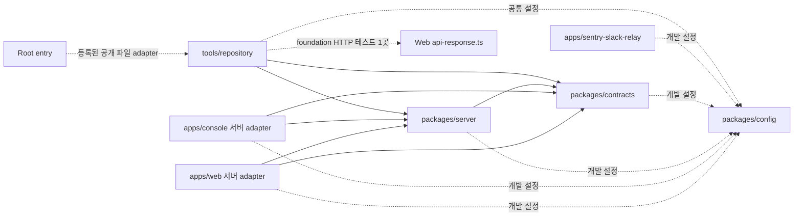
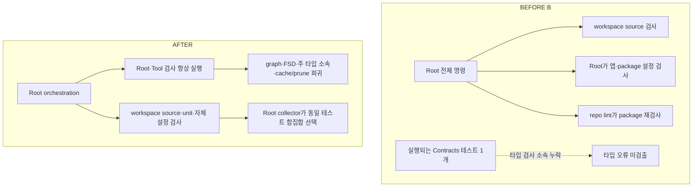
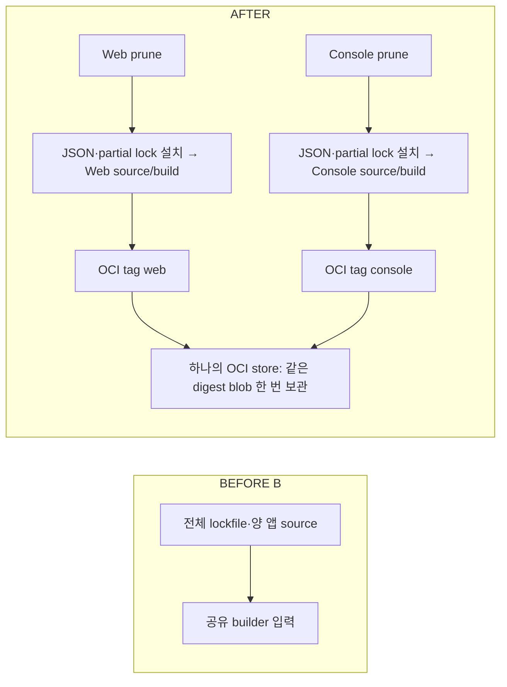

# 모노레포 개선 BEFORE / AFTER

이번 작업은 앱·공용 패키지의 물리적 분리 뒤에 남은 **의존성 선언, 설정·테스트 소유권, 검증과 빌드 입력의 결합**을 정리했다. 각 workspace가 자신의 소스·설정·검사를 소유하고, Root는 전체 실행을 조합하며, 실제 저장소 도구 구현은 `tools/repository`가 소유하도록 바뀌었다.

이 문서는 완료한 작업을 설명하는 비교 요약이다. 상세 실행 증거는 기존 RESULT가, 구현 지침은 [헌법 §5](../oioi-bwg-architecture-clean-v1/01-architecture-constitution.md#5-최상위-디렉터리)·[Testing §17](../oioi-bwg-architecture-clean-v1/10-testing-architecture.md#17-ci-gate)·[배포 runbook](../oioi-bwg-architecture-clean-v1/12-deployment-migration-runbook.md)이 소유한다. 향후 코드를 반영하는 상시 현황 문서가 아니라 아래 커밋 사이의 고정 비교다.

## 1. 비교 범위와 읽는 순서

| 구분     | 고정 커밋                                  | 의미와 상세 근거                                                                                                                                                                                                                         |
| -------- | ------------------------------------------ | ---------------------------------------------------------------------------------------------------------------------------------------------------------------------------------------------------------------------------------------- |
| BEFORE A | `4d5e42dac37aeb13b3279b47a7907fbb7bc91be2` | 설정 정상화 전. 이미 Web·Console과 server/contracts가 있는 모노레포다. [CONFIGURATION PLAN](https://github.com/goldmayo/oioi-bwg/blob/e93ae610169e4ce0e9b7f1a75a9a02cbf179d46f/docs/migration/implementation/MONOREPO-CONFIGURATION-PLAN.md)·[RESULT](MONOREPO-CONFIGURATION-RESULT.md)                                                                   |
| BEFORE B | `f39f0b875d64ba033da4f4ff3a5b0296b18f1678` | 초기 정상화 후, 의존성 경계·실행 개선 전. config·relay workspace는 이미 존재한다. [BOUNDARIES PLAN](https://github.com/goldmayo/oioi-bwg/blob/e93ae610169e4ce0e9b7f1a75a9a02cbf179d46f/docs/migration/implementation/MONOREPO-BOUNDARIES-AND-EXECUTION-PLAN.md)·[RESULT](MONOREPO-BOUNDARIES-AND-EXECUTION-RESULT.md)                                     |
| AFTER    | `c6c2f71b73235caa773de2ef56d51820b9e86b23` | #242 Root 정리와 #243 공통 blob 저장까지 `migration_main`에 통합한 상태. [AUDIT PLAN](https://github.com/goldmayo/oioi-bwg/blob/e93ae610169e4ce0e9b7f1a75a9a02cbf179d46f/docs/migration/implementation/MONOREPO-AUDIT-FOLLOWUP-PLAN.md)·[Root RESULT](MONOREPO-AUDIT-ROOT-DEPENDENCIES-RESULT.md)·[Cache RESULT](MONOREPO-AUDIT-BUILDKIT-CACHE-RESULT.md) |

먼저 §2의 문제별 비교와 §3의 구조를 읽고, 캐시·Docker의 변화는 §5~6에서 확인한다. 각 RESULT의 과거 수치·미병합·보류 표시는 해당 검증 시점의 기록이다. 이후 완료한 #242/#243의 통합 사실은 이 문서 §7에서 연결한다.

## 2. 무엇이 문제였고 어떻게 달라졌는가

아래 A/B는 위 기준선이다. 당시에도 제품 패키지의 앱 역참조나 앱 간 직접 import는 관찰되지 않았다. 경계 개선의 핵심은 정상 상태를 유지하면서 config·test·alias 우회까지 자동으로 거절하는 능력을 갖춘 것이다.

| 영역                  | BEFORE: 관찰한 문제                                                                                              | AFTER: 실제 변경과 효과                                                                                                                                               | 상세 근거                                                                                                                                                      |
| --------------------- | ---------------------------------------------------------------------------------------------------------------- | --------------------------------------------------------------------------------------------------------------------------------------------------------------------- | -------------------------------------------------------------------------------------------------------------------------------------------------------------- |
| 공통 설정 (A)         | Root `config/`의 파일 공유와 앱별 설정 조합에 소비·검사 책임이 섞였다.                                           | `packages/config`가 공개 preset/factory와 직접 의존성을 소유한다. 자동 탐색 entry와 앱별 env·instrumentation은 consumer에 둔다.                                       | [설정 정상화 결과](MONOREPO-CONFIGURATION-RESULT.md)                                                                                                           |
| 테스트 실행 (A)       | Root Vitest가 Web alias·jsdom·Web include를 직접 소유해 전체 workspace 실행·coverage와 역할이 달랐다.            | 각 workspace가 alias·환경·include를 소유하고 Root collector가 합집합을 선택한다. Node·브라우저·PostgreSQL 테스트의 실행 환경을 구분한다.                              | [TEST-01~06 결과](MONOREPO-CONFIGURATION-RESULT.md)                                                                                                            |
| 앱 환경·DB 도구 (A)   | 앱 예제·build 입력·DB 도구의 환경 선택 규칙을 함께 정리할 필요가 있었다.                                         | 앱의 `local`/`production` 계약과 앱별 입력을 명시하고 DB guard가 검증한 URL을 실제 실행 도구에 전달한다. 개인 env 값과 운영 주입 검증은 이 비교 범위 밖이다.          | [ENV·DB 정상화 결과](MONOREPO-CONFIGURATION-RESULT.md)                                                                                                         |
| 직접 의존성 (B)       | 앱의 Testing Library·일부 CLI/marker 사용이 Root 설치에 의존했다.                                                | 실제 consumer에 선언하고 내부 package는 `workspace:*`와 명시적 `exports`로 연결한다. #242는 실제 소비가 config/Tool에 있는 Root 외부 도구 선언 9개를 추가로 제거했다. | [경계 결과 1단계](MONOREPO-BOUNDARIES-AND-EXECUTION-RESULT.md#1단계--직접-의존성과-도구-실행-소유권)·[Root RESULT](MONOREPO-AUDIT-ROOT-DEPENDENCIES-RESULT.md) |
| 경계 강제 (B)         | 문자열·일부 source 중심 검사로 config/test의 역참조와 상대 경로·alias를 통한 우회 차단이 불완전했다.             | workspace별 TS 해석과 exports를 사용하는 graph 검사 및 Turbo boundaries를 기존 lint/CI/hook에 연결했다.                                                               | [경계 결과 2단계](MONOREPO-BOUNDARIES-AND-EXECUTION-RESULT.md#2단계-a--resolved-dependency-분석기)                                                             |
| 타입 검사 (B)         | Contracts 테스트 하나가 실행되지만 타입 검사 소속이 없었다. 앱·패키지 설정 일부도 자체 명령에서 검사되지 않았다. | 추적 TS 테스트의 주 타입 소속을 정확히 하나로 검사한다. Web·Console·server·contracts는 소스와 자체 Node 설정을 함께 검사한다.                                         | [경계 결과 3~4단계](MONOREPO-BOUNDARIES-AND-EXECUTION-RESULT.md#3단계--테스트의-주-타입-검사-소속)                                                             |
| 저장소 도구 (B)       | Root의 내부 package 소비가 전역 hash를 결합했고, repo lint가 package를 재검사했다.                               | 실제 consumer를 `tools/repository`로 이관한 뒤 Root 내부 workspace 선언·직접 import를 제거했다. Root·Tool 검사는 항상 실행하고 workspace 검사의 중복을 제거했다.      | [경계 결과 5단계](MONOREPO-BOUNDARIES-AND-EXECUTION-RESULT.md#5단계-a--캐시-기준선과-root-소유권-보완)                                                         |
| 캐시 입력 (B)         | Root 전역 입력과 config 전파로 무관한 변경까지 여러 task hash에 반영됐다.                                        | 공통 설정 입력을 build·type·lint·unit 소비에 맞춰 분리하고 필요한 무효화와 무관한 hash 보존을 함께 검증했다.                                                          | [경계 결과 5-C2/D](MONOREPO-BOUNDARIES-AND-EXECUTION-RESULT.md#5단계-c2--task별-config-입력과-필요한무관-cache-회귀)                                           |
| Docker 입력 (B)       | 전체 lockfile·양 앱 소스가 builder에 함께 입력됐다.                                                              | 앱별 `turbo prune --docker`로 JSON/partial lock 설치와 full source 복사를 분리하고 해당 앱만 빌드한다.                                                                | [경계 결과 6단계](MONOREPO-BOUNDARIES-AND-EXECUTION-RESULT.md#6단계-a--pruned-설치source-입력과-기존-ci-호환)                                                  |
| cache 보관 (6-B 이후) | 앱별 cache 디렉터리에서 같은 digest의 공통 layer도 중복 보관했다.                                                | #243은 native OCI 저장소 하나에 앱별 tag를 유지하고 공통 blob만 한 번 저장한다. 같은-run 관찰 기준 약 13.1% 절감했다.                                                 | [Cache RESULT](MONOREPO-AUDIT-BUILDKIT-CACHE-RESULT.md)·[PR #243](https://github.com/goldmayo/oioi-bwg/pull/243)                                               |

## 3. 폴더 구조와 책임의 BEFORE / AFTER

핵심 경로만 표시했다. BEFORE A와 B를 섞어 하나의 과거 상태로 그리지 않는다.

### BEFORE A — 공통 파일은 있으나 workspace 소유권이 불완전한 상태

```text
repo/
├─ package.json                    # 전체 실행 + 공용 도구·앱 테스트 의존성
├─ config/{eslint,typescript}/     # Root 파일 경로로 공유
├─ vitest.config.ts · vitest.setup.ts # Web 환경·alias·수집 직접 소유
├─ vitest.ops.config.ts · vitest.postgres.config.ts
├─ apps/{web,console}/             # 독립 앱·설정; Web unit entry는 Root
├─ packages/{server,contracts}/    # 공통 서버·HTTP 계약
├─ workers/sentry-slack-relay/     # 별도 package manifest 없는 Worker
├─ apps/web/eslint/                # 양 앱 정책 검사까지 Web 경로에 위치
├─ harness/architecture/
└─ scripts/ · tests/ · ops/ · drizzle/
```

BEFORE B에서는 공통 설정이 `packages/config`, relay가 `apps/sentry-slack-relay`로 옮겨지고 Web도 자체 Vitest entry를 가졌다. 다음 과제는 Root가 소비하던 내부 package·통합 도구와 workspace 설정 검사 책임을 분리하는 일이었다.

### AFTER — 각 workspace가 소비와 검사를 소유하는 상태

```text
repo/
├─ package.json · pnpm-workspace.yaml · turbo.json
├─ eslint.config.ts · steiger.config.ts # 자동 탐색용 공개 Tool adapter
├─ tsconfig*.json · vitest.config.ts    # Root 검사·전체 unit/coverage 조합
├─ apps/
│  ├─ web/                         # source·설정·unit·FSD·pruned Docker
│  ├─ console/                     # source·설정·unit·FSD·pruned Docker
│  └─ sentry-slack-relay/           # 독립 Worker·Node type/lint/unit
├─ packages/
│  ├─ contracts/                   # Zod HTTP schema·DTO·자체 검사
│  ├─ server/                      # DB·repository·service·자체/PG 검사
│  └─ config/                      # 공통 preset/factory·경계 정책·자체 검사
├─ tools/repository/               # private 저장소 도구 workspace
│  ├─ src/                         # dependency CLI·operator·MFA fixture
│  ├─ harness/architecture/         # FSD·graph·타입 소속·cache/prune 회귀
│  ├─ tests/                       # 내부 package 소비 ops/PG 테스트
│  └─ typescript/ · tsconfig*.json  # Root용 preset·Tool/Node/Web 검사
├─ scripts/                       # 기존 CLI entry·DB guard·독립 운영 도구
├─ tests/{ops,integration,k6}/     # Root 검사·조합 entry·수동 외부 검증
└─ ops/ · drizzle/                # 운영 자산·migration 이력
```

자동 탐색 설정은 도구가 찾는 Root/앱 위치에 유지했다. 공통 preset은 config, 저장소 전용 조합·실행 구현은 Tool, 앱 env·request·instrumentation은 해당 앱이 소유한다. Root에 실제 consumer가 있는 외부 CLI와 운영 의존성도 남아 있다.

소스 대조: [BEFORE Root manifest](https://github.com/goldmayo/oioi-bwg/blob/4d5e42dac37aeb13b3279b47a7907fbb7bc91be2/package.json)·[BEFORE Vitest](https://github.com/goldmayo/oioi-bwg/blob/4d5e42dac37aeb13b3279b47a7907fbb7bc91be2/vitest.config.ts)·[AFTER Root manifest](https://github.com/goldmayo/oioi-bwg/blob/c6c2f71b73235caa773de2ef56d51820b9e86b23/package.json)·[Tool 공개 entry](https://github.com/goldmayo/oioi-bwg/blob/c6c2f71b73235caa773de2ef56d51820b9e86b23/tools/repository/package.json).

## 4. 의존성과 검증 흐름의 변화

### 제품 소스와 도구 소비의 관계

화살표는 소비자 → 의존 대상이다. 실선은 제품/도구 소스 소비, 점선은 개발 설정·공개 파일 adapter·테스트 예외를 구분해 표시한다.



Root→Tool 점선은 manifest의 workspace 의존성이 아니라 허용 목록에 등록된 공개 파일 연결이다. 앱·공용 package의 workspace 상대 경로 우회는 거절한다. Tool의 앱 참조도 `m7-foundation.postgres.test.ts`→`apps/web/src/server/http/api-response.ts` 한 곳으로 제한한다.

Client Component는 contracts를 소비하며 server core를 직접 참조하지 않는다. server/contracts의 TS source export와 Next transpilation 전략은 유지한다. Relay는 config를 개발용으로 소비하고 제품 runtime과 독립적으로 실행한다.

차단 대상은 `packages → apps`, 앱 간 직접 참조, 비공개 export·상대 경로 우회, 미선언 내부 의존성, 제품 runtime의 tooling 참조, client의 server core 참조, runtime 순환이다. [정책 소스](https://github.com/goldmayo/oioi-bwg/blob/c6c2f71b73235caa773de2ef56d51820b9e86b23/packages/config/dependencies.ts)와 [분석기](https://github.com/goldmayo/oioi-bwg/blob/c6c2f71b73235caa773de2ef56d51820b9e86b23/tools/repository/src/check-workspace-dependencies.ts)가 source·config·test의 해석과 manifest를 대조한다.

### 검사 실행과 타입 소속



전체 실행에서는 Tool을 제품 Turbo 검사에서 제외하고 `type-check:repo`·`lint:repo`가 Tool 검사를 항상 위임한다. `--affected`가 Root 변경에서 제품 task를 선택하지 않아도 저장소 검사는 실행된다. Node 테스트에는 Web alias를 전역 주입하지 않으며, HTTP adapter를 소비하는 Tool 테스트만 별도 Web 타입 프로그램을 사용한다.

## 5. 캐시와 Docker: 입력 독립성과 저장 효율을 함께 확보

### Turborepo task cache

BEFORE B의 Root는 config/server/contracts를 직접 의존했다. 단계 중 실측에서 내부 source나 Root harness 변경이 cacheable task 19개 전부의 hash를 바꿨다. 실제 consumer 이관 후 Root의 내부 의존성을 제거하고 전역 파일 입력을 소비 task별 입력으로 바꿨다.

AFTER는 workspace 기본 입력과 server/contracts JIT source 전파를 유지한다. 공통 Next/Sentry·TS preset·ESLint/Steiger·browser setup 입력을 각각 필요한 task에 반영하며, config 전파 노드에는 manifest를 명시한다. build env와 `.env*`, `.next/**` 출력·cache 제외 계약도 유지한다. 선택 범위, hash 변화, 실제 실행은 서로 다른 관찰값으로 검증했다.

### Docker build와 BuildKit cache



각 Dockerfile은 자기 앱만 허용한다. 단독 prune 결과에는 대상 앱과 config/server/contracts가 들어가며 상대 앱·Relay·Tool은 제외된다. Docker context는 Root를 유지하고 pruner 이후 설치·source 입력을 줄였다. [Web Dockerfile](https://github.com/goldmayo/oioi-bwg/blob/c6c2f71b73235caa773de2ef56d51820b9e86b23/apps/web/Dockerfile)·[Console Dockerfile](https://github.com/goldmayo/oioi-bwg/blob/c6c2f71b73235caa773de2ef56d51820b9e86b23/apps/console/Dockerfile).

6-B는 먼저 앱별 builder/cache를 분리해 입력 독립성을 확보했지만 공통 layer의 중복 보관량이 늘었다. #243은 앱별 cache manifest/tag를 유지한 채 물리적 blob 저장소를 공유한다. 새 출력 디렉터리에 직렬 export하고 v4 namespace를 사용한다. 실제 Buildx v0.38.0·BuildKit v0.33.1에서 export/import와 digest/size를 검증했다.

이 저장 배치는 일반 Verify의 BuildKit cache에 적용된다. [Verify workflow](https://github.com/goldmayo/oioi-bwg/blob/c6c2f71b73235caa773de2ef56d51820b9e86b23/.github/workflows/verify.yml)의 같은 run 이미지 검증, merge cache 발행의 source/tree/run 증명, 별도 Promotion candidate digest·rollback 계약은 유지했다. Turborepo task cache와 BuildKit layer cache는 별개다.

## 6. 변경 이유: 공식 지침을 이 저장소에 적용한 판단

공유 단위는 책임과 실제 consumer를 기준으로 정했다. package 추가 자체보다 공개 계약, 소비 의존성, 검사 소유권과 작업 입력이 일치하는지를 판단 기준으로 삼았다. 아래 공식 문서는 2026-10-25 확인했으며, 설치 기준은 pnpm 10.15.1·Turbo 2.11.7이다.

pnpm은 workspace의 설치·링크를, Turborepo는 선언된 package/task 관계에 따른 실행·캐시를 담당한다. 저장소 공유와 runtime·배포 단위는 별도로 관리한다. Web·Console·Relay의 실행 경계를 유지하고 Web/Console의 검증·배포에는 기존 paired Promotion 계약을 적용한다.

| 공식 근거                                                                                                                             | 이번 작업의 적용과 범위                                                                                                                                             |
| ------------------------------------------------------------------------------------------------------------------------------------- | ------------------------------------------------------------------------------------------------------------------------------------------------------------------- |
| [pnpm Workspace](https://pnpm.io/10.x/workspaces)                                                                                     | `workspace:`로 내부 연결을 로컬 workspace에 한정한다. package 공개 API와 경계 차단은 exports·별도 검사로 보완한다.                                                  |
| [Turbo 의존성 관리](https://turborepo.dev/docs/crafting-your-repository/managing-dependencies#install-dependencies-where-theyre-used) | 실제 소비 workspace가 직접 선언한다. Root 도구는 실제 사용·CLI·peer 요구를 확인한 뒤 정리한다.                                                                      |
| [Turbo Root 의존성과 global hash](https://turborepo.dev/docs/crafting-your-repository/caching#root-workspace-dependencies)            | Root 내부 package 의존이 source를 global hash에 포함한다. 실제 소비자를 Tool로 이관한 뒤 Root 선언을 제거했다. Root 내부 의존 금지는 이 프로젝트가 선택한 정책이다. |
| [Turbo task 설정](https://turborepo.dev/docs/crafting-your-repository/configuring-tasks)                                              | manifest 의존성과 task 입력·선행 관계를 함께 검토한다. JIT 패키지에 일괄 `dist` 빌드를 추가하지 않고 현재 source 소비를 유지했다.                                   |
| [Turbo Docker 가이드](https://turborepo.dev/docs/guides/tools/docker)                                                                 | `prune --docker`로 설치 입력과 source 복사를 나눠 무관한 workspace 변경의 영향을 줄인다.                                                                            |
| [Docker local cache](https://docs.docker.com/build/cache/backends/local/)                                                             | native OCI tag로 앱별 manifest를 유지한다. 같은 digest blob을 공유하고 저장 비용은 실제 bytes로 측정했다.                                                           |

config를 Next·Node별 package로 더 나누거나 UI package를 선생성하지 않았다. 자동 탐색 entry를 일괄 이동하지도 않았다. 현재 consumer와 독립 설치·배포 필요가 확인된 경계까지 적용한 결과다.

## 7. 확인한 효과와 검증 범위

### 실행·저장 비용의 관찰

| 관찰 범위                          | 확인한 결과                                                                                                             | 해석의 한계                                                                              |
| ---------------------------------- | ----------------------------------------------------------------------------------------------------------------------- | ---------------------------------------------------------------------------------------- |
| 5단계 cache 회귀                   | 19 task × 19 입력의 필요한 hash 변화·무관 hash 보존 검사                                                                | affected 선택과 실제 실행 시간을 구분한다.                                               |
| 같은 로컬 fixture의 type/lint/unit | cold 17 miss → warm 17 hit. browser setup 변경 시 4 miss/13 hit                                                         | Root·Tool 항상 검사를 포함한 전체 verify 속도 향상율이 아니다.                           |
| 같은 fixture의 build archive       | cold 2 miss → 양 앱 `.next` 삭제 후 2 hit, standalone 복원                                                              | 해당 fixture의 산출물 복원 증거다.                                                       |
| #242 Root 선언 정리                | 외부 도구 선언 9개 제거, 기존 package/snapshot 해석 보존                                                                | 다른 workspace가 계속 소비하므로 설치 package 수 감소를 뜻하지 않는다.                   |
| #243 cold CI #543                  | 앱별 blob 별도 보관 합계 801,182,117 → 실제 공통 저장 696,461,096바이트. 104,721,021바이트·약 13.1% 절감, 미참조 blob 0 | 동일 run의 참조 데이터 기준이다. 전체 CI 시간·전체 개선 전 대비 절감률이 아니다.         |
| #243 warm CI #545                  | 새 builder에서 동일 v4 key 복원, Next compile 0회·cache 단계 51회 적중                                                  | cache manifest 재사용 증거다. 서로 다른 run의 runtime image digest가 같다는 뜻이 아니다. |
| #242 반영 후 CI #546               | 별도 보관 합계 802,051,037 → 공통 저장 697,330,228바이트. 104,720,809바이트 절감, 미참조 blob 0                         | 통합 상태에서도 같은 저장 방식을 검증했다.                                               |

5단계 실행의 상세 조건·시간은 [기존 RESULT](MONOREPO-BOUNDARIES-AND-EXECUTION-RESULT.md#5단계-d--실제-재실행재사용과-build-산출물-복원), cold 저장 측정은 [Cache RESULT](MONOREPO-AUDIT-BUILDKIT-CACHE-RESULT.md), warm·최종 통합 검증은 [PR #243](https://github.com/goldmayo/oioi-bwg/pull/243)이 소유한다.

6-B의 cache ZIP은 801,278,043바이트로 이전 공유 builder의 416,374,567바이트보다 컸다. #243의 ZIP은 696,468,887바이트다. 이는 **입력 분리의 보관 비용을 줄인 결과**이며, 전체 작업 전보다 cache 크기가 작아졌다는 주장은 아니다. run 간 ZIP 크기 비교와 동일-run blob 중복 절감 계산도 구분한다.

### 통합과 검증 증거

- [PR #242](https://github.com/goldmayo/oioi-bwg/pull/242)는 `3e91699e20230707ec19d616cfeb435d2dfa3dad`, [PR #243](https://github.com/goldmayo/oioi-bwg/pull/243)은 `c6c2f71b73235caa773de2ef56d51820b9e86b23`로 순서대로 squash 통합했다.
- 최종 [Verify #546](https://github.com/goldmayo/oioi-bwg/actions/runs/40160720963)은 #242 반영 head `fe2ba8ea14712d7a2a909b94fdc624230367ab5e`의 필수 gate 전체 성공이다. 검증 head와 #243 squash의 tree는 `63e830a1d46296c8ec346ad026e434576d5fb2bb`로 같다.
- 이 CI는 type-check·lint·의존성·unit 99파일/700건·ops 22파일/287건·harness 46건, 실제 PostgreSQL·양 앱 이미지·native/readiness/browser·paired Compose 보존/복구를 확인했다.
- 위 수치는 기존 실행 증거다. 이 비교 문서를 작성하면서 제품 코드의 검사나 build를 다시 실행했다는 뜻이 아니다. 일반 CI 검증과 실제 운영 배포·외부 수신 증거도 구분한다.

## 8. 경계를 유지할 때 사용하는 검사

아래는 AFTER의 재검증 entry 안내이며 이 문서 작성 작업의 실행 기록이 아니다.

| 확인할 내용                                     | 명령과 소유자                                                                   |
| ----------------------------------------------- | ------------------------------------------------------------------------------- |
| workspace 역참조·export/alias 우회·runtime 순환 | `pnpm lint:deps`: Tool의 해석 graph + Turbo boundaries                          |
| FSD·타입 주 소속·설정 입력·cache/prune 회귀     | `pnpm test:harness`: Tool architecture harness; FSD 직접 검사는 `pnpm lint:fsd` |
| workspace 소스·설정·Root/Tool 타입과 lint       | `pnpm type-check`, `pnpm lint`                                                  |
| unit 합집합·운영 및 cache 발행 계약             | `pnpm test:unit:run`, `pnpm test:ops`                                           |
| 실제 DB·컨테이너·브라우저·이미지 일치           | 일반 코드 PR의 Verify PostgreSQL/app build/build jobs                           |

정책은 [dependencies.ts](../../../packages/config/dependencies.ts), 검출 능력은 [graph 회귀](../../../tools/repository/harness/architecture/dependency-graph.test.js)·[타입 소속 회귀](../../../tools/repository/harness/architecture/repo-types.test.js)·[cache 회귀](../../../tools/repository/harness/architecture/app-dependencies.test.js)·[prune 회귀](../../../tools/repository/harness/architecture/docker-prune.test.js)에서 확인할 수 있다.

## 9. 남은 한계와 의도적으로 보류한 범위

| 항목                                              | AFTER 기준 판단                                                                                                    |
| ------------------------------------------------- | ------------------------------------------------------------------------------------------------------------------ |
| Console auth의 type import가 포함된 순환 경고 1개 | runtime 순환 오류와 구분해 노출한다. auth 도메인 변경은 별도 concern이다.                                          |
| 계산형 dynamic import·임의 파일 접근              | 정적 graph만으로 증명하지 못한다. 실제 runtime/build 검증을 함께 사용한다.                                         |
| config package 추가 분할·버전 catalog             | 독립 Node consumer·분리 설치 이득 등의 근거가 생기면 재검토한다.                                                   |
| CI affected 범위 확대·task remote cache           | 일반 코드 PR의 전체 gate를 보존했다. 영향 범위 축소와 CI 비용 개선은 별도 측정·설계 대상이다.                      |
| UI 공유 package·Base UI 전환·API 계약 진화        | 실제 재사용·UI 검증·독립 배포 호환성에 맞춘 별도 작업이다.                                                         |
| 운영 적용                                         | 이 모노레포 개선의 검증 범위는 저장소 구현과 일반 CI다. Promotion·VM/Worker 배포·외부 발송 완료를 포함하지 않는다. |

상세 보류 판단은 [AUDIT PLAN](https://github.com/goldmayo/oioi-bwg/blob/e93ae610169e4ce0e9b7f1a75a9a02cbf179d46f/docs/migration/implementation/MONOREPO-AUDIT-FOLLOWUP-PLAN.md)과 각 RESULT를 따른다. 개선의 유지 기준은 공개 계약과 소비 방향, 검사 소유권, 필요한 cache 무효화와 무관한 재사용을 함께 지키는 것이다.
