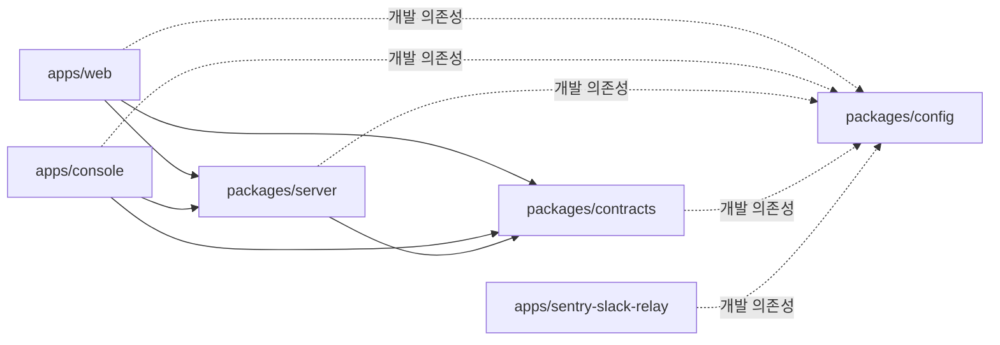
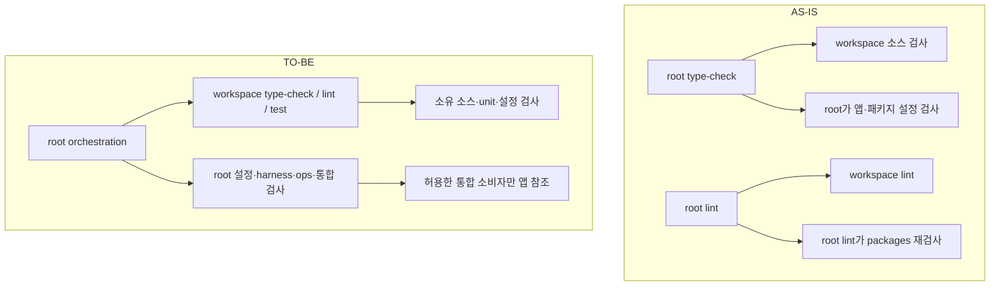
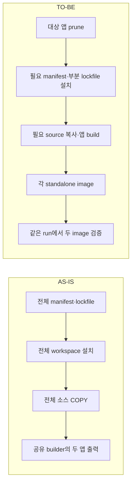

# 모노레포 의존성 경계와 검증·빌드 실행 개선 계획

## 1. 목적·기준선·문서 책임

목표는 각 workspace가 의존성·설정·검증을 소유하고, 저장소 도구가 실제 의존 관계에 맞춰 작업을 실행하는 것이다. 현재의 앱·서버·계약 분리를 유지하면서 모노레포 전환 뒤 남은 암묵적 의존, 검사 누락, 불필요한 재실행을 단계별로 해소한다.

- 저장소: `goldmayo/oioi-bwg`, 기준 브랜치: `migration_main`.
- 고정 기준: `f39f0b875d64ba033da4f4ff3a5b0296b18f1678`. fetch 후 local·origin의 기준 커밋이 일치하고 작업 트리가 깨끗한 상태에서 조사했다.
- 도구 계약: 루트 manifest의 `pnpm@10.15.1`, lockfile로 고정한 Turborepo를 유지한다. 공식 문서 열람일은 2026-10-25이며 pnpm은 10.x 문서를 사용한다.
- 이 문서는 **구현 미착수 계획**이다. 현재 관찰, 제안한 TO-BE, 앞으로 실행할 검증을 구분한다. 이전 대화의 검사 통과·캐시 실측을 이 SHA의 실행 결과로 재사용하지 않는다.
- 완료된 [이전 정상화 PLAN](MONOREPO-CONFIGURATION-PLAN.md)과 [RESULT](MONOREPO-CONFIGURATION-RESULT.md)는 당시 범위의 이력으로 보존한다. 이번 후속 범위의 실행 순서와 완료 조건은 이 문서가 소유하며, 구현 결과는 착수 후 별도 RESULT에서 PR·커밋·실제 검증과 연결한다.

상위 기준은 [헌법 §5](../oioi-bwg-architecture-clean-v1/01-architecture-constitution.md), [Frontend](../oioi-bwg-architecture-clean-v1/02-frontend-architecture.md), [Server §2.1](../oioi-bwg-architecture-clean-v1/06-server-data-access-architecture.md), [Testing §17](../oioi-bwg-architecture-clean-v1/10-testing-architecture.md), [배포 runbook §21](../oioi-bwg-architecture-clean-v1/12-deployment-migration-runbook.md)이다. 외부 권장사항은 이 저장소의 SSOT를 대체하지 않는다. 검사 소유권·캐시 정책·Docker 계약을 바꾸는 단계는 해당 active 문서를 같은 변경 단위에서 개정한다.

## 2. 모노레포의 철학과 적용 지침

이 계획에서 ‘네이티브 모노레포’는 별도 제품명이 아니라 **처음부터 workspace의 공개 계약과 작업 그래프를 기준으로 설계한 상태**를 뜻한다. 폴더 개수보다 아래 성질로 개선 여부를 판단한다.

| 원칙                               | 공식 지침과 의미                                                                                                                                                                 | 이 프로젝트의 변경 이유                                                                                                     |
| ---------------------------------- | -------------------------------------------------------------------------------------------------------------------------------------------------------------------------------- | --------------------------------------------------------------------------------------------------------------------------- |
| 소비 workspace가 의존성을 선언한다 | Turborepo는 사용하는 package에 직접 설치하고 루트에는 저장소 관리 도구를 두도록 권한다. [의존성 관리](https://turborepo.dev/docs/crafting-your-repository/managing-dependencies) | 앱 테스트가 루트 설치에 기대는 상태를 해소한다. 루트 운영·통합 도구가 실제 사용하는 의존성은 유지한다.                      |
| 패키지 계약이 그래프가 된다        | pnpm의 `workspace:`는 내부 package를 로컬 workspace에서 해석하게 한다. [Workspace](https://pnpm.io/10.x/workspaces)                                                              | 내부 의존성은 `workspace:*`와 명시적 `exports`로 연결한다. 앱 alias나 상대 경로로 패키지 연결을 대신하지 않는다.            |
| 구조와 소유권을 일치시킨다         | `apps/*`, `packages/*`, package별 설정과 공개 entry가 기본 구성이다. [저장소 구조](https://turborepo.dev/docs/crafting-your-repository/structuring-a-repository)                 | 앱별 자동 탐색 entry는 앱에 둔다. 루트는 저장소 자체의 설정·검사·운영을 소유한다.                                           |
| 공유는 실제 consumer를 따른다      | 내부 package는 소비 방식에 따라 JIT·compiled 전략을 선택한다. [Internal Packages](https://turborepo.dev/docs/core-concepts/internal-packages)                                    | 현재 server/contracts의 TS source export와 Next transpilation을 유지한다. 독립 배포나 `dist` 생성을 목표로 추가하지 않는다. |
| 정확한 작업 그래프가 효율의 전제다 | task 의존성과 입력이 실행·캐시 판단을 결정하며 transit node로 소스 변경을 전달할 수 있다. [작업 설정](https://turborepo.dev/docs/crafting-your-repository/configuring-tasks)     | 캐시 누락을 막는 전파를 보존하면서 무관한 tooling 변경의 전파를 줄인다.                                                     |
| 버전 공유와 의존성 소유는 다르다   | pnpm catalog는 버전 범위를 재사용한다. [Catalogs](https://pnpm.io/10.x/catalogs)                                                                                                 | 버전을 모으더라도 각 consumer의 선언은 남긴다. catalog 도입은 필수 수정 이후 별도 선택 사항이다.                            |

pnpm은 설치·링크·모듈 해석을 담당하고 Turborepo는 manifest·lockfile에 근거한 작업 실행과 캐시를 담당한다. `pnpm --filter`는 workspace를 선택하는 수단이지 경계 위반이나 설치 독립성의 증명이 아니다. [pnpm Filtering](https://pnpm.io/10.x/filtering)

## 3. AS-IS: 확인된 문제와 실제 영향

### 3.1. 현재 정상인 경계

고정 SHA의 추적 JS/TS 계열 파일 500개를 TypeScript `preProcessFile`로 읽어 import와 manifest를 대조했다. workspace 밖 상대 import와 `packages → apps`·앱 간 직접 참조를 발견하지 못했다. 이 방법은 계산된 동적 경로·실행 중 파일 접근까지 검증하지 않는다. 현재 위반 부재와 검사 도구의 차단 능력은 별개다.



화살표는 소비자 → 의존 대상이다. 실선은 제품 소스 의존, 점선은 tooling 의존이다. Relay는 독립 runtime이며 다른 앱·서버·계약 runtime에 연결하지 않는다.

### 3.2. 개선 항목과 소스 근거

| ID     | 현재 관찰과 근거                                                                                                                                                                                                                            | 문제·영향                                                                                                                                                     | 담당 단계 |
| ------ | ------------------------------------------------------------------------------------------------------------------------------------------------------------------------------------------------------------------------------------------- | ------------------------------------------------------------------------------------------------------------------------------------------------------------- | --------- |
| DEP-01 | [앱 manifest](../../../apps/web/package.json), [Console manifest](../../../apps/console/package.json)에 Testing Library 직접 선언이 없다. [루트](../../../package.json)에는 존재한다.                                                       | 루트 설치에서만 충족되는 암묵적 테스트 의존이다. 추출·필터 설치·Docker prune에 취약하다.                                                                      | 1         |
| BND-01 | [서버 규칙](../../../packages/config/eslint/server.ts)은 `src/**/*.ts`, [계약 규칙](../../../packages/config/eslint/contracts.ts)은 테스트 제외, [앱 규칙](../../../packages/config/eslint/architecture-rule.ts)은 package 문자열 중심이다. | 설정·테스트의 역참조와 상대 경로를 통한 export 우회를 일관되게 차단하지 못한다.                                                                               | 2         |
| TYP-01 | [Contracts tsconfig](../../../packages/contracts/tsconfig.json)가 `src/**/*.test.ts`를 제외한다.                                                                                                                                            | 추적 TS 테스트 124개와 11개 타입 설정의 root file 목록을 대조하면 `contract.test.ts` 하나에 검사 소속이 없다.                                                 | 3         |
| OWN-01 | [루트 설정 tsconfig](../../../tsconfig.config.json)가 앱·패키지 설정을 함께 포함한다.                                                                                                                                                       | 앱의 `type-check`만으로 소스와 앱 소유 설정의 검사가 완결되지 않는다. Relay·config는 이미 자체 설정도 포함하므로 개별 판단한다.                               | 4         |
| OWN-02 | [루트 lint](../../../package.json)는 `turbo run lint` 이후 앱만 제외한 `lint:repo`를 실행한다.                                                                                                                                              | 패키지 lint가 중복 실행된다. 양 앱을 검사하는 [규칙 테스트](../../../apps/web/eslint/architecture.test.js)도 Web 경로에 있어 저장소 검증 소유권이 불명확하다. | 4         |
| CAC-01 | [Turbo](../../../turbo.json)의 공통 `^transit`와 전역 입력, [config export](../../../packages/config/package.json)가 여러 tooling 책임을 묶는다.                                                                                            | 무관한 변경도 작업 hash에 전파될 수 있다. 앞선 대화에서 재현했으나 이 SHA의 hash·시간은 5단계에서 다시 측정한다.                                              | 5         |
| IMG-01 | [Web Dockerfile](../../../apps/web/Dockerfile)과 [Console Dockerfile](../../../apps/console/Dockerfile)은 양 앱 manifest·전체 lockfile·전체 소스를 builder에 입력한다.                                                                      | 대상 앱 밖 변경도 설치·빌드 레이어에 영향을 줄 수 있다. 실제 비용과 개선량은 6단계에서 측정한다.                                                              | 6         |

DEP-01의 정적 대조 결과는 Console `@testing-library/react` 11곳, Web의 같은 패키지 4곳·`@testing-library/jest-dom` 1곳·규칙 테스트의 `eslint` 1곳으로 **17개 import 위치**다. 별도로 `server-only` 21곳·`client-only` 2곳이 앱 manifest에 없다. Next는 marker 설치를 선택 사항으로 처리하므로 이 23곳을 runtime 결함으로 합산하지 않는다. [Next marker 설명](https://nextjs.org/docs/app/getting-started/server-and-client-components#preventing-environment-poisoning)

## 4. AS-IS → TO-BE 폴더 구조와 책임

### 4.1. AS-IS 주요 구조

```text
repo/
├─ package.json                       # workspace orchestration + 앱 테스트 의존 일부
├─ pnpm-workspace.yaml / pnpm-lock.yaml
├─ turbo.json                         # 공통 transit·전역 입력
├─ tsconfig.config.json               # root + apps + packages 설정 검사
├─ eslint.config.ts / vitest.config.ts # root 조합·전체 unit 선택
├─ apps/
│  ├─ web/
│  │  ├─ src/ · package.json · tsconfig.json
│  │  ├─ next.config.ts · vitest.config.ts · eslint.config.ts
│  │  ├─ eslint/architecture.test.js   # 두 앱의 공통 정책 검사
│  │  └─ Dockerfile                   # 전체 입력의 공유 builder
│  ├─ console/                        # 앱 설정 entry + 전체 입력 Dockerfile
│  └─ sentry-slack-relay/             # 자체 Node 검사·설정 소유
├─ packages/
│  ├─ contracts/src/contract.test.ts   # 실행 대상, 타입 검사 제외
│  ├─ server/src/ · tests/integration/
│  └─ config/{eslint,vitest,typescript}/ · next.ts · sentry-build.ts
├─ harness/architecture/
├─ tests/{ops,integration,k6}/         # 저장소 통합·운영·수동 외부 검증
└─ scripts/ · drizzle/ · ops/          # DB guard·migration·운영 자산
```

### 4.2. TO-BE 기본안: 1~4단계 완료 후

```text
repo/
├─ package.json                       # 전체 실행 + root 실제 consumer 의존
├─ pnpm-workspace.yaml / pnpm-lock.yaml
├─ turbo.json
├─ tsconfig.config.json               # root·저장소 통합 설정만 검사
├─ eslint.config.ts / vitest.config.ts # 자동 탐색 entry·전체 선택 유지
├─ <dependency-cruiser 설정 entry>     # 2단계에서 loader·파일 형식 확정
├─ apps/
│  ├─ web/
│  │  ├─ src/ · package.json          # 직접 테스트·CLI 의존 명시
│  │  ├─ tsconfig.json                # 앱 소스·unit 타입 검사
│  │  ├─ tsconfig.config.json         # 새 파일: 앱 설정 검사
│  │  └─ next/vitest/eslint 설정 · Dockerfile
│  ├─ console/                        # Web과 같은 검사 소유권
│  └─ sentry-slack-relay/             # 기존 자체 타입 프로그램 유지
├─ packages/
│  ├─ contracts/
│  │  ├─ src/contract.test.ts         # package 타입 검사에 포함
│  │  └─ tsconfig.config.json         # 새 파일: 자체 설정 검사
│  ├─ server/
│  │  ├─ src/ · tests/integration/    # 기존 소유권·직렬 DB 실행 유지
│  │  └─ tsconfig.config.json         # 새 파일: 자체 설정 검사
│  └─ config/                         # 기존 공개 export·자체 검사 유지
├─ harness/architecture/
│  ├─ fsd-policy.test.js              # Web 경로의 양 앱 정책 검사 이관
│  └─ 경계·타입 소속·캐시 회귀 검사
└─ tests/ · scripts/ · drizzle/ · ops/ # 실제 통합·운영 소유권 유지
```

자동 탐색 entry와 앱 env·instrumentation은 앱에 유지한다. 루트 `tsconfig.json`은 실제 Node 도구를 검사하므로 유지한다. 공통 설정은 `packages/config`를 우선 유지하며, 형식 미확정인 신규 도구 entry는 2단계의 실제 loader 확인 없이 경로를 고정하지 않는다. 앱 설정 타입 검사는 Node 전용 프로그램에서 수행해 앱의 `@/*` alias가 Node 테스트로 번지지 않게 한다.

### 4.3. 검증 흐름의 변화



## 5. 단계별 실행 계획

단계마다 최신 `origin/migration_main`과 local 기준을 확인하고 feature 브랜치를 만든다. 아래는 6개 checkpoint이며 변경 파일 20개·400줄 목표를 넘으면 같은 단계도 독립 검증 가능한 PR로 나눈다. 이전 단계의 검증·병합 결과를 확인한 뒤 다음 단계에 착수한다. 이 문서 작성은 아래 코드 변경의 실행 완료를 뜻하지 않는다.


### 1단계 — 의존성 선언 정상화 / DEP-01

- 변경: Web·Console의 직접 테스트 import를 각 `devDependencies`에 선언한다. script의 CLI·loader·`jsdom` 환경도 소비자별로 점검한다. 공통 preset이 직접 import하는 패키지는 config가 소유한다.
- marker: 두 앱에 사용하는 `server-only`·`client-only`를 명시적으로 선언하는 안을 적용한다. Next·Vitest alias 동작을 보존하며 검사 전체를 ignore하지 않는다.
- 버전: 기존 lockfile의 해석 버전을 우선 사용한다. 루트의 각 의존성은 root 테스트·CLI·설정 consumer가 없다는 근거가 있을 때만 제거한다. catalog 전환·일괄 업그레이드는 분리한다.
- 검증: clean 임시 checkout의 frozen install과 앱별 type/lint/unit을 실행하고, 설치된 도구로 `turbo boundaries`의 기준 출력을 기록한다. 앱 필터 실행만으로 격리 설치 성공을 주장하지 않는다.
- 완료: 직접 import 미선언 17곳과 marker 23곳을 재대조하고, 남은 CLI·가상 모듈 예외를 명시한다. root 검증과 앱 실행이 함께 성공해야 한다.

### 2단계 — 설정·테스트를 포함한 경계 강제 / BND-01

- 변경: root 진입점 `lint:deps`를 추가한다. ESLint·Steiger는 FSD/계층, dependency-cruiser는 해석된 파일의 방향·순환, Turbo boundaries는 workspace 경계·미선언 import를 담당하게 한다. [도구 규칙](https://github.com/sverweij/dependency-cruiser/blob/main/doc/rules-reference.md)
- 도입: dependency-cruiser의 버전·Node 호환성·config loader·package export/TS alias 해석을 먼저 검증한다. 실제 consumer별 tsconfig로 분석하고 Web alias를 전역 주입하지 않는다.
- 정책: `packages/** → apps/**`, 앱 간 직접 참조, workspace 간 상대 경로 우회, runtime의 tooling 참조를 차단한다. package 테스트도 앱 역참조 금지 대상이며, 테스트 전용 Vitest 등 선언된 dev 의존성은 허용한다.
- 예외: root harness·설정 조합·허용된 Web HTTP 통합 테스트·Drizzle schema 입력 같은 저장소 integration은 목적·출발 경로·대상을 한정한다. 테스트 디렉터리 전체 예외를 두지 않는다.
- 회귀: 패키지 테스트의 앱 import, 앱 config의 타 앱 import, Client/FSD의 상대 서버 schema import, Contracts의 상대 config import, type-only·re-export·literal dynamic import를 검사한다. 적법한 package export와 자체 테스트도 성공시킨다.
- 완료: root·workspace·hook·CI에서 정책이 일치한다. 실험적 [Turbo boundaries](https://turborepo.dev/docs/reference/boundaries)의 알려진 한계는 기록하고, 필수 경계 규칙은 안정적으로 재현되는 gate가 책임진다. 계산된 동적 경로는 정적 분석 범위 밖임을 남긴다.

### 3단계 — 테스트 타입 검사 누락 방지 / TYP-01

- 변경: Contracts의 명시적 Vitest import를 유지하면서 `contract.test.ts`를 해당 package 타입 프로그램에 포함한다. 별도 테스트 tsconfig는 실제 환경 분리가 필요할 때만 도입한다.
- 소속 검사: 기존 harness를 확장해 추적된 모든 TS 테스트의 주 검사 소속을 대조한다. 각 파일에 소유 프로그램 하나가 있어야 하며, import에 따른 중복 방문은 별도로 구분한다.
- 범위: 앱 unit, server 통합, Relay unit, root Node/Web 통합을 모두 대조한다. 기존 PG 테스트는 package 타입 검사와 guarded root 실행의 역할을 유지한다.
- 검증: 테스트 파일에 잘못된 타입을 넣는 임시 fixture가 실제 소유 검사에서 거절되는지 확인한다. runtime 테스트 실행 성공으로 대신하지 않는다.
- 완료: 소속 누락 0개, 설명 없는 중복 소속 0개. Node·Web alias 격리와 기존 unit 수집 범위를 보존한다.

### 4단계 — workspace 검증의 완결성과 root 중복 제거 / OWN-01·02

- 변경: Web·Console·server·contracts의 설정 타입 프로그램을 각 workspace로 옮기고 `type-check`가 소스와 설정을 함께 검사하게 한다. Relay·config의 기존 자체 소속은 재사용한다. root include는 이관 후 축소한다.
- lint: `lint:repo`는 workspace를 제외한 root·scripts·harness·통합 도구를 검사한다. pre-commit의 root ESLint 조합은 유지해 staged 앱/패키지에 동일 정책을 적용한다.
- harness: 양 앱을 검증하는 Web의 architecture 테스트를 `harness/architecture/fsd-policy.test.js`로 이관하고 config의 공개 rule을 직접 소비한다. 기존 wrapper는 import·CLI·config consumer 확인 후 처리한다.
- 명령: `pnpm --filter @oioi-bwg/web type-check` 등 앱 단독 entry가 앱 설정 오류도 검출해야 한다. root 전체 검사에서는 같은 package lint를 다시 실행하지 않는다.
- 검증: 이관 전후 파일 소속·strict 옵션·설정 오류 검출·cwd별 ESLint 정책·전체 unit/coverage 수집 합집합을 비교한다. CI·push hook은 같은 root entry를 사용한다.
- 문서·완료: Testing §17과 실제 검사 소유권을 함께 맞춘다. root 통합 테스트·DB guard·운영 도구는 유지하며, 검사 누락을 만든 채 root include부터 삭제하지 않는다.

### 5단계 — task별 캐시 영향 범위 정교화 / CAC-01

- 선행: 현재 SHA에서 config·server·contract·root harness 파일을 각각 바꾸는 임시 Git fixture로 affected 선택과 task hash를 다시 기록한다. owner 자체 검사와 consumer의 영향을 구분한다.
- 변경: task별 입력·transit 경로·전역 입력을 소비 관계에 맞춘다. 단일 `^transit` 제거만으로 해결하지 않으며 JIT source package 변경의 전파를 보장한다. 빌드 산출물과 env 입력 계약을 함께 검토한다.
- 선택: 기본안은 config를 유지한 task별 전파 조정이다. 복잡한 glob/예외가 늘거나 Next tooling이 Relay 설치까지 과도하게 결합하면 TS·lint·Next·test config 분리를 별도 PR로 선택한다. package 분리만으로 cache가 정교해진다고 가정하지 않는다.
- 문서: 현 헌법 §5는 `packages/config` 소유권을 명시한다. package 분리 선택 시 헌법·Testing·index 개정과 실제 consumer/export 이관을 같은 변경 단위로 수행한다. 미사용 package는 선생성하지 않는다.
- 완료: 아래 matrix의 필요한 무효화와 불필요한 무효화 부재를 함께 검사한다. 경과 시간은 cold/warm·실행 환경과 함께 기록하고 단순 hash 변경을 속도 향상으로 보고하지 않는다.

| 변경 입력                 | consumer 측 필수 영향                   | 유지해야 하는 무관한 캐시의 예 |
| ------------------------- | --------------------------------------- | ------------------------------ |
| Next/Sentry build factory | Web·Console build와 해당 설정 검사      | Relay unit·서버 unit           |
| browser setup             | Web·Console unit                        | 제품 build·Relay unit          |
| ESLint/Steiger rule       | 해당 lint·정책 harness·설정 검사        | 무관한 제품 build              |
| TS preset                 | 해당 type-check와 이를 소비하는 build   | preset 비소비 작업             |
| server/contracts source   | 해당 package 검사·실제 앱 consumer 작업 | Relay runtime/unit             |
| root harness              | root 정책 검사                          | 제품 출력과 관계없는 build     |

task의 `inputs`만 좁혀도 upstream transit의 전체 hash가 전달되면 과도한 무효화가 남는다. task별 transit 또는 명시적 작업 의존을 포함해 검증한다. `--affected`의 선택 여부, hash 무효화, 실제 재실행을 별도 관찰값으로 기록하며 모든 무관한 task의 미선택까지 강제하지 않는다.

### 6단계 — Docker 설치·빌드 입력 축소 / IMG-01

- 변경: 정확한 package 이름으로 `turbo prune @oioi-bwg/web --docker`, Console에 대응하는 추출을 수행한다. prune의 manifest/lockfile과 source를 분리해 복사하고 실제 frozen install을 검증한다. [Docker 권장 방식](https://turborepo.dev/docs/guides/tools/docker)
- 주의: prune는 root manifest의 의존성을 자동 정당화하거나 모두 제거하지 않는다. 1단계의 소유권 정리와 실제 출력 목록·설치량 대조가 선행한다. env 파일·secret이 context나 산출물에 포함되지 않는지 확인한다.
- CI: 현 runbook은 일반 CI의 공유 builder·`BUILD_APP=all`과 두 runtime image 검증을 요구한다. 먼저 pruned 입력의 로컬 비교 증거를 만든 뒤, 각 앱 pruned builder의 결과를 같은 CI run에서 검증하는 계약으로 runbook §21·workflow·ops fixture를 함께 전환한다.
- 보존: Promotion의 보수적 image 선택, source/tree·candidate digest·Sentry release·paired smoke·rollback 증거를 유지한다. Next/Turbo build archive 복원을 새로 도입하지 않고 현 BuildKit cache 정책을 따른다.
- 검증: cold/warm build, 상대 앱만 변경, target/runtime dependency 변경을 비교한다. 양 앱 image의 native dependency·readiness·browser·paired Compose smoke를 실행한다. 새 wrapper가 다른 앱 산출물을 암묵적으로 요구하지 않아야 한다.
- 완료: 대상 밖 입력의 설치/build 영향이 감소하고 필요한 변경은 반영된다. image 크기·설치 대상·빌드 시간·실제 digest를 기록한다. 이 단계는 저장소 구현과 candidate 검증이며 실제 운영 배포는 별도 Promotion이다.



## 6. 단계 운영·검증·복구 기준

| checkpoint | 주요 변경 경계                     | active 문서 검토                   | rollback 단위                          |
| ---------- | ---------------------------------- | ---------------------------------- | -------------------------------------- |
| 1          | manifest·lockfile·직접 실행 도구   | 헌법 §5의 명시 의존성              | 해당 의존성 변경 commit                |
| 2          | 경계 설정·root 명령·CI/hook        | Testing §17·Frontend/Server 경계   | gate 도입 commit; 기존 FSD 검사는 유지 |
| 3          | Contracts 타입 소속·harness        | Testing 타입 검사 책임             | 테스트 타입 프로그램 변경              |
| 4          | workspace 설정 타입·root 검사 범위 | Testing §17                        | 이관과 root include를 함께 복원        |
| 5          | task 그래프·필요시 config 패키지   | 헌법 §5·Testing·runbook cache 정책 | 보수적인 기존 입력·전파로 복원         |
| 6          | Docker·workflow·candidate 증거     | runbook §21                        | 기존 builder·workflow를 함께 복원      |

코드 변경 단계의 기본 gate는 `pnpm type-check`, `pnpm test:harness`, `pnpm lint`, `pnpm lint:fsd`, `pnpm test:unit:run`, `pnpm format:check`다. 새 `lint:deps`를 도입한 뒤 root 검증·CI·hook에 연결한다. runtime/build에 영향이 있는 단계는 `pnpm build`와 필요한 container smoke를 추가한다. DB 변경이 목적이 아니며, DB 회귀 검증이 필요하면 기존 local guard와 격리 PG runner만 사용한다.

각 PR에는 기준 SHA, 변경 이유와 범위, 실제 실행 명령·결과, 캐시 재사용 여부, 보류 항목을 기록한다. 한글 Conventional Commit → 같은 이름의 원격 작업 브랜치 push → `migration_main` 대상 PR 순서로 진행한다. 다음 단계는 새 통합 head에서 분기하며 squash 병합 방식과 저장소 보호 조건을 따른다.

캐시·prune·타입 검사 소유권 변경이 출력·수집·도메인 동작을 바꾸면 해당 단계를 중단해 차이를 분류한다. 도구 오탐은 좁은 예외와 회귀 근거로 처리하고 디렉터리 전체 ignore나 source 전파 제거로 검사를 통과시키지 않는다.

## 7. 완료 조건과 보류 범위

- [ ] DEP-01: 사용 workspace의 직접 의존성과 CLI/환경 소유권이 명시된다.
- [ ] BND-01: runtime·config·test의 역참조·상대 경로 우회를 재현 가능한 gate가 거절한다.
- [ ] TYP-01: 추적 TS 테스트의 주 검사 소속 누락이 없고 오류 검출을 확인한다.
- [ ] OWN-01/02: workspace 소스·설정 검사 완결, root 통합 검사 유지, package lint 중복 제거.
- [ ] CAC-01: 필요한 hash 전파와 무관한 캐시 유지가 matrix·실측으로 증명된다.
- [ ] IMG-01: pruned 양 앱 입력·출력과 paired candidate 증거가 runbook 계약과 일치한다.

공용 UI 추출(UI-03), Base UI 전환, 도메인/API/DB schema 변경, 계정·메일 재활성화, env 값 변경, 실제 외부 알림·Worker 배포·운영 배포는 이 계획의 범위에 포함하지 않는다. 버전 catalog와 config 세분화는 각각 근거가 생긴 별도 단위로 다루며 기본 완료 조건에 자동 추가하지 않는다.

이 문서 작성에서는 고정 SHA의 manifest·import·타입 설정을 정적으로 대조하고 공식 자료를 열람했다. 코드 lint/type-check/test/build, Turbo boundaries와 cache benchmark, Docker·DB 검증은 실행하지 않았다. 문서 형식·링크·diff 검사와 PR의 Markdown-only 검증은 이 계획의 코드 구현 검증과 구분해 보고한다.
