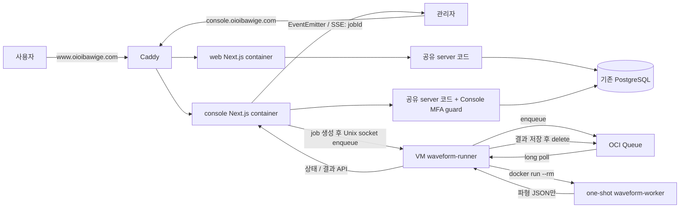

# Console·다중 응원법·파형 편집기 최소 설계

**전체 방향을 승인한 설계이며 P07은 스키마 재설계 중, P07~P10 구현은 미착수다.** P01~P06의 완료 결과와 미래 기능 제안을 구분한다.
현재·보류 상태는 [WORK](../../../WORK.md)가 소유한다. 아래 Queue/runner/job/editor와 CheerGuide 모델은 현행 구현 완료를 뜻하지 않는다.

초기 제안의 코드 근거는 [CURRENT-STATE](CURRENT-STATE.md), 파형 기술 근거는
[AUDIO-FEASIBILITY](AUDIO-FEASIBILITY.md), 구현 순서는 [ROADMAP](ROADMAP.md)이 소유한다.
이 개정은 `ef0ac77cd81cf7312df32139c44909fbf2166a09`의 runtime 실행·공용 설정·직렬 로드맵을 수정한다.
`8882b71c0bf6bfa71f3295d6b5f34de0b16d1dce` 이후 피드백으로 SSE 전달·Queue 인증 주체·active Job 중복 생성 규칙을 보완했다.
2026-10-11 개정은 `dfcf9182c42efa9ee48899c55495746797c2cb4f`의 enqueue/socket 응답 불확실성 처리를 보완했다.
2026-10-26 사용자 합의로 §5를 두 공연 모드·출처 분리·관리자 공동 편집·명시적 공개 구조로 재설계했다.
[이전 설계 고정본](https://github.com/goldmayo/oioi-bwg/blob/6411686ace378ef339aeafd1beea470860c86348/docs/migration/implementation/console-guide-editor/DESIGN.md#5-cheerguide)의 세 종류·공개 이력 보류 판단을 대체한다.
애플리케이션·DB·배포 코드는 이번 문서 변경에 포함하지 않는다.

## 1. 목표

운영 화면을 별도 Console로 옮기고, 같은 곡의 CONCERT/FESTIVAL 응원법을 선택하고 편집한다.
공식 여부는 공연 모드와 별개인 출처 속성으로 둔다. 기존 데이터는 운영자가 수동 분류한다.
Console에서 YouTube 링크를 입력하면 일회성 컨테이너가 파형 JSON을 생성하고, 편집기는 YouTube 재생과 JSON을 사용한다.
**서버의 음원 임시 처리는 허용하며 음원 영구 저장·공개·전달은 금지한다. 브라우저에서는 분석하지 않는다.**

기존 Service/Repository/CASL/Query/Ky/Zod, Auth.js/Argon2id, 가사 JSON, LRC·시간 캡처·Undo/Redo를 재사용한다.
세션 레지스트리·인증 grant·복구 UI·범용 Audit DB·미래 Event/variant 모델과 자동 정렬 연구는 이번 범위에서 뺀다.
필요한 도구의 기능을 직접 다시 구현하지 않는다.

## 2. 핵심 Architecture



공유 server는 두 Next 프로세스에서 실행하는 소스 패키지다. 별도 API 서버는 만들지 않는다.
RSC → Service와 Client → Query → Ky → Route → Service 흐름 및 기존 FSD 규칙을 유지한다.
각 앱은 자기 origin의 API를 호출하며 Console 세션을 web과 공유하지 않는다.
현재 배포의 digest·health·smoke·rollback 절차를 두 앱에 적용한다. release manifest framework는 추가하지 않는다.
GitHub Actions / OCI Run Command는 배포·운영 자동화에만 사용하고 runtime job을 실행하지 않는다.
DB runtime role 분리는 후속 hardening으로 남기고 기존 service 인가를 유지한다.

## 3. Monorepo 구조와 검증

P01~P04는 완료됐다. 현재 구조와 검사 책임은 [헌법](../../oioi-bwg-architecture-clean-v1/01-architecture-constitution.md)과
[검증 기준](../../oioi-bwg-architecture-clean-v1/10-testing-architecture.md), 실제 변경·실패는 [완료 지도](../COMPLETED-DESIGN-INDEX.md)가 소유한다.
초기 config/harness 배치와 명령을 미래 기능의 재작업 지시로 사용하지 않는다.

## 4. Console / Auth

P05 MFA와 P06 운영 전환은 [전체 결과](P06-RESULT.md)로 종료됐다. 현재 인증 계약은
[Auth](../../oioi-bwg-architecture-clean-v1/04-auth-authz-architecture.md), 등록·회수 절차는 [운영 안내](../../../../ops/oci/README.md)를 따른다.
원래 제안과 승인/검증은 완료 지도에서 추적한다. 계정 관리 G는 별도 미구현 제안이다.

## 5. CheerGuide

### 5.1. 범위와 책임

[Domain §8.0](../../DOMAIN_SPECIFICATION.md#80-p07-관리자-공동-편집과-공개)의 초기 계약을 구현할 **DDL 초안**이다.
아래 SQL은 Drizzle schema/migration에 아직 반영하지 않았으며 DB 적용·실행 검증 전이다.
기준 코드는 `6411686ace378ef339aeafd1beea470860c86348`의 UUIDv7 단일 PK와 `LyricsData` 배열이다.
독립 PK는 서버에서 UUIDv7을 생성하고 FK는 부모 UUID를 사용한다. 순서·충돌 버전은 정수다.

| 테이블 | 책임 |
| --- | --- |
| `cheer_guide` | 곡·공연 모드별 고정 identity, 공유 작업본과 현재 공개 조치의 포인터, 충돌 버전 |
| `cheer_guide_edit` | 명시적 초안 저장마다 추가하는 전체 내용 snapshot, 편집자·수정 이유·편집 계보 |
| `cheer_guide_publication` | 어떤 저장본을 누가 공개/공개 중단했는지 남기는 불변 기록 |

공유 작업본은 `head_edit_id` 하나다. 공개 후에도 유지하며 저장본 여러 개를 활성 Draft branch로 취급하지 않는다.
`edit`는 향후 제안·토론·승인 workflow의 Domain `Revision`과 구분한다. `APPROVED` 상태를 임의 부여하지 않는다.
실시간 동시 편집, 자동 병합, Contribution/Discussion/범용 Audit 플랫폼은 이 범위에 넣지 않는다.

### 5.2. 테이블·제약·인덱스

```sql
CREATE TABLE cheer_guide (
  id uuid PRIMARY KEY,
  song_id uuid NOT NULL REFERENCES song(id) ON DELETE RESTRICT,
  mode text NOT NULL CHECK (mode IN ('CONCERT', 'FESTIVAL')),
  head_edit_id uuid,
  current_publication_id uuid,
  lock_version integer NOT NULL DEFAULT 1 CHECK (lock_version > 0),
  created_at timestamptz(3) NOT NULL DEFAULT now(),
  updated_at timestamptz(3) NOT NULL DEFAULT now(),
  UNIQUE (song_id, mode)
);

CREATE TABLE cheer_guide_edit (
  id uuid PRIMARY KEY,
  cheer_guide_id uuid NOT NULL REFERENCES cheer_guide(id) ON DELETE RESTRICT,
  edit_no integer NOT NULL CHECK (edit_no > 0),
  parent_edit_id uuid,
  derived_from_edit_id uuid REFERENCES cheer_guide_edit(id) ON DELETE RESTRICT,
  lyrics jsonb NOT NULL CHECK (jsonb_typeof(lyrics) = 'array'),
  description text,
  source_type text CHECK (source_type IN ('OFFICIAL', 'FAN')),
  source_url text,
  guide_video_url text,
  edited_by_account_id uuid NOT NULL REFERENCES account(id) ON DELETE RESTRICT,
  change_summary text NOT NULL CHECK (length(btrim(change_summary)) > 0),
  created_at timestamptz(3) NOT NULL DEFAULT now(),
  UNIQUE (cheer_guide_id, edit_no),
  UNIQUE (cheer_guide_id, id),
  FOREIGN KEY (cheer_guide_id, parent_edit_id)
    REFERENCES cheer_guide_edit(cheer_guide_id, id) ON DELETE RESTRICT,
  CHECK (parent_edit_id IS NULL OR parent_edit_id <> id),
  CHECK (derived_from_edit_id IS NULL OR derived_from_edit_id <> id)
);

CREATE TABLE cheer_guide_publication (
  id uuid PRIMARY KEY,
  cheer_guide_id uuid NOT NULL REFERENCES cheer_guide(id) ON DELETE RESTRICT,
  publication_no integer NOT NULL CHECK (publication_no > 0),
  action text NOT NULL CHECK (action IN ('PUBLISH', 'UNPUBLISH')),
  edit_id uuid NOT NULL,
  actor_account_id uuid NOT NULL REFERENCES account(id) ON DELETE RESTRICT,
  reason text NOT NULL CHECK (length(btrim(reason)) > 0),
  created_at timestamptz(3) NOT NULL DEFAULT now(),
  UNIQUE (cheer_guide_id, publication_no),
  UNIQUE (cheer_guide_id, id),
  FOREIGN KEY (cheer_guide_id, edit_id)
    REFERENCES cheer_guide_edit(cheer_guide_id, id) ON DELETE RESTRICT
);

ALTER TABLE cheer_guide ADD CONSTRAINT cheer_guide_head_edit_fkey
  FOREIGN KEY (id, head_edit_id)
  REFERENCES cheer_guide_edit(cheer_guide_id, id) ON DELETE RESTRICT;
ALTER TABLE cheer_guide ADD CONSTRAINT cheer_guide_current_publication_fkey
  FOREIGN KEY (id, current_publication_id)
  REFERENCES cheer_guide_publication(cheer_guide_id, id) ON DELETE RESTRICT;

CREATE INDEX cheer_guide_edit_parent_idx
  ON cheer_guide_edit (cheer_guide_id, parent_edit_id);
CREATE INDEX cheer_guide_edit_derived_idx
  ON cheer_guide_edit (derived_from_edit_id);
CREATE INDEX cheer_guide_edit_editor_idx
  ON cheer_guide_edit (edited_by_account_id);
CREATE INDEX cheer_guide_publication_edit_idx
  ON cheer_guide_publication (cheer_guide_id, edit_id);
CREATE INDEX cheer_guide_publication_actor_idx
  ON cheer_guide_publication (actor_account_id);

CREATE FUNCTION reject_cheer_guide_history_mutation() RETURNS trigger
LANGUAGE plpgsql AS $$
BEGIN
  RAISE EXCEPTION 'cheer guide history is immutable' USING ERRCODE = '55000';
END;
$$;
CREATE TRIGGER cheer_guide_edit_immutable
  BEFORE UPDATE OR DELETE OR TRUNCATE ON cheer_guide_edit
  FOR EACH STATEMENT EXECUTE FUNCTION reject_cheer_guide_history_mutation();
CREATE TRIGGER cheer_guide_publication_immutable
  BEFORE UPDATE OR DELETE OR TRUNCATE ON cheer_guide_publication
  FOR EACH STATEMENT EXECUTE FUNCTION reject_cheer_guide_history_mutation();
```

`UNIQUE(song_id, mode)`가 Song별 최대 두 개를 보장한다. 복합 FK는 작업본·공개 기록·부모 저장본의
다른 guide 참조를 막는다. `derived_from_edit_id`만 다른 guide의 저장본 복사를 허용한다.
해당 출처는 복사/복원 추적용이며 이후 원본 수정과 동기화하지 않는다.
`edit_no`와 `publication_no`는 guide 안에서 각각 증가한다. 후자는 공개 중단도 포함하는 조치 순서다.
포인터가 참조하는 현재 번호에서 다음 번호를 할당하고 UNIQUE로 중복을 방어한다. UUID 정렬을 업무 순서로 쓰지 않는다.
UNIQUE 인덱스는 guide별 저장/공개 이력의 역순 조회에도 사용한다. `id`로 시작하는 포인터 FK에 중복 인덱스를 만들지 않는다.

`edit`·`publication`의 UPDATE/DELETE/TRUNCATE는 위 [statement trigger](https://www.postgresql.org/docs/17/sql-createtrigger.html)로 거부한다.
Drizzle 구현 시 custom migration으로 함께 반영한다.
포인터는 정상 조치로만 갱신하고 이전 포인터로 되감는 API를 만들지 않는다.
DB owner의 trigger 해제·직접 SQL 우회까지 막는 역할 분리는 기존 DB role hardening 후속이다.
FK는 이력을 가진 guide 및 부모 Song/Album의 연쇄 삭제를 막는다. 해당 삭제 요청은 서비스에서 거절하고 숨김/공개 중단을 사용한다.
Account 탈퇴는 기존 tombstone 정책을 따라 편집·공개 주체 FK를 보존한다.

### 5.3. 저장·공개·복원

| 조치 | 원자적으로 남길 내용 |
| --- | --- |
| 생성 | guide + 첫 edit + head 연결. 새 guide를 공개로 취급하지 않음 |
| 초안 저장 | 현재 head를 parent로 새 edit 추가 + head 전진. 공개 포인터 유지 |
| 공개하기 | 미리 본 현재 head를 가리키는 PUBLISH 기록 추가 + 공개 포인터 갱신 |
| 공개 중단 | 직전 공개 edit를 가리키는 UNPUBLISH 기록 추가 + 공개 포인터 갱신. head 유지 |
| 과거 내용 복원 | 현재 head를 parent, 선택한 과거 edit를 derived_from으로 새 edit 생성. 별도로 공개 |
| 다른 응원법 복사 | 원본 edit를 derived_from으로 대상 guide에 새 edit 생성. 원본과 독립 편집 |

수정 요약·공개 사유는 최초 생성/복사/가져오기에도 남긴다. 브라우저 입력 중인 RHF draft는 DB 저장 이력과 구분한다.
초안은 `source_type = null`, 빈 가사, 공식 원본 링크 미입력 상태를 허용한다.
공개 service는 저장된 head의 가사 계약·비어 있지 않은 내용·출처 선택을 검증하고, OFFICIAL이면 원본 URL을 필수로 요구한다.
FAN은 화면에서 **팬 응원법**으로 표시하며 원본 URL은 선택이다. 영상이 없다는 이유로 공개를 막지 않는다.
`guide_video_url`은 **응원법 영상 보기**, `source_url`은 **원본 보기**이며 곡 재생용 `song.youtube_id`와 구분한다.
URL 형식·허용 scheme과 가사 내부 구조는 Zod/서비스가 검증한다. 교차 테이블 공개 조건을 CHECK로 보장한다고 주장하지 않는다.
`description`은 선택적인 곡별 한국어 설명이다. 고정 모드 설명·버튼·안내문은 DB에 저장하지 않는다.

현재 공개 조치가 PUBLISH인 guide만 `publication → edit`로 조회하고 Song/Album visibility를 함께 적용한다.
공개 조회는 한 SQL snapshot에서 포인터·내용·공개 상태를 결합한다. head의 미공개 출처/설명을 공개 DTO에 섞지 않는다.
공개 중단은 현재 조치가 PUBLISH일 때만 허용하고 그 edit_id를 기록한다. 재공개도 새 PUBLISH 기록을 추가한다.
UNPUBLISH의 edit_id는 중단한 저장본 추적용이다. 공개 DTO의 공식 표시는 선택한 공개 edit의 source_type에서 구하며 legacy flag를 섞지 않는다.

### 5.4. 여러 관리자의 쓰기 충돌과 트랜잭션

ADMIN/MFA 인가 후 service가 짧은 transaction을 소유하고 repository에 동일 `tx`를 전달한다.
생성 이후 저장·공개·공개 중단·복원은 **모두 같은 guide 행**에서 아래 조건부 UPDATE를 먼저 수행한다.

```sql
UPDATE cheer_guide
SET lock_version = lock_version + 1, updated_at = now()
WHERE id = $1 AND lock_version = $2
RETURNING head_edit_id, current_publication_id, lock_version;
```

`$2`는 편집 시작/미리보기 시 받은 버전이다. UPDATE의 행 잠금은 commit/rollback까지 유지된다.
존재하는 guide에서 0행이면 충돌로 rollback하고 service AppError를 HTTP boundary에서 409로 변환한다.
존재하지 않는 ID는 not-found 오류로 구분한다. 입력 중 draft는 보존한다.
반환된 포인터로 저장본을 읽고 검증한 뒤 새 이력 INSERT와 포인터 갱신을 같은 transaction에서 끝낸다.
공개는 `expectedHeadEditId`도 비교해 미리 본 저장본만 공개한다. 원격 변경을 최신 version으로 자동 재시도하지 않는다.

READ COMMITTED에서 경쟁 UPDATE가 대기 후 조건을 다시 확인하므로 같은 버전의 두 쓰기는 하나만 성공한다.
이 규칙이 guide 단위 쓰기를 직렬화하며 모든 업무를 SERIALIZABLE로 올리지는 않는다.
행이 없는 최초 생성은 UNIQUE(song_id, mode)로 경합을 막고, repository가 알려진 중복 제약을 의미 오류로 변환한다.
다중 guide 조치는 UUID 오름차순으로 잠근다. 사용자 편집 시간·영상 조회·외부 I/O 동안 DB 잠금을 유지하지 않는다.
lock/statement timeout을 설정하고 실패한 조치는 전체 rollback한다. commit 후 Query invalidate하며 응답 유실 시 먼저 현재 상태를 재조회한다.
동시성 근거: [PostgreSQL 17 Read Committed](https://www.postgresql.org/docs/17/transaction-iso.html#XACT-READ-COMMITTED),
[행 잠금](https://www.postgresql.org/docs/17/explicit-locking.html#LOCKING-ROWS),
[제약](https://www.postgresql.org/docs/17/ddl-constraints.html).

### 5.5. 기존 데이터와 화면 전환

`LyricsData`의 startTime·segments·isCheer/isEcho/isExtra·startTimeOffset과 초 단위를 보존한다.
Cue/Variant/Event 테이블과 영구 가사 행 ID를 선생성하지 않는다. 편집기 ms는 저장 경계에서 초로 변환한다.
모든 guide는 같은 `song.youtube_id`를 사용하고 BPM/beatOffset은 P10의 Song 편집 설정으로 둔다.

운영자가 모드·출처를 수동 매핑한다. `has_official_cheer = false/null`을 특정 모드/출처로 자동 변환하지 않는다.
Song.lyrics와 기존 flag는 전환 기간 보존한다. 첫 guide 생성 시 기존 쓰기와 같은 Song 잠금 아래 원본을 복사하고 legacy writer를 차단한다.
첫 공개 전까지 legacy reader를 유지하고, 해당 곡에 공개 이력이 생기면 guide reader로 영구 전환한다.
공개 중단으로 guide가 0개가 되어도 legacy 응원법을 다시 노출하지 않는다. 이력은 삭제하지 않으므로 전환 판정도 유지된다.
LRC create/update·lyrics 저장·Song/Album 삭제를 함께 점검하고 shadow 비교로 내용 보존을 확인한다.
기존 writer의 모든 진입점도 Song 잠금과 guide 존재 검사를 적용한다. Song과 guide를 함께 잠글 때는 Song → guide 순서를 지킨다.
rollback은 새 guide를 읽는 호환 앱으로 하며 원본의 파괴적 정리는 후속으로 둔다.

공개 항목 기본 선택은 CONCERT → FESTIVAL이다. 하나면 selector를 숨기고 두 개면 segmented control을 쓴다.
`nuqs`의 `?guide=<id>`를 유지하며 잘못된/다른 곡/미공개 ID는 기본 항목으로 정규화한다.
전환 중 player를 유지하고 가사만 바꾼다. Query cache는 공개 DTO를 사용하며 다른 origin의 갱신은 refetch로 확인한다.

### 5.6. P10 이후 i18n과 이후 협업 기능

UI 메뉴·버튼·안내·고정 모드 설명은 message resource, 곡별 `description`은 콘텐츠 번역으로 분리한다.
가사 의미 번역과 가사/응원법 독음은 범위 밖이다. 현재 JSON에 독음을 위한 행 ID를 추가하지 않는다.
영어·일본어와 대만/홍콩 독자를 고려하되 번체 공통/지역별·광둥어 문어 범위와 fallback은 후속 리서치로 확정한다.
`description_en/ja` 열이나 locale DB enum을 미리 만들지 않는다. 후속 번역은 원문 `edit_id + locale`별로 연결해
새 원문의 설명에 이전 번역이 잘못 붙지 않게 설계한다. 이번에는 번역 테이블을 생성하지 않는다.
이는 [i18n architecture](../../oioi-bwg-architecture-clean-v1/11-content-i18n-assets-runtime-architecture.md)의 UI/콘텐츠 분리를 따른다.
향후 검토 workflow는 저장본을 참조하는 별도 작업 단위로 추가한다. 상세 diff·최근 변경 목록·토론·검토 승인은 별도 기능이다.

## 6. Waveform Worker

```text
POST /api/admin/waveform-jobs
  → MFA/ADMIN + 입력 검증 → active Job 재사용 또는 PostgreSQL Job(QUEUED) 생성
  → 새 Job만 Unix socket → VM runner → OCI Queue enqueue
  → 202 Accepted { jobId }

OCI Queue → VM runner long poll → Job(RUNNING)
  → docker run --rm → yt-dlp → ffmpeg pipe → audiowaveform → JSON
  → JSON 검증 → 결과와 Job(SUCCEEDED) 저장 → message delete
```

| 요소              | 책임                                                                               |
| ----------------- | ---------------------------------------------------------------------------------- |
| PostgreSQL        | WaveformJob 상태와 Waveform JSON 결과의 SSOT                                       |
| OCI Queue         | 전달·재전달/retry·visibility timeout·delivery count·DLQ                            |
| waveform-runner   | 제한된 enqueue 호출·Queue consume → job 검증 → 고정 container → 결과 반영 → delete |
| waveform-worker   | audio → JSON만. HTTP 서버·DB 쓰기·job 관리 없음                                    |
| SSE               | 열린 Console에 상태 변경만 알림. 데이터 조회는 Query/API                           |
| OCI Notifications | 선택적 운영 장애 알림만. job 성공 여부와 결합하지 않음                             |

**동일 `(songId, videoId)`의 active Job(`QUEUED | RUNNING`)은 최대 한 개다.**
연속 클릭·응답 유실 후 재요청·동시 POST에 기존 active Job이 있으면 `202 { jobId }`로 그 Job을 반환하고
새 Job/message는 만들지 않는다. 새 Job 생성 경로만 enqueue 확인 뒤 202를 반환한다.
이는 active 작업 재사용 규칙이며 terminal(`SUCCEEDED | FAILED`) 이후의 새 요청은 재생성으로 처리한다.
UI의 버튼 비활성화에만 의존하지 않고 DB에서 조회/생성을 원자적으로 보장한다.
partial unique index 또는 기존 Song 행 잠금 등 구체적인 DB 수단은 P08에서 선택하고 동시 요청으로 검증한다.

**OCI Queue 호출은 VM-local Runner 하나가 push + pull을 모두 소유한다.**
Console은 Job을 저장한 뒤 제한된 Unix socket enqueue 호출만 한다. socket은 Console에만 연결하고
소유자/그룹 권한으로 접근을 제한하며 Caddy/public TCP endpoint로 공개하지 않는다.
Runner는 고정 Queue에 세 식별자만 enqueue하고 성공 확인을 내부 Job API에 기록한 뒤 socket 응답을 반환한다. 분석 완료를 기다리지 않는다.
SDK의 long poll 대기 중에도 enqueue 호출을 받을 수 있지만 분석 worker 동시 실행은 한 개를 유지한다.

Runner의 OCI SDK는 [Compute Instance Principal](https://docs.oracle.com/en-us/iaas/Content/Identity/Tasks/callingservicesfrominstances.htm)로 인증한다.
해당 VM을 dynamic group에 포함하고 [Queue IAM](https://docs.oracle.com/en-us/iaas/Content/queue/policy-reference.htm)의
`use queue-push`(PutMessages)와 `use queue-pull`(GetMessages/UpdateMessage/DeleteMessage)을 waveform Queue/DLQ 처리 범위로 제한한다.
Queue OCID/message endpoint는 배포 설정으로 고정하며 runtime에 Queue 생성·삭제·변경 권한을 주지 않는다.
Console은 OCI SDK/credential을 사용하지 않고 Runner가 내부 결과 API에 쓰는 service token과 OCI 인증은 별개다.
**IAM 주체는 container/process가 아니라 VM이며 이 VM을 OCI trust boundary로 본다.**
Runner로 호출을 모아도 IAM 차원의 process별 권한 분리가 생기지는 않는다. Console/Web/worker의
metadata 접근을 차단하고 host root 권한은 이 경계 안에 둔다. Console MFA secret의 VM 읽기
권한을 추가하는 **P06에서 Web/Console metadata 차단을 실제 VM에서 확인한다.** env 분리만으로
접근 격리를 주장하지 않는다. [P06 계획 §4.1~4.2](https://github.com/goldmayo/oioi-bwg/blob/e93ae610169e4ce0e9b7f1a75a9a02cbf179d46f/docs/migration/implementation/console-guide-editor/P06-PLAN.md#41-p06-b0-arm64-빌드-전-iam-준비실증)의
선행 차단·host 양성 대조·재시작/복구 검증을 따른다. P08은 Runner/worker·Queue IAM·Unix socket을
추가 검증하고 기존 Web/Console 차단도 재검증한다.

Queue payload는 `{ jobId, songId, videoId }`만 받는다. image/command/argument/volume/env를 받지 않는다.
Runner는 message의 songId/videoId를 DB job과 대조한 뒤 실행한다.
Runner는 기존 OCI SDK의 [long polling/visibility 연장](https://docs.oracle.com/en-us/iaas/Content/queue/consume-messages.htm)을 사용한다.
VM-local 프로세스 하나가 한 건씩 수신하고 worker 하나만 실행한다. 다음 요청은 Queue에 대기하며 scheduler/Redis/분산 잠금은 추가하지 않는다.
runner는 분석하지 않으며 image·argument·자원 한도는 배포된 고정 설정에서 결정한다.

```text
WaveformJob
  id, songId, videoId, status: QUEUED | RUNNING | SUCCEEDED | FAILED
  errorCode nullable, createdAt, startedAt nullable, finishedAt nullable
  enqueuedAt nullable        Runner의 PutMessages 성공 확인 시각, null은 성공 미확인
  attemptId nullable         재전달 시 오래된 실행 결과를 거절하는 식별자

Waveform                    job lifecycle과 분리한 song/source별 정상 JSON
```

Runner는 위 Queue push/pull 권한과 좁은 내부 job API의 service token만 사용한다. worker에는 videoId·자원 한도·outbound network만 제공한다.
worker에 DATABASE_URL/AUTH_SECRET/R2/OCI credential을 주지 않고 VM metadata·DB·내부 API 접근도 막는다.
Console의 내부 API → 기존 Service/Repository가 상태·결과를 저장하고 Runner/worker에 DB 연결을 주지 않는다.
token은 Runner의 보호된 환경에 보관하며 Queue·command·로그에 넣지 않는다.

jobId로 중복 반영을 막는다. 이미 SUCCEEDED인 message는 재분석하지 않고 delete하며 FAILED도 terminal로 취급한다.
실행 중에는 visibility를 연장하고, 만료/Runner 종료 후 재전달 시 기존 RUNNING 작업의 잔존 container를 정리한 뒤 다시 처리한다.
visibility 소유권을 잃으면 기존 실행을 중단한다. 현재 처리 시도·source에 맞는 결과만 조건부 반영한다.
**결과 저장과 SUCCEEDED 갱신을 같은 transaction으로 끝낸 뒤** delete한다. delete 실패는 DB 성공을 되돌리지 않는다.
일시 실패는 message를 지우지 않고 Queue 재전달에 맡긴다. 반복 실패는 [DLQ](https://docs.oracle.com/en-us/iaas/Content/queue/deadletterqueues.htm)로 보내지며
Runner가 DLQ의 미완료 job을 FAILED로 반영한 뒤 해당 message를 정리한다. DB에 retry queue를 구현하지 않는다.
DB Job 생성과 enqueue는 원자적이지 않으며 **socket error는 Queue enqueue 실패의 증거가 아니다.**
`QUEUED`는 전달 성공 또는 전달 결과 확인 중인 Job을 포함한다. 상태는 `QUEUED/RUNNING/SUCCEEDED/FAILED`를 유지한다.

| enqueue 결과 | 처리                                                                                                              |
| ------------ | ----------------------------------------------------------------------------------------------------------------- |
| 명확한 실패  | Runner의 호출 실패와 message 미생성이 확정된 경우만 FAILED로 전환할 수 있다. 이미 진행된 상태는 역전하지 않는다.  |
| 성공         | Runner가 PutMessages 성공 확인 → Console 내부 Job API로 enqueuedAt 기록 → socket 성공 응답 → 202 반환.            |
| 불확실       | socket/PutMessages 응답 유실 등으로 전달 여부를 확정할 수 없으면 QUEUED를 유지하고 즉시 FAILED로 전환하지 않는다. |

`enqueuedAt`은 Console의 socket 응답 수신 시각이 아니라 Runner의 PutMessages 성공 확인 기록이다.
PutMessages 성공 뒤 내부 API 기록 실패/응답 유실도 Queue 실패로 간주하지 않는다. `enqueuedAt = null`만으로 message가 없다고 판단하지 않는다.
Runner consume은 enqueuedAt이 null이어도 기존 Job을 RUNNING → SUCCEEDED로 처리할 수 있다.
결과 불확실로 Console이 즉시 재enqueue하지 않으며 재요청은 기존 active Job의 jobId를 반환한다.

Runner의 작은 stale-job 점검은 `status = QUEUED AND enqueuedAt IS NULL`인 Job에 대해 message가 더 이상
정상 전달될 수 없다고 간주할 수 있는 **충분히 보수적인 전달 종료 기한 이후에만** 조건부로 FAILED를 반영한다.
기한은 가장 늦은 enqueue 가능 시점부터 실제 [Queue 최대 message retention](https://docs.oracle.com/en-us/iaas/Content/queue/overview.htm)과
충분한 시계/관측 지연 여유를 포함해 P08에서 정한다. socket/visibility timeout이나 임의의 짧은 timeout을 기준으로 삼지 않는다.
그 이전에는 enqueue 여부 불확실성만으로 FAILED 처리하지 않는다. 이미 전달 확인/진행된 상태는 역전하지 않고 정상 Queue 대기 및 기존 retention 점검은 유지한다.
Console의 주기적 Queue 조회/재enqueue, DB retry queue, Outbox framework, 별도 retry scheduler·분산 transaction·범용 reconciliation은 만들지 않는다.
중복 전달·늦은 응답·timeout 경계는 P08에서 검증한다.

Worker는 `--rm --read-only --tmpfs /tmp`, CPU/memory/pids limit, cap-drop, no-new-privileges, restart 없음으로 실행한다.
pipe가 기본이고 필요 파일/cache만 tmpfs에 둔다. swap/core dump를 막고 성공·실패·timeout 모두 container와 하위 프로세스를 제거한다.
음원/PCM은 host filesystem/volume·Docker volume·PostgreSQL·R2/S3·로그·Sentry에 남기지 않는다.
재생성 실패는 직전 정상 JSON을 지우지 않으며 Waveform을 갱신해도 Cue 시각은 자동 변경하지 않는다.
JSON 형식·도구 선택·삭제 검증은 [파형 기술 검토](AUDIO-FEASIBILITY.md)를 따른다.

열린 Console은 `GET /api/admin/waveform-jobs/{jobId}/events`에 native EventSource로 연결한다(endpoint는 구현 시 고정).
`event: waveform-job-updated`, `data: {"jobId":"..."}`만 보내고 Waveform JSON 전체를 전송하지 않는다.
브라우저는 이벤트 수신 → 관련 Query invalidate → Job/Waveform refetch한다. 연결·재연결·focus 때도 현재 DB 상태를 확인한다.
초기 Console은 단일 container·단일 Node process로 운영한다. 상태/결과 Service가 DB commit을 끝낸 뒤 Console 서버 adapter에서
process-local [Node EventEmitter](https://nodejs.org/api/events.html#class-eventemitter)로 jobId를 emit하고 SSE에 전달한다.
결과 API와 SSE route가 같은 process의 EventEmitter 한 개를 공유한다. 범용 event bus나 별도 알림 저장소는 만들지 않는다.
EventEmitter/SSE는 영속 event log가 아니며 알림 실패로 commit된 성공을 되돌리거나 결과 API/Queue 처리를 실패시키지 않는다.
PostgreSQL LISTEN/NOTIFY는 지금 도입하지 않는다. Console process/container가 두 개 이상이 될 때 process 간 전달 수단으로 검토한다.
SSE는 MFA/ADMIN guard·job 검증을 거치고, 만료/회수·연결 종료 시 stream/listener를 정리한다. heartbeat와 Caddy 경유 전달을 확인한다.
FCM/Web Push는 닫힌 탭·서비스 전체 push 요구가 생길 때 후속으로 검토한다. OCI Notifications는 DLQ/Runner 장애 등 운영 알림 후보만 둔다.
Queue abstraction·Notification framework·Worker platform은 추가하지 않는다.

## 7. Audio Editor

```text
기존 YouTube / 가사 표 / LRC / 시간 캡처 / Undo·Redo
+ Peaks.js overview·zoom waveform·timeline·playhead·Cue point drag
+ BPM / 첫 박(beatOffset) / grid / Snap ON·OFF
+ Nudge / Fine Nudge / Cue 주변 Loop / A-B Loop
```

파형·zoom·point drag는 Peaks.js를 사용하고 현재 YouTubePlayer를 작은 custom player adapter로 연결한다.
별도 waveform Canvas 엔진이나 DAW를 만들지 않는다. 기존 가사 행은 point marker이며 UI 폭을 실제 종료 시각으로 저장하지 않는다.
Grid는 기존 point marker/시간축에 붙이는 기능이며 자동 BPM/onset은 필수가 아니다.
예를 들어 120 BPM에서 1/16 grid는 125ms다. 관리자가 첫 박을 지정하고 Snap을 켜야 이동에 적용된다.
Grid 변경은 기존 Cue를 움직이지 않는다. fine nudge는 Snap을 우회하며 Loop는 YouTube seek 지연을 허용한다.

server DTO는 Query, 편집 draft는 RHF, 선택/zoom/loop/drag preview는 local state/ref로 둔다.
기존 50개 Undo/Redo를 재사용하고 drag 종료 한 번을 변경 한 번으로 처리한다. Esc/취소는 원래 위치로 복원한다.
저장은 명시적으로 수행하며 충돌·만료·네트워크 실패에도 draft를 보존한다.
입력란·IME·dialog에서 전역 단축키를 막고 기존 Q/W/E/R·텍스트/강조 편집을 보존한다.
파형 실패 중에도 기존 가사 표와 시간 캡처를 사용할 수 있다. editor 라이브러리는 Console에서만 로드한다.

## 8. 주요 Trade-off

| 선택                                       | 남는 한계 / 확인 사항                                                                                             |
| ------------------------------------------ | ----------------------------------------------------------------------------------------------------------------- |
| OCI Queue + 작은 VM runner + 일회성 worker | Queue의 전달/재시도 기능을 사용하고 동시 분석은 하나로 제한한다. 같은 host의 자원 경쟁과 전달/DB 경계를 검증한다. |
| YouTube → 파형 JSON                        | iframe은 PCM을 제공하지 않는다. yt-dlp 성공·동일 영상의 시간축·이용 허용을 실제 입력으로 확인한다.                |
| 단일 프로세스 limiter와 MFA version        | 재시작 시 limiter 상태는 사라지고 세션별 회수는 없다. 복제 운영 시에만 분산 저장을 재검토한다.                    |
| 모드별 한 guide + 불변 저장본/공개 기록    | 저장마다 전체 JSON을 보존하므로 저장량이 늘어난다. diff 저장·실시간 병합·공연별 다수 variant는 후속이다.          |
| 공유 DB·별도 앱                            | 같은 host/DB까지 격리되지는 않는다. pool 합계와 한쪽 rollback을 검증하고 DB role 세분화는 후속으로 둔다.          |

상위 기준은 [헌법](../../oioi-bwg-architecture-clean-v1/01-architecture-constitution.md),
[Auth](../../oioi-bwg-architecture-clean-v1/04-auth-authz-architecture.md), [Deployment](../../oioi-bwg-architecture-clean-v1/12-deployment-migration-runbook.md),
[Domain](../../DOMAIN_SPECIFICATION.md)이다. 앱 분리·MFA claims/회수·공연 모드·출처/Revision 단계·YouTube 임시 분석·실제 CD 경로의
변경은 해당 구현 PR에서 관련 active 문서와 같은 단위로 반영한다. Queue/runner/job/SSE의 lifecycle도 해당 문서에 반영하며 이 계획이 상위 문서를 자동 대체하지 않는다.
