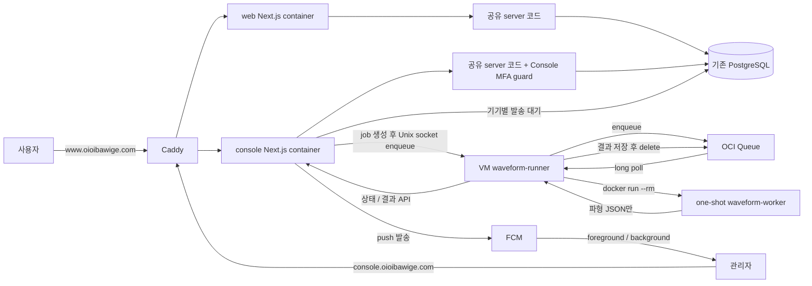

# Console·다중 응원법·파형 편집기 최소 설계

**P07 데이터 기반을 구현했으며 이관·조회 전환과 P08~P10은 미착수다.** P01~P06의 완료 결과와 미래 기능 제안을 구분한다.
현재·보류 상태는 [WORK](../../../WORK.md)가 소유한다. 아래 Queue/runner/job/editor와 CheerGuide 모델은 현행 구현 완료를 뜻하지 않는다.

초기 제안의 코드 근거는 [CURRENT-STATE](CURRENT-STATE.md), 파형 기술 근거는
[AUDIO-FEASIBILITY](AUDIO-FEASIBILITY.md), 구현 순서는 [ROADMAP](ROADMAP.md)이 소유한다.
이 개정은 `ef0ac77cd81cf7312df32139c44909fbf2166a09`의 runtime 실행·공용 설정·직렬 로드맵을 수정한다.
`8882b71c0bf6bfa71f3295d6b5f34de0b16d1dce` 이후 피드백으로 SSE 전달·Queue 인증 주체·active Job 중복 생성 규칙을 보완했다.
2026-10-11 개정은 `dfcf9182c42efa9ee48899c55495746797c2cb4f`의 enqueue/socket 응답 불확실성 처리를 보완했다.
2026-10-26 사용자 지시로 P07을 두 공연 모드·공식/팬덤 출처·데이터/조회로 제한하고 관리자 편집은 후속으로 분리했다.
[원래 §5](https://github.com/goldmayo/oioi-bwg/blob/bb3396b21ed2b5399aebb78e236764e56ee92e72/docs/migration/implementation/console-guide-editor/DESIGN.md#5-cheerguide)의 세 종류 분류와
[이전 제안 #268](https://github.com/goldmayo/oioi-bwg/pull/268)의 새 관리자 초안/공개 기능 포함 범위를 대체한다.
설계 초안 작성 시점([80916d4](https://github.com/goldmayo/oioi-bwg/commit/80916d48fd15529f83f1c6e66fad1af7f6fcac91))에는 애플리케이션·DB·배포 코드를 포함하지 않았다.
이후 사용자 구현 지시로 첫 단위인 데이터 기반을 추가한다. 변경·검증 결과는 [구현 PR #272](https://github.com/goldmayo/oioi-bwg/pull/272)가 소유한다.

## 1. 목표

같은 곡의 CONCERT/FESTIVAL 응원법을 조회·선택하고 출처를 공식/팬덤으로 표시한다.
공식 여부는 공연 모드와 별개다. 기존 데이터는 운영자가 수동 분류하며 새 관리자 편집 기능은 P07 이후에 다룬다.
Console에서 YouTube 링크를 입력하면 일회성 컨테이너가 파형 JSON을 생성하고, 편집기는 YouTube 재생과 JSON을 사용한다.
**서버의 음원 임시 처리는 허용하며 음원 영구 저장·공개·전달은 금지한다. 브라우저에서는 분석하지 않는다.**

기존 Service/Repository/CASL/Query/Ky/Zod, Auth.js/Argon2id, 가사 JSON, LRC·시간 캡처·Undo/Redo를 재사용한다.
세션 레지스트리·인증 grant·복구 UI·범용 Audit DB·미래 Event/variant 모델과 자동 정렬 연구는 이번 범위에서 뺀다.
필요한 도구의 기능을 직접 다시 구현하지 않는다.

## 2. 핵심 Architecture



공유 server는 두 Next 프로세스에서 실행하는 소스 패키지다. 별도 API 서버는 만들지 않는다.
RSC → Service와 Client → Query → Ky → Route → Service 흐름 및 기존 FSD 규칙을 유지한다.
각 앱은 자기 origin의 API를 호출하며 Console 세션을 web과 공유하지 않는다.
현재 배포의 digest·health·smoke·rollback 절차를 두 앱에 적용한다. release manifest framework는 추가하지 않는다.
GitHub Actions / OCI Run Command는 배포·운영 자동화에만 사용하고 runtime job을 실행하지 않는다.
DB runtime role 분리는 후속 hardening으로 남기고 기존 service 인가를 유지한다.

## 3. Monorepo 구조와 검증

P01~P04는 완료됐다. 현재 구조와 검사 책임은 [헌법](../../oioi-bwg-architecture-clean-v1/01-architecture-constitution.md)과
[검증 기준](../../oioi-bwg-architecture-clean-v1/10-testing-architecture.md), 실제 변경·실패는 [완료 지도](../COMPLETED-DESIGN-INDEX.md)가 소유한다.
초기 config/harness 배치와 명령을 미래 기능의 재작업 지시로 사용하지 않는다.

## 4. Console / Auth

P05 MFA와 P06 운영 전환은 [전체 결과](P06-RESULT.md)로 종료됐다. 현재 인증 계약은
[Auth](../../oioi-bwg-architecture-clean-v1/04-auth-authz-architecture.md), 등록·회수 절차는 [운영 안내](../../../../ops/oci/README.md)를 따른다.
원래 제안과 승인/검증은 완료 지도에서 추적한다. 계정 관리 G는 별도 미구현 제안이다.

## 5. CheerGuide

### 5.1. P07 범위와 기준

[Domain §8.0](../../DOMAIN_SPECIFICATION.md#80-p07-데이터와-공개-조회)의 단계 계약을 따르는 **스키마·구현 계획**이다.
기준은 fetch한 `origin/migration_main@bb3396b21ed2b5399aebb78e236764e56ee92e72`다.
아래 DDL은 설계 기준이다. 실제 테이블은 `packages/server/src/db/schema.ts`, 적용 SQL은 `drizzle/0007_p07_cheer_guide_foundation.sql`이 소유하며 이관·앱 전환과 구분한다.
DB 이름은 [ADR 0009](../../../adr/0009-uuid-domain-identity.md)의 단수 snake_case, 독립 PK는 서버 생성 UUIDv7이다.

| P07에 포함 | P07 이후 |
| --- | --- |
| 두 모드의 데이터·출처·불변 공개 내용·조회/선택·수동 이관 | 새 관리자 편집 UI/API, 초안 저장·미리보기·공개/중단·복원 UI |
| 기존 저장 경로의 최소 호환·원자성·버전 검사 | Contribution/Discussion·REVIEWER·승인 workflow·편집 예약/실시간 병합 |
| 기존 가사 JSON·재생·slug·Song/Album visibility 보존 | 전체 정비 현황판·팬 숙지/참여 응답·정규화 Cue/variant |

기존 Console 편집기는 유지한다. 호환 쓰기는 기존 동작을 보존하기 위한 데이터 어댑터이며 새로운 편집 기능이 아니다.
초안/공개 분리 UX는 후속이므로 기존 편집기의 즉시 반영 동작을 새 초안 저장이라고 안내하지 않는다.

### 5.2. 테이블 초안

| 테이블 | 현재 필요한 책임 |
| --- | --- |
| `cheer_guide` | Song·공연 모드 identity, 현재 공개 조치, 충돌 버전, 기존 writer의 연결 대상 |
| `cheer_guide_snapshot` | 이관 또는 호환 저장 시 전체 내용·출처·타이밍 기준 영상을 불변 보존 |
| `cheer_guide_publication` | 공개할 snapshot과 공개/중단 조치·행위자를 기록 |

snapshot은 미래 Domain Revision의 DRAFT/UNDER_REVIEW/APPROVED 상태와 별개다. P07에 활성 작업본 포인터를 만들지 않는다.
공개 기록은 첫 이관·기존 즉시 반영 경로에서 소비한다. 과거 내용 보호를 위해 현재 내용 한 행을 계속 덮어쓰지 않는다.

```sql
CREATE TABLE cheer_guide (
  id uuid PRIMARY KEY,
  song_id uuid NOT NULL REFERENCES song(id) ON DELETE RESTRICT,
  mode text NOT NULL CHECK (mode IN ('CONCERT', 'FESTIVAL')),
  legacy_write_target boolean NOT NULL DEFAULT false,
  current_publication_id uuid,
  lock_version integer NOT NULL DEFAULT 1 CHECK (lock_version > 0),
  created_at timestamptz(3) NOT NULL DEFAULT now(),
  updated_at timestamptz(3) NOT NULL DEFAULT now(),
  UNIQUE (song_id, mode)
);
CREATE UNIQUE INDEX cheer_guide_song_id_legacy_write_target_key
  ON cheer_guide (song_id) WHERE legacy_write_target;

CREATE TABLE cheer_guide_snapshot (
  id uuid PRIMARY KEY,
  cheer_guide_id uuid NOT NULL REFERENCES cheer_guide(id) ON DELETE RESTRICT,
  version_no integer NOT NULL CHECK (version_no > 0),
  lyrics jsonb NOT NULL CHECK (jsonb_typeof(lyrics) = 'array'),
  reference_youtube_id text NOT NULL CHECK (length(btrim(reference_youtube_id)) > 0),
  source_type text NOT NULL CHECK (source_type IN ('OFFICIAL', 'FANDOM')),
  source_url text,
  guide_video_url text,
  description text,
  created_by_account_id uuid REFERENCES account(id) ON DELETE RESTRICT,
  change_summary text NOT NULL CHECK (length(btrim(change_summary)) > 0),
  created_at timestamptz(3) NOT NULL DEFAULT now(),
  UNIQUE (cheer_guide_id, version_no),
  UNIQUE (cheer_guide_id, id),
  CHECK (source_type <> 'OFFICIAL' OR
    (source_url IS NOT NULL AND length(btrim(source_url)) > 0))
);
CREATE INDEX cheer_guide_snapshot_created_by_account_id_idx
  ON cheer_guide_snapshot (created_by_account_id);

CREATE TABLE cheer_guide_publication (
  id uuid PRIMARY KEY,
  cheer_guide_id uuid NOT NULL REFERENCES cheer_guide(id) ON DELETE RESTRICT,
  publication_no integer NOT NULL CHECK (publication_no > 0),
  action text NOT NULL CHECK (action IN ('PUBLISH', 'UNPUBLISH')),
  snapshot_id uuid NOT NULL,
  actor_account_id uuid NOT NULL REFERENCES account(id) ON DELETE RESTRICT,
  reason text NOT NULL CHECK (length(btrim(reason)) > 0),
  created_at timestamptz(3) NOT NULL DEFAULT now(),
  UNIQUE (cheer_guide_id, publication_no),
  UNIQUE (cheer_guide_id, id),
  FOREIGN KEY (cheer_guide_id, snapshot_id)
    REFERENCES cheer_guide_snapshot(cheer_guide_id, id) ON DELETE RESTRICT
);
CREATE INDEX cheer_guide_publication_cheer_guide_id_snapshot_id_idx
  ON cheer_guide_publication (cheer_guide_id, snapshot_id);
CREATE INDEX cheer_guide_publication_actor_account_id_idx
  ON cheer_guide_publication (actor_account_id);
ALTER TABLE cheer_guide ADD CONSTRAINT cheer_guide_id_current_publication_id_fkey
  FOREIGN KEY (id, current_publication_id)
  REFERENCES cheer_guide_publication(cheer_guide_id, id) ON DELETE RESTRICT;

CREATE FUNCTION reject_cheer_guide_history_mutation() RETURNS trigger
LANGUAGE plpgsql AS $$
BEGIN
  RAISE EXCEPTION 'cheer guide history is immutable' USING ERRCODE = '55000';
END;
$$;
CREATE TRIGGER cheer_guide_snapshot_immutable
  BEFORE UPDATE OR DELETE OR TRUNCATE ON cheer_guide_snapshot
  FOR EACH STATEMENT EXECUTE FUNCTION reject_cheer_guide_history_mutation();
CREATE TRIGGER cheer_guide_publication_immutable
  BEFORE UPDATE OR DELETE OR TRUNCATE ON cheer_guide_publication
  FOR EACH STATEMENT EXECUTE FUNCTION reject_cheer_guide_history_mutation();
```

UNIQUE(song_id, mode)는 모드별 하나, partial UNIQUE는 Song별 기존 writer 연결 대상 최대 하나를 보장한다.
복합 FK는 다른 guide의 snapshot/공개 기록 연결을 막는다. UNIQUE 인덱스로 guide별 최신 번호·이력을 역순 조회한다.
번호는 guide 잠금 후 최신 번호 + 1로 할당하고 UUID 순서를 업무 순서로 사용하지 않는다.
원본 작성자를 모르는 이관 snapshot의 created_by는 null, created_at은 이관 시각이다. 원 작성자·과거 작성 시각을 추정하지 않는다.
공개 기록의 actor는 이번 이관/저장을 수행한 실제 ADMIN이다. Account tombstone을 유지하며 닉네임 등 PII를 복제하지 않는다.
trigger는 custom migration으로 함께 반영한다. DB owner의 직접 SQL·trigger 해제 방어는 기존 role hardening 후속이다.
이력이 있는 guide/Song/Album의 물리 삭제는 FK로 제한하고 숨김을 사용한다. 기존 삭제 service의 기대 오류도 함께 처리한다.

### 5.3. 공개 조회와 출처

현재 공개 조치가 PUBLISH인 guide만 `guide → publication → snapshot`으로 읽고 Song/Album visibility를 함께 적용한다.
한 SQL snapshot에서 공개 포인터·내용·타이밍 기준을 결합한다. 내부 작성자/사유와 과거 snapshot은 공개 DTO에 넣지 않는다.
`OFFICIAL → 공식`, `FANDOM → 팬덤`이며 label 자체를 DB enum으로 저장하지 않는다. 공식 원본 링크는 필수다.
원본 링크는 **원본 보기**, 선택적인 안내 영상은 **응원법 영상 보기**로 제공하고 곡별 설명은 선택으로 둔다.
이관곡의 공식 표시는 선택한 공개 snapshot에서, 곡 목록은 기본 공개 guide에서 구한다. legacy flag를 새 출처의 권위로 사용하지 않는다.
URL scheme/형식과 LyricsData 내부 구조·공개 가능한 내용은 Zod/서비스에서 검증한다. JSON 배열 CHECK만으로 충분하다고 보지 않는다.
reference_youtube_id는 응원 타이밍을 맞춘 곡 재생 영상이다. 안내 영상과 구분하고 현재 Song.youtube_id와 일치해야 공개한다.
현재 조치가 UNPUBLISH면 연결된 snapshot이 있어도 비공개다. 공개 중단 UI/API는 후속이며 이 상태를 읽을 데이터 계약만 둔다.

공개 기본 선택은 CONCERT → FESTIVAL이다. 0개는 비어 있음, 1개는 selector 숨김, 2개는 segmented control을 쓴다.
`nuqs`의 `?guide=<UUIDv7>`로 공유하고 다른 곡/미공개/잘못된 ID는 기본 항목으로 정규화한다.
전환 시 같은 Song.youtube_id의 player를 유지하고 가사만 바꾼다. DTO·공유 queryKey·Query invalidation은 기존 05/07 계약을 따른다.

### 5.4. 기존 데이터·writer 전환

기준 코드의 `createSong`·`editSong`(LRC 포함)·`saveSongLyrics`와 공개 mapper는 아직 Song.lyrics를 읽고 쓴다.
[기준 service](https://github.com/goldmayo/oioi-bwg/blob/bb3396b21ed2b5399aebb78e236764e56ee92e72/packages/server/src/services/song-service.ts)를 입력으로 다음 호환 경로를 구현한다.

1. 운영자가 Song ID·mode·source_type·원본 URL·기준 영상·기존 writer 연결 대상을 검토한다. 대응표에 생성 UUID와 원본 fingerprint를 고정·재사용하고 false/null flag로 자동 분류하지 않는다.
2. 첫 이관은 Song 행 잠금 아래 기존 JSON을 복사하고 guide·최초 snapshot·PUBLISH·공개 포인터를 같은 transaction에서 만든다.
3. 기존 Song.lyrics를 가져온 guide 하나만 legacy_write_target=true로 둔다. 다른 모드를 같은 내용으로 자동 복제하지 않는다.
4. 연결 전에는 기존 reader/writer를 유지한다. 새 곡 생성도 분류 전까지 legacy 경로를 유지하며 임의 guide를 만들지 않는다.
5. 연결 후 기존 editor의 데이터 계약에 guide ID·expected lock_version을 전달한다. 새 편집 버튼/화면은 추가하지 않는다.
6. 기존 가사/LRC 저장은 Song → 연결 guide 순서로 잠그고 version과 현재 PUBLISH 상태를 검사한다. Song.lyrics 호환 사본 갱신·새 snapshot·PUBLISH·포인터 전진을 같은 tx로 끝낸다.
7. 연결 대상이 아닌 모드는 이 저장으로 바뀌지 않는다. 기존 flag로 출처를 재분류하지 않으며 이관 후 출처/기준 영상 변경은 후속 관리 기능 전까지 명시적으로 거절한다.
8. 새 공개 reader를 켜기 전에 모든 가사/LRC/삭제 진입점의 호환성·stale 요청 거절·전체 내용 보존을 검증한다. 준비 전에는 기존 공개 reader를 유지한다.

재실행은 대응표의 같은 UUID·내용이 이미 적용됐으면 no-op, 다르거나 이후 저장이 있었으면 중단한다. 새 이력을 중복 추가하지 않는다.
이관 전 열린 탭처럼 version/guide 연결 정보가 없는 요청도 이관 후에는 거절하며 입력을 보존한다. 공개 중단한 guide를 호환 저장으로 자동 재공개하지 않는다.
기존 가사 행·segments·isCheer/isEcho/isExtra·startTimeOffset과 초 단위, slug·자산 URL·관계를 보존한다.
공개 이력이 있는 곡은 공개 guide가 0개가 돼도 legacy reader로 되돌아가지 않는다. 조회 전환 기준은 공개 이력의 존재다.
Song.lyrics·has_official_cheer와 연결 표시는 전환 기간 보존한다. 새 편집 writer 전환 뒤 호환 경로의 제거를 별도 검토한다.
원본 파괴적 정리나 구 앱 재배포만으로 rollback하지 않는다. 새 guide 데이터를 읽는 호환 앱으로 복구한다.

### 5.5. 원자성·동시성

기존 ADMIN/MFA 인가 후 service가 짧은 transaction을 소유하고 repository에 같은 tx를 명시적으로 전달한다.
Song → guide(UUID 오름차순) 순서를 지킨다. 연결/가사/LRC/기준 영상 변경 경로도 같은 Song 잠금 규칙을 따라 이관과 경합하지 않게 한다.
동일 guide의 쓰기는 아래 CAS를 먼저 성공한 뒤 snapshot·공개 이력 추가와 포인터 갱신을 수행한다.

```sql
UPDATE cheer_guide
SET lock_version = lock_version + 1, updated_at = now()
WHERE id = $1 AND lock_version = $2
RETURNING current_publication_id, lock_version;
```

존재하는 guide에서 0행이면 rollback하고 서비스 의미 오류를 HTTP boundary에서 409로 변환한다. 없는 ID는 not-found로 구분한다.
READ COMMITTED에서 대기 후 WHERE가 재평가되어 같은 버전의 두 쓰기를 막는다. 이력/포인터/호환 사본은 전부 commit되거나 전부 rollback된다.
입력 중 DB 잠금을 유지하지 않고 외부 영상 호출도 tx 밖에서 수행한다. timeout으로 대기를 제한하고 응답 유실 시 현재 상태부터 재조회한다.
직접 SQL이나 오래된 version을 최신값으로 바꾼 자동 재시도로 충돌을 우회하지 않는다.
근거: [제약](https://www.postgresql.org/docs/17/ddl-constraints.html), [Read Committed](https://www.postgresql.org/docs/17/transaction-iso.html#XACT-READ-COMMITTED),
[statement trigger](https://www.postgresql.org/docs/17/sql-createtrigger.html).

### 5.6. 구현 PR 순서와 완료 조건

| 검증 가능한 PR 단위 | 범위와 통과 조건 |
| --- | --- |
| 계약·persistence | Domain·Drizzle schema → migration 생성 → SQL 검토 → guarded local 적용. 중복 모드/연결 대상·복합 FK·불변 trigger 검증 |
| 데이터 이관·기존 writer 호환 | 검토한 대응표·동일 transaction·version 전달. 이관/저장 경합·LRC·실패 rollback·복구·미분류 및 전체 payload 보존 검증 |
| 공개 조회·선택 | 0/1/2개·공식/팬덤·비공개/다른 곡 ID·visibility·URL/재생 유지. 공개 중단 뒤 legacy 재노출 방지와 실제 브라우저 검증 |

2026-10-26 구현 구체화: 이번 영속성 단위는 HTTP 진입점을 만들지 않는다. 사용하지 않는 DTO를 선행 추가하지 않고 Zod 입력/출력 계약은 이관·writer 호환·조회 consumer가 생기는 단위에서 구현한다.

각 PR은 20파일/400줄 목표로 추가 분할할 수 있다. P07 전체를 한 구현 PR로 만들지 않는다.
로컬 검증은 Docker PostgreSQL과 승인된 복원 데이터로 수행한다. 운영 DB 변경은 별도 검토·승인·Promotion 범위다.
새 관리자 편집·초안/공개·복원은 후속 계획에서 다룬다. 그때 작업본 포인터·편집 사유·복원 계보를 추가하고 기존 snapshot/publication identity는 유지한다.
P08~P10의 파형/Grid 계획을 이 작업에 합치지 않는다. BPM/beatOffset은 기존 계획대로 Song 편집 설정이다.
i18n은 P10 이후 UI·곡별 설명만 검토한다. 설명 번역은 원문 snapshot ID와 locale에 연결하며 현재 번역 테이블·locale enum·언어별 열을 만들지 않는다.
영어·일본어·대만/홍콩 표기와 fallback은 후속 리서치로 정하고 가사 의미 번역·독음·이를 위한 영구 Cue ID는 이번 범위에서 제외한다.

## 6. Waveform Worker

```text
POST /api/admin/waveform-jobs
  → MFA/ADMIN + 입력 검증 → active Job 재사용 또는 PostgreSQL Job(QUEUED) 생성
  → 새 Job만 Unix socket → VM runner → OCI Queue enqueue
  → 202 Accepted { jobId }

OCI Queue → VM runner long poll → Job(RUNNING)
  → docker run --rm → yt-dlp → ffmpeg pipe → audiowaveform → JSON
  → JSON 검증 → 결과와 Job(SUCCEEDED) 저장 → message delete
```

| 요소              | 책임                                                                               |
| ----------------- | ---------------------------------------------------------------------------------- |
| PostgreSQL        | WaveformJob 상태와 Waveform JSON 결과의 SSOT                                       |
| OCI Queue         | 전달·재전달/retry·visibility timeout·delivery count·DLQ                            |
| waveform-runner   | 제한된 enqueue 호출·Queue consume → job 검증 → 고정 container → 결과 반영 → delete |
| waveform-worker   | audio → JSON만. HTTP 서버·DB 쓰기·job 관리 없음                                    |
| FCM               | foreground 토스트·background OS push. 내역·읽음·결과 조회는 DB/API                  |
| OCI Notifications | 선택적 운영 장애 알림만. job 성공 여부와 결합하지 않음                             |

**동일 `(songId, videoId)`의 active Job(`QUEUED | RUNNING`)은 최대 한 개다.**
연속 클릭·응답 유실 후 재요청·동시 POST에 기존 active Job이 있으면 `202 { jobId }`로 그 Job을 반환하고
새 Job/message는 만들지 않는다. 새 Job 생성 경로만 enqueue 확인 뒤 202를 반환한다.
이는 active 작업 재사용 규칙이며 terminal(`SUCCEEDED | FAILED`) 이후의 새 요청은 재생성으로 처리한다.
UI의 버튼 비활성화에만 의존하지 않고 DB에서 조회/생성을 원자적으로 보장한다.
partial unique index 또는 기존 Song 행 잠금 등 구체적인 DB 수단은 P08에서 선택하고 동시 요청으로 검증한다.

**OCI Queue 호출은 VM-local Runner 하나가 push + pull을 모두 소유한다.**
Console은 Job을 저장한 뒤 제한된 Unix socket enqueue 호출만 한다. socket은 Console에만 연결하고
소유자/그룹 권한으로 접근을 제한하며 Caddy/public TCP endpoint로 공개하지 않는다.
Runner는 고정 Queue에 세 식별자만 enqueue하고 성공 확인을 내부 Job API에 기록한 뒤 socket 응답을 반환한다. 분석 완료를 기다리지 않는다.
SDK의 long poll 대기 중에도 enqueue 호출을 받을 수 있지만 분석 worker 동시 실행은 한 개를 유지한다.

Runner의 OCI SDK는 [Compute Instance Principal](https://docs.oracle.com/en-us/iaas/Content/Identity/Tasks/callingservicesfrominstances.htm)로 인증한다.
해당 VM을 dynamic group에 포함하고 [Queue IAM](https://docs.oracle.com/en-us/iaas/Content/queue/policy-reference.htm)의
`use queue-push`(PutMessages)와 `use queue-pull`(GetMessages/UpdateMessage/DeleteMessage)을 waveform Queue/DLQ 처리 범위로 제한한다.
Queue OCID/message endpoint는 배포 설정으로 고정하며 runtime에 Queue 생성·삭제·변경 권한을 주지 않는다.
Console은 OCI SDK/credential을 사용하지 않고 Runner가 내부 결과 API에 쓰는 service token과 OCI 인증은 별개다.
**IAM 주체는 container/process가 아니라 VM이며 이 VM을 OCI trust boundary로 본다.**
Runner로 호출을 모아도 IAM 차원의 process별 권한 분리가 생기지는 않는다. Console/Web/worker의
metadata 접근을 차단하고 host root 권한은 이 경계 안에 둔다. Console MFA secret의 VM 읽기
권한을 추가하는 **P06에서 Web/Console metadata 차단을 실제 VM에서 확인한다.** env 분리만으로
접근 격리를 주장하지 않는다. [P06 계획 §4.1~4.2](https://github.com/goldmayo/oioi-bwg/blob/e93ae610169e4ce0e9b7f1a75a9a02cbf179d46f/docs/migration/implementation/console-guide-editor/P06-PLAN.md#41-p06-b0-arm64-빌드-전-iam-준비실증)의
선행 차단·host 양성 대조·재시작/복구 검증을 따른다. P08은 Runner/worker·Queue IAM·Unix socket을
추가 검증하고 기존 Web/Console 차단도 재검증한다.

Queue payload는 `{ jobId, songId, videoId }`만 받는다. image/command/argument/volume/env를 받지 않는다.
Runner는 message의 songId/videoId를 DB job과 대조한 뒤 실행한다.
Runner는 기존 OCI SDK의 [long polling/visibility 연장](https://docs.oracle.com/en-us/iaas/Content/queue/consume-messages.htm)을 사용한다.
VM-local 프로세스 하나가 한 건씩 수신하고 worker 하나만 실행한다. 다음 요청은 Queue에 대기하며 scheduler/Redis/분산 잠금은 추가하지 않는다.
runner는 분석하지 않으며 image·argument·자원 한도는 배포된 고정 설정에서 결정한다.

```text
WaveformJob
  id, songId, videoId, status: QUEUED | RUNNING | SUCCEEDED | FAILED
  errorCode nullable, createdAt, startedAt nullable, finishedAt nullable
  enqueuedAt nullable        Runner의 PutMessages 성공 확인 시각, null은 성공 미확인
  attemptId nullable         재전달 시 오래된 실행 결과를 거절하는 식별자

Waveform                    job lifecycle과 분리한 song/source별 정상 JSON
```

Runner는 위 Queue push/pull 권한과 좁은 내부 job API의 service token만 사용한다. worker에는 videoId·자원 한도·outbound network만 제공한다.
worker에 DATABASE_URL/AUTH_SECRET/R2/OCI credential을 주지 않고 VM metadata·DB·내부 API 접근도 막는다.
Console의 내부 API → 기존 Service/Repository가 상태·결과를 저장하고 Runner/worker에 DB 연결을 주지 않는다.
token은 Runner의 보호된 환경에 보관하며 Queue·command·로그에 넣지 않는다.

jobId로 중복 반영을 막는다. 이미 SUCCEEDED인 message는 재분석하지 않고 delete하며 FAILED도 terminal로 취급한다.
실행 중에는 visibility를 연장하고, 만료/Runner 종료 후 재전달 시 기존 RUNNING 작업의 잔존 container를 정리한 뒤 다시 처리한다.
visibility 소유권을 잃으면 기존 실행을 중단한다. 현재 처리 시도·source에 맞는 결과만 조건부 반영한다.
**결과 저장과 SUCCEEDED 갱신을 같은 transaction으로 끝낸 뒤** delete한다. delete 실패는 DB 성공을 되돌리지 않는다.
일시 실패는 message를 지우지 않고 Queue 재전달에 맡긴다. 반복 실패는 [DLQ](https://docs.oracle.com/en-us/iaas/Content/queue/deadletterqueues.htm)로 보내지며
Runner가 DLQ의 미완료 job을 FAILED로 반영한 뒤 해당 message를 정리한다. DB에 retry queue를 구현하지 않는다.
DB Job 생성과 enqueue는 원자적이지 않으며 **socket error는 Queue enqueue 실패의 증거가 아니다.**
`QUEUED`는 전달 성공 또는 전달 결과 확인 중인 Job을 포함한다. 상태는 `QUEUED/RUNNING/SUCCEEDED/FAILED`를 유지한다.

| enqueue 결과 | 처리                                                                                                              |
| ------------ | ----------------------------------------------------------------------------------------------------------------- |
| 명확한 실패  | Runner의 호출 실패와 message 미생성이 확정된 경우만 FAILED로 전환할 수 있다. 이미 진행된 상태는 역전하지 않는다.  |
| 성공         | Runner가 PutMessages 성공 확인 → Console 내부 Job API로 enqueuedAt 기록 → socket 성공 응답 → 202 반환.            |
| 불확실       | socket/PutMessages 응답 유실 등으로 전달 여부를 확정할 수 없으면 QUEUED를 유지하고 즉시 FAILED로 전환하지 않는다. |

`enqueuedAt`은 Console의 socket 응답 수신 시각이 아니라 Runner의 PutMessages 성공 확인 기록이다.
PutMessages 성공 뒤 내부 API 기록 실패/응답 유실도 Queue 실패로 간주하지 않는다. `enqueuedAt = null`만으로 message가 없다고 판단하지 않는다.
Runner consume은 enqueuedAt이 null이어도 기존 Job을 RUNNING → SUCCEEDED로 처리할 수 있다.
결과 불확실로 Console이 즉시 재enqueue하지 않으며 재요청은 기존 active Job의 jobId를 반환한다.

Runner의 작은 stale-job 점검은 `status = QUEUED AND enqueuedAt IS NULL`인 Job에 대해 message가 더 이상
정상 전달될 수 없다고 간주할 수 있는 **충분히 보수적인 전달 종료 기한 이후에만** 조건부로 FAILED를 반영한다.
기한은 가장 늦은 enqueue 가능 시점부터 실제 [Queue 최대 message retention](https://docs.oracle.com/en-us/iaas/Content/queue/overview.htm)과
충분한 시계/관측 지연 여유를 포함해 P08에서 정한다. socket/visibility timeout이나 임의의 짧은 timeout을 기준으로 삼지 않는다.
그 이전에는 enqueue 여부 불확실성만으로 FAILED 처리하지 않는다. 이미 전달 확인/진행된 상태는 역전하지 않고 정상 Queue 대기 및 기존 retention 점검은 유지한다.
Console의 주기적 Queue 조회/재enqueue, DB retry queue, Outbox framework, 별도 retry scheduler·분산 transaction·범용 reconciliation은 만들지 않는다.
중복 전달·늦은 응답·timeout 경계는 P08에서 검증한다.

Worker는 `--rm --read-only --tmpfs /tmp`, CPU/memory/pids limit, cap-drop, no-new-privileges, restart 없음으로 실행한다.
pipe가 기본이고 필요 파일/cache만 tmpfs에 둔다. swap/core dump를 막고 성공·실패·timeout 모두 container와 하위 프로세스를 제거한다.
음원/PCM은 host filesystem/volume·Docker volume·PostgreSQL·R2/S3·로그·Sentry에 남기지 않는다.
재생성 실패는 직전 정상 JSON을 지우지 않으며 Waveform을 갱신해도 Cue 시각은 자동 변경하지 않는다.
JSON 형식·도구 선택·삭제 검증은 [파형 기술 검토](AUDIO-FEASIBILITY.md)를 따른다.

### 6.1. 공통 알림과 FCM

2026-10-27 사용자 승인으로 [이전 SSE 설계](https://github.com/goldmayo/oioi-bwg/blob/87a02f9344faa2f80a667b65250fc1294ee81680/docs/migration/implementation/console-guide-editor/DESIGN.md#6-waveform-worker)를 대체한다.
닫힌 탭의 OS push·놓친 알림 내역을 이번 범위에 포함한다. 도메인 채널·수신자·읽음 규칙은 [Domain §15](../../DOMAIN_SPECIFICATION.md#15-notification)가 소유한다.

- 공통 Notification/기기 등록/발송 대기를 PostgreSQL에 저장한다. Job terminal 반영과 요청자별 알림·발송 대기는 동일 transaction이다.
- Console Node startup adapter가 단일 dispatch loop를 시작한다. commit 직후 깨우며 60초마다 미발송·lease 만료를 복구한다. Sentry 활성 여부와 분리하고 build·기본 local에서는 비활성화한다.
- claim은 짧은 transaction/lease로 처리하고 네트워크 발송은 밖에서 수행한다. retry는 backoff/jitter·Retry-After를 따르며 유효 기간은 생성 후 24시간이다.
- 등록별 접수/실패를 독립 저장한다. 접수 후 crash는 재발송될 수 있으며 notificationId로 중복 표시를 억제한다. 발송 접수는 읽음이나 수신 보장이 아니다.
- Console 공통 layout에서 수신하고 Query를 invalidate한다. 내역·미읽음 배지·추가 페이지·개별/모두 읽음과 사용자 동작 기반 push 설정을 제공한다.
- 등록은 Firebase Installation ID와 현재 account/MFA/binding에 연결한다. logout·전환·회수·기한 만료 후 발송하지 않는다. 큐에 이미 접수된 일반 안내의 회수는 보장하지 않는다.
- payload는 일반 안내·notificationId만 포함한다. 항목 조회·읽음·이동은 ADMIN/MFA와 수신자 소유권·현재 대상 인가를 검증한다.
- Firebase SDK는 지연 로드하고 SW SDK는 로컬 번들한다. 공개 설정은 runtime 주입하며 동일 candidate digest 승격을 유지한다. SW는 인증 응답을 캐시하지 않는다.
- iOS/iPadOS는 홈 화면 웹 앱 조건과 최소 manifest/icon을 제공한다. foreground는 onMessage, background는 notification 자동 표시 경로만 사용한다.
- 권한 거부·미지원은 내역을 유지하고 초기 진입·복귀·네트워크 복구·알림함 열기에 재조회한다. 주기적 browser polling은 하지 않는다.

HTTP 계약은 `/api/admin/notifications` 목록/미읽음 개수, `/{id}` 단건, `/{id}/read` PATCH,
`/read-all` POST와 `/api/admin/push-installations` PUT·`/{id}` DELETE다. 현재 API/Error/Query 규칙을 따른다.
FCM 발송 credential은 Console server만 사용하며 Runner·worker·Web·클라이언트에 전달하지 않는다.
별도 Redis/Ably/Firestore/Cloud Functions·범용 Notification framework는 추가하지 않는다.
OCI Notifications는 DLQ/Runner 장애 등 운영 알림 후보로 유지한다.

## 7. Audio Editor

```text
기존 YouTube / 가사 표 / LRC / 시간 캡처 / Undo·Redo
+ Peaks.js overview·zoom waveform·timeline·playhead·Cue point drag
+ BPM / 첫 박(beatOffset) / grid / Snap ON·OFF
+ Nudge / Fine Nudge / Cue 주변 Loop / A-B Loop
```

파형·zoom·point drag는 Peaks.js를 사용하고 현재 YouTubePlayer를 작은 custom player adapter로 연결한다.
별도 waveform Canvas 엔진이나 DAW를 만들지 않는다. 기존 가사 행은 point marker이며 UI 폭을 실제 종료 시각으로 저장하지 않는다.
Grid는 기존 point marker/시간축에 붙이는 기능이며 자동 BPM/onset은 필수가 아니다.
예를 들어 120 BPM에서 1/16 grid는 125ms다. 관리자가 첫 박을 지정하고 Snap을 켜야 이동에 적용된다.
Grid 변경은 기존 Cue를 움직이지 않는다. fine nudge는 Snap을 우회하며 Loop는 YouTube seek 지연을 허용한다.

server DTO는 Query, 편집 draft는 RHF, 선택/zoom/loop/drag preview는 local state/ref로 둔다.
기존 50개 Undo/Redo를 재사용하고 drag 종료 한 번을 변경 한 번으로 처리한다. Esc/취소는 원래 위치로 복원한다.
저장은 명시적으로 수행하며 충돌·만료·네트워크 실패에도 draft를 보존한다.
입력란·IME·dialog에서 전역 단축키를 막고 기존 Q/W/E/R·텍스트/강조 편집을 보존한다.
파형 실패 중에도 기존 가사 표와 시간 캡처를 사용할 수 있다. editor 라이브러리는 Console에서만 로드한다.

## 8. 주요 Trade-off

| 선택                                       | 남는 한계 / 확인 사항                                                                                             |
| ------------------------------------------ | ----------------------------------------------------------------------------------------------------------------- |
| OCI Queue + 작은 VM runner + 일회성 worker | Queue의 전달/재시도 기능을 사용하고 동시 분석은 하나로 제한한다. 같은 host의 자원 경쟁과 전달/DB 경계를 검증한다. |
| YouTube → 파형 JSON                        | iframe은 PCM을 제공하지 않는다. yt-dlp 성공·동일 영상의 시간축·이용 허용을 실제 입력으로 확인한다.                |
| 단일 프로세스 limiter와 MFA version        | 재시작 시 limiter 상태는 사라지고 세션별 회수는 없다. 복제 운영 시에만 분산 저장을 재검토한다.                    |
| 모드별 guide + 불변 snapshot/공개 기록     | 기존 writer 연결·원자적 호환 비용이 있다. 새 관리자 편집과 일반 사용자 검토 workflow는 후속이다.                 |
| 공유 DB·별도 앱                            | 같은 host/DB까지 격리되지는 않는다. pool 합계와 한쪽 rollback을 검증하고 DB role 세분화는 후속으로 둔다.          |

상위 기준은 [헌법](../../oioi-bwg-architecture-clean-v1/01-architecture-constitution.md),
[Auth](../../oioi-bwg-architecture-clean-v1/04-auth-authz-architecture.md), [Deployment](../../oioi-bwg-architecture-clean-v1/12-deployment-migration-runbook.md),
[Domain](../../DOMAIN_SPECIFICATION.md)이다. 앱 분리·MFA claims/회수·공연 모드·출처/Revision 단계·YouTube 임시 분석·실제 CD 경로의
변경은 해당 구현 PR에서 관련 active 문서와 같은 단위로 반영한다. Queue/runner/job/SSE의 lifecycle도 해당 문서에 반영하며 이 계획이 상위 문서를 자동 대체하지 않는다.
