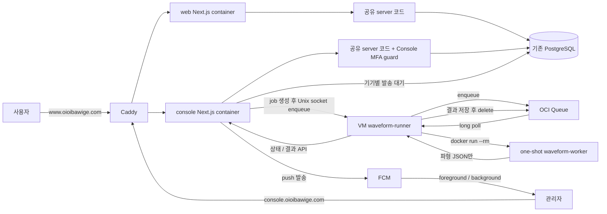
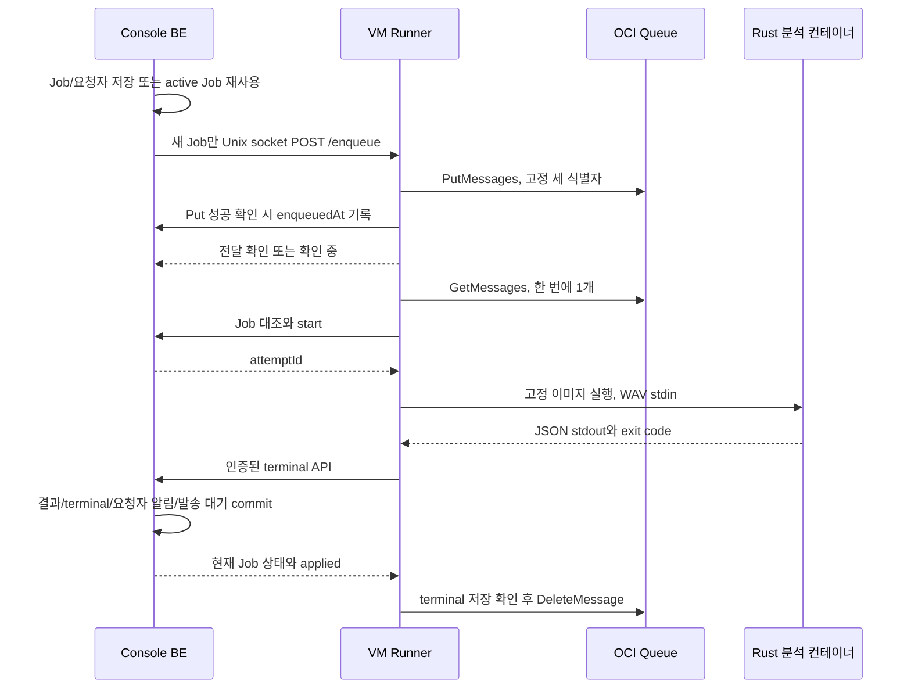

# Console·다중 응원법·파형 편집기 최소 설계

**2026-10-28 기준 P07은 운영 적용·배포 완료다. P08의 Job/알림 저장 기반은 운영 반영됐고 Rust 분석기·내부 조회/완료 API는 migration_main에 통합했다. Queue/Runner는 후속 작업이다.** P01~P07의 완료 결과와 P08~P10 실행 계획을 구분한다.
현재·보류 상태는 [WORK](../../../WORK.md)가 소유한다. 아래 Queue/runner/job/editor와 CheerGuide 모델은 현행 구현 완료를 뜻하지 않는다.

초기 제안의 코드 근거는 [CURRENT-STATE](CURRENT-STATE.md), 파형 기술 근거는
[AUDIO-FEASIBILITY](AUDIO-FEASIBILITY.md), 구현 순서는 [ROADMAP](ROADMAP.md)이 소유한다.
이 개정은 `ef0ac77cd81cf7312df32139c44909fbf2166a09`의 runtime 실행·공용 설정·직렬 로드맵을 수정한다.
`8882b71c0bf6bfa71f3295d6b5f34de0b16d1dce` 이후 피드백으로 SSE 전달·Queue 인증 주체·active Job 중복 생성 규칙을 보완했다.
2026-10-11 개정은 `dfcf9182c42efa9ee48899c55495746797c2cb4f`의 enqueue/socket 응답 불확실성 처리를 보완했다.
2026-10-26 사용자 지시로 P07을 두 공연 모드·공식/팬덤 출처·데이터/조회로 제한하고 관리자 편집은 후속으로 분리했다.
[원래 §5](https://github.com/goldmayo/oioi-bwg/blob/bb3396b21ed2b5399aebb78e236764e56ee92e72/docs/migration/implementation/console-guide-editor/DESIGN.md#5-cheerguide)의 세 종류 분류와
[이전 제안 #268](https://github.com/goldmayo/oioi-bwg/pull/268)의 새 관리자 초안/공개 기능 포함 범위를 대체한다.
설계 초안 작성 시점([80916d4](https://github.com/goldmayo/oioi-bwg/commit/80916d48fd15529f83f1c6e66fad1af7f6fcac91))에는 애플리케이션·DB·배포 코드를 포함하지 않았다.
이후 사용자 구현 지시로 첫 단위인 데이터 기반을 추가한다. 변경·검증 결과는 [구현 PR #272](https://github.com/goldmayo/oioi-bwg/pull/272)가 소유한다.

## 1. 목표

같은 곡의 CONCERT/FESTIVAL 응원법을 조회·선택하고 출처를 공식/팬덤으로 표시한다.
공식 여부는 공연 모드와 별개다. 기존 데이터는 운영자가 수동 분류하며 새 관리자 편집 기능은 P07 이후에 다룬다.
2026-10-31부터 관리자가 로컬 일회성 컨테이너에서 JSON을 생성해 Console로 등록하고, 편집기는 참조 영상 재생과 JSON을 사용한다.
**Domain §20.2의 입력 이용 범위를 먼저 확인하며 음원은 pipe/tmpfs에서만 처리한다. 브라우저에서는 분석하지 않는다.**
2026-10-28 초기 source 정정에서는 과거 YouTube/yt-dlp 제안을 production source 승인과 구분하고 추출 금지를 따랐다.
같은 날 후속 재설계 요청으로 [Domain §20.2](../../DOMAIN_SPECIFICATION.md#202-source-policy)를 조건부 허용으로 개정했다. 구체적 입력 승인은 [§6.4](#64-yt-dlp-acquisition-2026-10-28-개정)를 따른다.

기존 Service/Repository/CASL/Query/Ky/Zod, Auth.js/Argon2id, 가사 JSON, LRC·시간 캡처·Undo/Redo를 재사용한다.
세션 레지스트리·인증 grant·복구 UI·범용 Audit DB·미래 Event/variant 모델과 자동 정렬 연구는 이번 범위에서 뺀다.
필요한 도구의 기능을 직접 다시 구현하지 않는다.

## 2. 핵심 Architecture



공유 server는 두 Next 프로세스에서 실행하는 소스 패키지다. 별도 API 서버는 만들지 않는다.
RSC → Service와 Client → Query → Ky → Route → Service 흐름 및 기존 FSD 규칙을 유지한다.
각 앱은 자기 origin의 API를 호출하며 Console 세션을 web과 공유하지 않는다.
현재 배포의 digest·health·smoke·rollback 절차를 두 앱에 적용한다. release manifest framework는 추가하지 않는다.
GitHub Actions / OCI Run Command는 배포·운영 자동화에만 사용하고 runtime job을 실행하지 않는다.
DB runtime role 분리는 후속 hardening으로 남기고 기존 service 인가를 유지한다.

## 3. Monorepo 구조와 검증

P01~P04는 완료됐다. 현재 구조와 검사 책임은 [헌법](../../oioi-bwg-architecture-clean-v1/01-architecture-constitution.md)과
[검증 기준](../../oioi-bwg-architecture-clean-v1/10-testing-architecture.md), 실제 변경·실패는 [완료 지도](../COMPLETED-DESIGN-INDEX.md)가 소유한다.
초기 config/harness 배치와 명령을 미래 기능의 재작업 지시로 사용하지 않는다.

## 4. Console / Auth

P05 MFA와 P06 운영 전환은 [전체 결과](P06-RESULT.md)로 종료됐다. 현재 인증 계약은
[Auth](../../oioi-bwg-architecture-clean-v1/04-auth-authz-architecture.md), 등록·회수 절차는 [운영 안내](../../../../ops/oci/README.md)를 따른다.
원래 제안과 승인/검증은 완료 지도에서 추적한다. 계정 관리 G는 별도 미구현 제안이다.

## 5. CheerGuide

### 5.1. P07 범위와 기준

[Domain §8.0](../../DOMAIN_SPECIFICATION.md#80-p07-데이터와-공개-조회)의 단계 계약을 따르는 **스키마·구현 계획**이다.
기준은 fetch한 `origin/migration_main@bb3396b21ed2b5399aebb78e236764e56ee92e72`다.
아래 DDL은 설계 기준이다. 실제 테이블은 `packages/server/src/db/schema.ts`, 적용 SQL은 `drizzle/0007_p07_cheer_guide_foundation.sql`이 소유하며 이관·앱 전환과 구분한다.
DB 이름은 [ADR 0009](../../../adr/0009-uuid-domain-identity.md)의 단수 snake_case, 독립 PK는 서버 생성 UUIDv7이다.

| P07에 포함 | P07 이후 |
| --- | --- |
| 두 모드의 데이터·출처·불변 공개 내용·조회/선택·수동 이관 | 새 관리자 편집 UI/API, 초안 저장·미리보기·공개/중단·복원 UI |
| 기존 저장 경로의 최소 호환·원자성·버전 검사 | Contribution/Discussion·REVIEWER·승인 workflow·편집 예약/실시간 병합 |
| 기존 가사 JSON·재생·slug·Song/Album visibility 보존 | 전체 정비 현황판·팬 숙지/참여 응답·정규화 Cue/variant |

기존 Console 편집기는 유지한다. 호환 쓰기는 기존 동작을 보존하기 위한 데이터 어댑터이며 새로운 편집 기능이 아니다.
초안/공개 분리 UX는 후속이므로 기존 편집기의 즉시 반영 동작을 새 초안 저장이라고 안내하지 않는다.

### 5.2. 테이블 초안

| 테이블 | 현재 필요한 책임 |
| --- | --- |
| `cheer_guide` | Song·공연 모드 identity, 현재 공개 조치, 충돌 버전, 기존 writer의 연결 대상 |
| `cheer_guide_snapshot` | 이관 또는 호환 저장 시 전체 내용·출처·타이밍 기준 영상을 불변 보존 |
| `cheer_guide_publication` | 공개할 snapshot과 공개/중단 조치·행위자를 기록 |

snapshot은 미래 Domain Revision의 DRAFT/UNDER_REVIEW/APPROVED 상태와 별개다. P07에 활성 작업본 포인터를 만들지 않는다.
공개 기록은 첫 이관·기존 즉시 반영 경로에서 소비한다. 과거 내용 보호를 위해 현재 내용 한 행을 계속 덮어쓰지 않는다.

```sql
CREATE TABLE cheer_guide (
  id uuid PRIMARY KEY,
  song_id uuid NOT NULL REFERENCES song(id) ON DELETE RESTRICT,
  mode text NOT NULL CHECK (mode IN ('CONCERT', 'FESTIVAL')),
  legacy_write_target boolean NOT NULL DEFAULT false,
  current_publication_id uuid,
  lock_version integer NOT NULL DEFAULT 1 CHECK (lock_version > 0),
  created_at timestamptz(3) NOT NULL DEFAULT now(),
  updated_at timestamptz(3) NOT NULL DEFAULT now(),
  UNIQUE (song_id, mode)
);
CREATE UNIQUE INDEX cheer_guide_song_id_legacy_write_target_key
  ON cheer_guide (song_id) WHERE legacy_write_target;

CREATE TABLE cheer_guide_snapshot (
  id uuid PRIMARY KEY,
  cheer_guide_id uuid NOT NULL REFERENCES cheer_guide(id) ON DELETE RESTRICT,
  version_no integer NOT NULL CHECK (version_no > 0),
  lyrics jsonb NOT NULL CHECK (jsonb_typeof(lyrics) = 'array'),
  reference_youtube_id text NOT NULL CHECK (length(btrim(reference_youtube_id)) > 0),
  source_type text NOT NULL CHECK (source_type IN ('OFFICIAL', 'FANDOM')),
  source_url text,
  guide_video_url text,
  description text,
  created_by_account_id uuid REFERENCES account(id) ON DELETE RESTRICT,
  change_summary text NOT NULL CHECK (length(btrim(change_summary)) > 0),
  created_at timestamptz(3) NOT NULL DEFAULT now(),
  UNIQUE (cheer_guide_id, version_no),
  UNIQUE (cheer_guide_id, id),
  CHECK (source_type <> 'OFFICIAL' OR
    (source_url IS NOT NULL AND length(btrim(source_url)) > 0))
);
CREATE INDEX cheer_guide_snapshot_created_by_account_id_idx
  ON cheer_guide_snapshot (created_by_account_id);

CREATE TABLE cheer_guide_publication (
  id uuid PRIMARY KEY,
  cheer_guide_id uuid NOT NULL REFERENCES cheer_guide(id) ON DELETE RESTRICT,
  publication_no integer NOT NULL CHECK (publication_no > 0),
  action text NOT NULL CHECK (action IN ('PUBLISH', 'UNPUBLISH')),
  snapshot_id uuid NOT NULL,
  actor_account_id uuid NOT NULL REFERENCES account(id) ON DELETE RESTRICT,
  reason text NOT NULL CHECK (length(btrim(reason)) > 0),
  created_at timestamptz(3) NOT NULL DEFAULT now(),
  UNIQUE (cheer_guide_id, publication_no),
  UNIQUE (cheer_guide_id, id),
  FOREIGN KEY (cheer_guide_id, snapshot_id)
    REFERENCES cheer_guide_snapshot(cheer_guide_id, id) ON DELETE RESTRICT
);
CREATE INDEX cheer_guide_publication_cheer_guide_id_snapshot_id_idx
  ON cheer_guide_publication (cheer_guide_id, snapshot_id);
CREATE INDEX cheer_guide_publication_actor_account_id_idx
  ON cheer_guide_publication (actor_account_id);
ALTER TABLE cheer_guide ADD CONSTRAINT cheer_guide_id_current_publication_id_fkey
  FOREIGN KEY (id, current_publication_id)
  REFERENCES cheer_guide_publication(cheer_guide_id, id) ON DELETE RESTRICT;

CREATE FUNCTION reject_cheer_guide_history_mutation() RETURNS trigger
LANGUAGE plpgsql AS $$
BEGIN
  RAISE EXCEPTION 'cheer guide history is immutable' USING ERRCODE = '55000';
END;
$$;
CREATE TRIGGER cheer_guide_snapshot_immutable
  BEFORE UPDATE OR DELETE OR TRUNCATE ON cheer_guide_snapshot
  FOR EACH STATEMENT EXECUTE FUNCTION reject_cheer_guide_history_mutation();
CREATE TRIGGER cheer_guide_publication_immutable
  BEFORE UPDATE OR DELETE OR TRUNCATE ON cheer_guide_publication
  FOR EACH STATEMENT EXECUTE FUNCTION reject_cheer_guide_history_mutation();
```

UNIQUE(song_id, mode)는 모드별 하나, partial UNIQUE는 Song별 기존 writer 연결 대상 최대 하나를 보장한다.
복합 FK는 다른 guide의 snapshot/공개 기록 연결을 막는다. UNIQUE 인덱스로 guide별 최신 번호·이력을 역순 조회한다.
번호는 guide 잠금 후 최신 번호 + 1로 할당하고 UUID 순서를 업무 순서로 사용하지 않는다.
원본 작성자를 모르는 이관 snapshot의 created_by는 null, created_at은 이관 시각이다. 원 작성자·과거 작성 시각을 추정하지 않는다.
공개 기록의 actor는 이번 이관/저장을 수행한 실제 ADMIN이다. Account tombstone을 유지하며 닉네임 등 PII를 복제하지 않는다.
trigger는 custom migration으로 함께 반영한다. DB owner의 직접 SQL·trigger 해제 방어는 기존 role hardening 후속이다.
이력이 있는 guide/Song/Album의 물리 삭제는 FK로 제한하고 숨김을 사용한다. 기존 삭제 service의 기대 오류도 함께 처리한다.

### 5.3. 공개 조회와 출처

현재 공개 조치가 PUBLISH인 guide만 `guide → publication → snapshot`으로 읽고 Song/Album visibility를 함께 적용한다.
한 SQL snapshot에서 공개 포인터·내용·타이밍 기준을 결합한다. 내부 작성자/사유와 과거 snapshot은 공개 DTO에 넣지 않는다.
`OFFICIAL → 공식`, `FANDOM → 팬덤`이며 label 자체를 DB enum으로 저장하지 않는다. 공식 원본 링크는 필수다.
원본 링크는 **원본 보기**, 선택적인 안내 영상은 **응원법 영상 보기**로 제공하고 곡별 설명은 선택으로 둔다.
이관곡의 공식 표시는 선택한 공개 snapshot에서, 곡 목록은 기본 공개 guide에서 구한다. legacy flag를 새 출처의 권위로 사용하지 않는다.
URL scheme/형식과 LyricsData 내부 구조·공개 가능한 내용은 Zod/서비스에서 검증한다. JSON 배열 CHECK만으로 충분하다고 보지 않는다.
reference_youtube_id는 응원 타이밍을 맞춘 곡 재생 영상이다. 안내 영상과 구분하고 현재 Song.youtube_id와 일치해야 공개한다.
현재 조치가 UNPUBLISH면 연결된 snapshot이 있어도 비공개다. 공개 중단 UI/API는 후속이며 이 상태를 읽을 데이터 계약만 둔다.

공개 기본 선택은 CONCERT → FESTIVAL이다. 0개는 비어 있음, 1개는 selector 숨김, 2개는 segmented control을 쓴다.
`nuqs`의 `?guide=<UUIDv7>`로 공유하고 다른 곡/미공개/잘못된 ID는 기본 항목으로 정규화한다.
전환 시 같은 Song.youtube_id의 player를 유지하고 가사만 바꾼다. DTO·공유 queryKey·Query invalidation은 기존 05/07 계약을 따른다.

### 5.4. 기존 데이터·writer 전환

기준 코드의 `createSong`·`editSong`(LRC 포함)·`saveSongLyrics`와 공개 mapper는 아직 Song.lyrics를 읽고 쓴다.
[기준 service](https://github.com/goldmayo/oioi-bwg/blob/bb3396b21ed2b5399aebb78e236764e56ee92e72/packages/server/src/services/song-service.ts)를 입력으로 다음 호환 경로를 구현한다.

1. 운영자가 Song ID·mode·source_type·원본 URL·기준 영상·기존 writer 연결 대상을 검토한다. 대응표에 생성 UUID와 원본 fingerprint를 고정·재사용하고 false/null flag로 자동 분류하지 않는다.
2. 첫 이관은 Song 행 잠금 아래 기존 JSON을 복사하고 guide·최초 snapshot·PUBLISH·공개 포인터를 같은 transaction에서 만든다.
3. 기존 Song.lyrics를 가져온 guide 하나만 legacy_write_target=true로 둔다. 다른 모드를 같은 내용으로 자동 복제하지 않는다.
4. 연결 전에는 기존 reader/writer를 유지한다. 새 곡 생성도 분류 전까지 legacy 경로를 유지하며 임의 guide를 만들지 않는다.
5. 연결 후 기존 editor의 데이터 계약에 guide ID·expected lock_version을 전달한다. 새 편집 버튼/화면은 추가하지 않는다.
6. 기존 가사/LRC 저장은 Song → 연결 guide 순서로 잠그고 version과 현재 PUBLISH 상태를 검사한다. Song.lyrics 호환 사본 갱신·새 snapshot·PUBLISH·포인터 전진을 같은 tx로 끝낸다.
7. 연결 대상이 아닌 모드는 이 저장으로 바뀌지 않는다. 기존 flag로 출처를 재분류하지 않으며 이관 후 출처/기준 영상 변경은 후속 관리 기능 전까지 명시적으로 거절한다.
8. 새 공개 reader를 켜기 전에 모든 가사/LRC/삭제 진입점의 호환성·stale 요청 거절·전체 내용 보존을 검증한다. 준비 전에는 기존 공개 reader를 유지한다.

재실행은 대응표의 같은 UUID·내용이 이미 적용됐으면 no-op, 다르거나 이후 저장이 있었으면 중단한다. 새 이력을 중복 추가하지 않는다.
이관 전 열린 탭처럼 version/guide 연결 정보가 없는 요청도 이관 후에는 거절하며 입력을 보존한다. 공개 중단한 guide를 호환 저장으로 자동 재공개하지 않는다.
기존 가사 행·segments·isCheer/isEcho/isExtra·startTimeOffset과 초 단위, slug·자산 URL·관계를 보존한다.
공개 이력이 있는 곡은 공개 guide가 0개가 돼도 legacy reader로 되돌아가지 않는다. 조회 전환 기준은 공개 이력의 존재다.
Song.lyrics·has_official_cheer와 연결 표시는 전환 기간 보존한다. 새 편집 writer 전환 뒤 호환 경로의 제거를 별도 검토한다.
원본 파괴적 정리나 구 앱 재배포만으로 rollback하지 않는다. 새 guide 데이터를 읽는 호환 앱으로 복구한다.

### 5.5. 원자성·동시성

기존 ADMIN/MFA 인가 후 service가 짧은 transaction을 소유하고 repository에 같은 tx를 명시적으로 전달한다.
Song → guide(UUID 오름차순) 순서를 지킨다. 연결/가사/LRC/기준 영상 변경 경로도 같은 Song 잠금 규칙을 따라 이관과 경합하지 않게 한다.
동일 guide의 쓰기는 아래 CAS를 먼저 성공한 뒤 snapshot·공개 이력 추가와 포인터 갱신을 수행한다.

```sql
UPDATE cheer_guide
SET lock_version = lock_version + 1, updated_at = now()
WHERE id = $1 AND lock_version = $2
RETURNING current_publication_id, lock_version;
```

존재하는 guide에서 0행이면 rollback하고 서비스 의미 오류를 HTTP boundary에서 409로 변환한다. 없는 ID는 not-found로 구분한다.
READ COMMITTED에서 대기 후 WHERE가 재평가되어 같은 버전의 두 쓰기를 막는다. 이력/포인터/호환 사본은 전부 commit되거나 전부 rollback된다.
입력 중 DB 잠금을 유지하지 않고 외부 영상 호출도 tx 밖에서 수행한다. timeout으로 대기를 제한하고 응답 유실 시 현재 상태부터 재조회한다.
직접 SQL이나 오래된 version을 최신값으로 바꾼 자동 재시도로 충돌을 우회하지 않는다.
근거: [제약](https://www.postgresql.org/docs/17/ddl-constraints.html), [Read Committed](https://www.postgresql.org/docs/17/transaction-iso.html#XACT-READ-COMMITTED),
[statement trigger](https://www.postgresql.org/docs/17/sql-createtrigger.html).

### 5.6. 구현 PR 순서와 완료 조건

| 검증 가능한 PR 단위 | 범위와 통과 조건 |
| --- | --- |
| 계약·persistence | Domain·Drizzle schema → migration 생성 → SQL 검토 → guarded local 적용. 중복 모드/연결 대상·복합 FK·불변 trigger 검증 |
| 데이터 이관·기존 writer 호환 | 검토한 대응표·동일 transaction·version 전달. 이관/저장 경합·LRC·실패 rollback·복구·미분류 및 전체 payload 보존 검증 |
| 공개 조회·선택 | 0/1/2개·공식/팬덤·비공개/다른 곡 ID·visibility·URL/재생 유지. 공개 중단 뒤 legacy 재노출 방지와 실제 브라우저 검증 |

2026-10-26 구현 구체화: 이번 영속성 단위는 HTTP 진입점을 만들지 않는다. 사용하지 않는 DTO를 선행 추가하지 않고 Zod 입력/출력 계약은 이관·writer 호환·조회 consumer가 생기는 단위에서 구현한다.

각 PR은 20파일/400줄 목표로 추가 분할할 수 있다. P07 전체를 한 구현 PR로 만들지 않는다.
로컬 검증은 Docker PostgreSQL과 승인된 복원 데이터로 수행한다. 운영 DB 변경은 별도 검토·승인·Promotion 범위다.
새 관리자 편집·초안/공개·복원은 후속 계획에서 다룬다. 그때 작업본 포인터·편집 사유·복원 계보를 추가하고 기존 snapshot/publication identity는 유지한다.
P08~P10의 파형/Grid 계획을 이 작업에 합치지 않는다. BPM/beatOffset은 기존 계획대로 Song 편집 설정이다.
i18n은 P10 이후 UI·곡별 설명만 검토한다. 설명 번역은 원문 snapshot ID와 locale에 연결하며 현재 번역 테이블·locale enum·언어별 열을 만들지 않는다.
영어·일본어·대만/홍콩 표기와 fallback은 후속 리서치로 정하고 가사 의미 번역·독음·이를 위한 영구 Cue ID는 이번 범위에서 제외한다.

## 6. Waveform Worker

**2026-10-31 경로 전환:** 사용자 요청으로 현재 기본 경로는 [§6.5 로컬 분석·JSON 등록](#65-로컬-분석json-등록-2026-10-31-개정)이다. 아래 OCI Queue/Runner 설계는 이미 구현·배포한 이전 경로의 계약과 정리 근거로 보존하며, 로컬 등록의 선행 조건으로 삼지 않는다.

2026-10-28 사용자 선택으로 OCI Queue 기반을 유지하고 Unix socket과 Runner의 역할을 구체화한다.
Runner는 VM의 상주 큐 소비·실행 프로세스이며 enqueue와 consume을 함께 맡는다. Rust 분석기는 작업별 일회성 컨테이너다.
아래 HTTP/socket/Queue 경로는 구현 계획이다. 기존 저장·알림 기반과 [Rust 분석 도구 PR #310](https://github.com/goldmayo/oioi-bwg/pull/310)을 재사용한다.

```text
POST /api/admin/waveform-jobs
  → MFA/ADMIN + 입력 검증 → active Job 재사용 또는 PostgreSQL Job(QUEUED) 생성
  → 새 Job만 Unix socket → VM runner → OCI Queue enqueue
  → 202 Accepted { jobId } (DB 접수, 전달 성공 또는 확인 중)

OCI Queue → VM runner long poll → Job(RUNNING)
  → docker run --rm → 승인 videoId → Rust/yt-dlp/ffmpeg pipe/audiowaveform → JSON stdout
  → Runner → Console 내부 결과 API → 결과/terminal/알림 transaction → message delete
```

| 요소              | 책임                                                                               |
| ----------------- | ---------------------------------------------------------------------------------- |
| PostgreSQL        | WaveformJob 상태와 Waveform JSON 결과의 SSOT                                       |
| OCI Queue         | 전달·재전달/retry·visibility timeout·delivery count·DLQ                            |
| waveform-runner   | 제한된 enqueue 호출·Queue consume → job 검증 → 고정 container → 결과 반영 → delete |
| waveform-worker   | audio → JSON만. HTTP 서버·DB 쓰기·job 관리 없음                                    |
| FCM               | foreground 토스트·background OS push. 내역·읽음·결과 조회는 DB/API                  |
| OCI Notifications | 선택적 운영 장애 알림만. job 성공 여부와 결합하지 않음                             |

**동일 `(songId, videoId)`의 active Job(`QUEUED | RUNNING`)은 최대 한 개다.**
연속 클릭·응답 유실 후 재요청·동시 POST에 기존 active Job이 있으면 `202 { jobId }`로 그 Job을 반환하고
새 Job/message는 만들지 않는다. 새 Job 생성 경로만 enqueue를 요청한다.
2026-10-28 응답 의미 보완: 전달 성공과 응답 유실로 인한 확인 중에는 모두 DB에 접수된 jobId로 202를 반환한다.
202는 Queue 접수 보장이 아니다. 전달 미생성이 확정된 실패만 조건부 FAILED 반영 후 503/ENQUEUE_FAILED로 응답한다.
이는 active 작업 재사용 규칙이며 terminal(`SUCCEEDED | FAILED`) 이후의 새 요청은 재생성으로 처리한다.
UI의 버튼 비활성화에만 의존하지 않고 DB에서 조회/생성을 원자적으로 보장한다.
기존 Song → Job 잠금, active partial unique index와 requester 유일 제약을 재사용하며 생성 HTTP 연결 시 경합을 재검증한다.

**OCI Queue 호출은 VM-local Runner 하나가 push + pull을 모두 소유한다.**
Console은 Job을 저장한 뒤 제한된 Unix socket enqueue 호출만 한다. socket은 Console에만 연결하고
소유자/그룹 권한으로 접근을 제한하며 Caddy/public TCP endpoint로 공개하지 않는다.
Runner는 고정 Queue에 세 식별자만 enqueue하고 성공 확인을 내부 Job API에 기록한 뒤 socket 응답을 반환한다. 분석 완료를 기다리지 않는다.
SDK의 long poll 대기 중에도 enqueue 호출을 받을 수 있지만 분석 worker 동시 실행은 한 개를 유지한다.

Runner의 OCI SDK는 [Compute Instance Principal](https://docs.oracle.com/en-us/iaas/Content/Identity/Tasks/callingservicesfrominstances.htm)로 인증한다.
해당 VM을 dynamic group에 포함하고 [Queue IAM](https://docs.oracle.com/en-us/iaas/Content/queue/policy-reference.htm)의
`use queue-push`(PutMessages)와 `use queue-pull`(GetMessages/UpdateMessage/DeleteMessage)을 waveform Queue/DLQ 처리 범위로 제한한다.
Queue OCID/message endpoint는 배포 설정으로 고정하며 runtime에 Queue 생성·삭제·변경 권한을 주지 않는다.
Console은 OCI SDK/credential을 사용하지 않고 Runner가 내부 결과 API에 쓰는 service token과 OCI 인증은 별개다.
**IAM 주체는 container/process가 아니라 VM이며 이 VM을 OCI trust boundary로 본다.**
Runner로 호출을 모아도 IAM 차원의 process별 권한 분리가 생기지는 않는다. Console/Web/worker의
metadata 접근을 차단하고 host root 권한은 이 경계 안에 둔다. Console MFA secret의 VM 읽기
권한을 추가하는 **P06에서 Web/Console metadata 차단을 실제 VM에서 확인한다.** env 분리만으로
접근 격리를 주장하지 않는다. [P06 계획 §4.1~4.2](https://github.com/goldmayo/oioi-bwg/blob/e93ae610169e4ce0e9b7f1a75a9a02cbf179d46f/docs/migration/implementation/console-guide-editor/P06-PLAN.md#41-p06-b0-arm64-빌드-전-iam-준비실증)의
선행 차단·host 양성 대조·재시작/복구 검증을 따른다. P08은 Runner/worker·Queue IAM·Unix socket을
추가 검증하고 기존 Web/Console 차단도 재검증한다.

Queue payload는 `{ jobId, songId, videoId }`만 받는다. image/command/argument/volume/env를 받지 않는다.
Runner는 message의 songId/videoId를 DB job과 대조한 뒤 실행한다.
Runner는 기존 OCI SDK의 [long polling/visibility 연장](https://docs.oracle.com/en-us/iaas/Content/queue/consume-messages.htm)을 사용한다.
VM-local 프로세스 하나가 한 건씩 수신하고 worker 하나만 실행한다. 다음 요청은 Queue에 대기하며 scheduler/Redis/분산 잠금은 추가하지 않는다.
runner는 분석하지 않으며 image·argument·자원 한도는 배포된 고정 설정에서 결정한다.

```text
WaveformJob
  id, songId, videoId, status: QUEUED | RUNNING | SUCCEEDED | FAILED
  errorCode nullable, createdAt, startedAt nullable, finishedAt nullable
  enqueuedAt nullable        Runner의 PutMessages 성공 확인 시각, null은 성공 미확인
  attemptId nullable         재전달 시 오래된 실행 결과를 거절하는 식별자

Waveform                    job lifecycle과 분리한 song/source별 정상 JSON
```

Runner는 위 Queue push/pull 권한과 좁은 내부 job API의 service token만 사용한다. 분석기에는 고정된 videoId 인자·승인 목록과 실행 한도만 제공한다.
로컬 합성 검증은 network none이다. 승인 입력·전용 outbound 격리를 확인하기 전에는 운영 fetch를 활성화하지 않는다.
worker에 DATABASE_URL/AUTH_SECRET/R2/OCI credential을 주지 않고 VM metadata·DB·내부 API 접근도 막는다.
Console의 내부 API → 기존 Service/Repository가 상태·결과를 저장하고 Runner/worker에 DB 연결을 주지 않는다.
token은 Runner의 보호된 환경에 보관하며 Queue·command·로그에 넣지 않는다.

jobId로 중복 반영을 막는다. 이미 SUCCEEDED인 message는 재분석하지 않고 delete하며 FAILED도 terminal로 취급한다.
실행 중에는 visibility를 연장하고, 만료/Runner 종료 후 재전달 시 기존 RUNNING 작업의 잔존 container를 정리한 뒤 다시 처리한다.
visibility 소유권을 잃으면 기존 실행을 중단한다. 현재 처리 시도·source에 맞는 결과만 조건부 반영한다.
**결과 저장과 SUCCEEDED 갱신을 같은 transaction으로 끝낸 뒤** delete한다. delete 실패는 DB 성공을 되돌리지 않는다.
일시 실패는 message를 지우지 않고 Queue 재전달에 맡긴다. 반복 실패는 [DLQ](https://docs.oracle.com/en-us/iaas/Content/queue/deadletterqueues.htm)로 보내지며
Runner가 DLQ의 미완료 job을 FAILED로 반영한 뒤 해당 message를 정리한다. DB에 retry queue를 구현하지 않는다.
DB Job 생성과 enqueue는 원자적이지 않으며 **socket error는 Queue enqueue 실패의 증거가 아니다.**
`QUEUED`는 전달 성공 또는 전달 결과 확인 중인 Job을 포함한다. 상태는 `QUEUED/RUNNING/SUCCEEDED/FAILED`를 유지한다.

| enqueue 결과 | 처리                                                                                                              |
| ------------ | ----------------------------------------------------------------------------------------------------------------- |
| 명확한 실패  | Runner의 호출 실패와 message 미생성이 확정된 경우만 FAILED로 전환할 수 있다. 이미 진행된 상태는 역전하지 않는다.  |
| 성공         | Runner가 PutMessages 성공 확인 → Console 내부 Job API로 enqueuedAt 기록 → socket 성공 응답 → 202 반환.            |
| 불확실       | socket/PutMessages 응답 유실 등으로 전달 여부를 확정할 수 없으면 QUEUED를 유지하고 즉시 FAILED로 전환하지 않는다. |

`enqueuedAt`은 Console의 socket 응답 수신 시각이 아니라 Runner의 PutMessages 성공 확인 기록이다.
PutMessages 성공 뒤 내부 API 기록 실패/응답 유실도 Queue 실패로 간주하지 않는다. `enqueuedAt = null`만으로 message가 없다고 판단하지 않는다.
Runner consume은 enqueuedAt이 null이어도 기존 Job을 RUNNING → SUCCEEDED로 처리할 수 있다.
결과 불확실로 Console이 즉시 재enqueue하지 않으며 재요청은 기존 active Job의 jobId를 반환한다.

Runner의 작은 stale-job 점검은 `status = QUEUED AND enqueuedAt IS NULL`인 Job에 대해 message가 더 이상
정상 전달될 수 없다고 간주할 수 있는 **충분히 보수적인 전달 종료 기한 이후에만** 조건부로 FAILED를 반영한다.
기한은 가장 늦은 enqueue 가능 시점부터 실제 [Queue 최대 message retention](https://docs.oracle.com/en-us/iaas/Content/queue/overview.htm)과
충분한 시계/관측 지연 여유를 포함해 P08에서 정한다. socket/visibility timeout이나 임의의 짧은 timeout을 기준으로 삼지 않는다.
그 이전에는 enqueue 여부 불확실성만으로 FAILED 처리하지 않는다. 이미 전달 확인/진행된 상태는 역전하지 않고 정상 Queue 대기 및 기존 retention 점검은 유지한다.
Console의 주기적 Queue 조회/재enqueue, DB retry queue, Outbox framework, 별도 retry scheduler·분산 transaction·범용 reconciliation은 만들지 않는다.
중복 전달·늦은 응답·timeout 경계는 P08에서 검증한다.

Worker는 `--rm --read-only --tmpfs /tmp`, CPU/memory/pids limit, cap-drop, no-new-privileges, restart 없음으로 실행한다.
pipe가 기본이고 필요 파일/cache만 tmpfs에 둔다. swap/core dump를 막고 성공·실패·timeout 모두 container와 하위 프로세스를 제거한다.
음원/PCM은 host filesystem/volume·Docker volume·PostgreSQL·R2/S3·로그·Sentry에 남기지 않는다.
재생성 실패는 직전 정상 JSON을 지우지 않으며 Waveform을 갱신해도 Cue 시각은 자동 변경하지 않는다.
JSON 형식·도구 선택·삭제 검증은 [파형 기술 검토](AUDIO-FEASIBILITY.md)를 따른다.

2026-10-27 구현 제출에서 source 정책을 유지한 passive Job/terminal 준비를 먼저 분리했다.
제출한 저장·삭제·source/attempt 계약은 [#302의 Domain §20.4.1](https://github.com/goldmayo/oioi-bwg/blob/2157e70199e8c73cd6adf6f6e84d6af7b329f870/docs/migration/DOMAIN_SPECIFICATION.md#2041-파형-job과-알림-저장-계약-2026-10-27),
실행 PR의 고유 범위와 squash 후 순서는 [ROADMAP 병합표](ROADMAP.md#공통-알림-pr의-병합-순서)를 따른다.
이 준비 구현은 실제 생성 HTTP·Queue/Runner·ARM64 검증이나 P08 전체 완료를 뜻하지 않는다.

### 6.1. 공통 알림과 FCM

2026-10-27 사용자 승인으로 [이전 SSE 설계](https://github.com/goldmayo/oioi-bwg/blob/87a02f9344faa2f80a667b65250fc1294ee81680/docs/migration/implementation/console-guide-editor/DESIGN.md#6-waveform-worker)를 대체한다.
닫힌 탭의 OS push·놓친 알림 내역을 이번 범위에 포함한다. 도메인 채널·수신자·읽음 규칙은 [Domain §15](../../DOMAIN_SPECIFICATION.md#15-notification)가 소유한다.

- 공통 Notification/기기 등록/발송 대기를 PostgreSQL에 저장한다. Job terminal 반영과 요청자별 알림·발송 대기는 동일 transaction이다.
- Console Node startup adapter가 단일 dispatch loop를 시작한다. commit 직후 깨우며 60초마다 미발송·lease 만료를 복구한다. Sentry 활성 여부와 분리하고 build·기본 local에서는 비활성화한다.
- claim은 짧은 transaction/lease로 처리하고 네트워크 발송은 밖에서 수행한다. retry는 backoff/jitter·Retry-After를 따르며 유효 기간은 생성 후 24시간이다.
- 등록별 접수/실패를 독립 저장한다. 접수 후 crash는 재발송될 수 있으며 notificationId로 중복 표시를 억제한다. 발송 접수는 읽음이나 수신 보장이 아니다.
- Console 공통 layout에서 수신하고 Query를 invalidate한다. 내역·미읽음 배지·추가 페이지·개별/모두 읽음과 사용자 동작 기반 push 설정을 제공한다.
- 등록은 Firebase Installation ID와 현재 account/MFA/binding에 연결한다. logout·전환·회수·기한 만료 후 발송하지 않는다. 큐에 이미 접수된 일반 안내의 회수는 보장하지 않는다.
- payload는 일반 안내·notificationId만 포함한다. 항목 조회·읽음·이동은 ADMIN/MFA와 수신자 소유권·현재 대상 인가를 검증한다.
- Firebase SDK는 지연 로드하고 SW SDK는 로컬 번들한다. 공개 설정은 runtime 주입하며 동일 candidate digest 승격을 유지한다. SW는 인증 응답을 캐시하지 않는다.
- iOS/iPadOS는 홈 화면 웹 앱 조건과 최소 manifest/icon을 제공한다. foreground는 onMessage, background는 notification 자동 표시 경로만 사용한다.
- 권한 거부·미지원은 내역을 유지하고 초기 진입·복귀·네트워크 복구·알림함 열기에 재조회한다. 주기적 browser polling은 하지 않는다.

HTTP 계약은 `/api/admin/notifications` 목록/미읽음 개수, `/{id}` 단건, `/{id}/read` PATCH,
`/read-all` POST와 `/api/admin/push-installations` PUT·`/{id}` DELETE다. 현재 API/Error/Query 규칙을 따른다.
FCM 발송 credential은 Console server만 사용하며 Runner·worker·Web·클라이언트에 전달하지 않는다.
별도 Redis/Ably/Firestore/Cloud Functions·범용 Notification framework는 추가하지 않는다.
OCI Notifications는 DLQ/Runner 장애 등 운영 알림 후보로 유지한다.

### 6.2. OCI Queue 연결과 완료 전달 계약

2026-10-28 설계 기준은 fetch한 `origin/migration_main@f8a59be59cc4e16fdc6719f7f3f6ccac448fa4c1`이다.
해당 기준에서 `waveform-service`의 request/start/complete와 Console `acceptWaveformResult`는 이미 있었고,
생성 HTTP·enqueue·Runner·내부 HTTP는 없었다. 후속 구현은 아래 날짜별 개정으로 구분한다.



**실행·인증 선택.** Runner는 host systemd의 단일 프로세스로 두고 host lock으로 중복 기동을 막는다.
소켓 접수와 Queue long poll은 독립 처리하지만 분석 슬롯은 하나다. 자체 broker·retry scheduler를 두지 않는다.
Redis 대안은 새 상주 broker·영속성/복구 운영이 필요해 이번 범위에서 채택하지 않는다.
Console 직접 publish는 별도 push 전용 인증을 도입할 때 재검토하며 기존 Web/Console IMDS 차단을 해제하지 않는다.
소켓 선택 근거는 이 인증 경계다. Redis/직접 publish와 총메모리·지연을 실측 비교한 결과로 주장하지 않는다.
Runner 구현안은 Go + [OCI 공식 SDK](https://docs.oracle.com/en-us/iaas/Content/API/Concepts/sdks.htm)의
[Queue client](https://docs.oracle.com/en-us/iaas/tools/go/latest/queue/index.html)와
[Instance Principal provider](https://docs.oracle.com/en-us/iaas/tools/go/latest/common/auth/index.html)다.
Rust는 분석기에 유지한다. OCI 요청 서명·인증서/토큰 갱신을 직접 구현하지 않기 위한 선택이며,
Go/SDK 버전·binary hash·상주 CPU/RSS는 Runner 구현 PR에서 실제 ARM64 검증으로 고정한다.
Rust 분석 성능 비교를 Go Runner 성능의 근거로 사용하지 않는다.

**2026-10-29 언어 재검토:** [Python 공식 SDK](https://docs.oracle.com/en-us/iaas/tools/python/latest/api/queue/client/oci.queue.QueueClient.html)도
Queue/Instance Principal을 지원한다. 언어 추가 비용을 검토한 뒤 사용자는 Go Runner 유지를 선택했다.
기존 통신 검증과 동시성·취소 모델을 이어가는 선택이며 Python 대비 성능 우위나 성능상 필수성을 입증한 결과는 없다.

**2026-10-29 사용자 확정·첫 SDK 구현:** Runner는 Go, 분석 worker는 Rust로 확정한다.
`ops/waveform-runner`의 첫 단위는 고정 Osaka Queue의 PutMessages 송신부다. 도구/SDK 버전은
해당 Dockerfile digest와 go.mod/go.sum으로 고정하고 ARM64 CI에서 실제 SDK·로컬 HTTP 서버로 검증한다.
세 식별자만 한 번 보내며 Queue HTTP는 2초·응답 header/body 각 4KiB로 제한한다. 오류는 정제된 불확실 결과이며
Job 실패·재전송·DB 쓰기를 하지 않는다. Put 성공은 후속 enqueuedAt 저장 확인 전 socket ENQUEUED가 아니다.
socket/내부 Job 대조·전달 확인·consumer·설치는 후속이다. SDK 인증 bootstrap/갱신의 시간·환경과 상주 RSS,
실제 Instance Principal/Queue·권한 격리는 이 로컬 검증으로 완료 처리하지 않는다.

**2026-10-29 내부 client 연결:** Go JobClient는 고정 `http://127.0.0.1:<보호된 port>`의 내부 Job 조회와
`/enqueued` 기록만 제공한다. 독립 64자리 token을 사용하고 cookie/Origin·proxy env·redirect·retry를 쓰지 않는다.
HTTP 1초·header/body 각 4KiB로 제한하고 기존 DTO의 식별자·상태·nullable 필드·시각과 응답 Job을 대조한다.
명시적인 404/WAVEFORM_JOB_NOT_FOUND만 삭제된 Job으로 구분한다. 비활성 403·일반 404·오류 원문은 부재 근거가 아니다.
전달 기록의 최초 시각과 RUNNING/terminal 응답은 허용하고, 응답 유실·불일치는 불확실로 반환한다. socket 연결은 다음 단위다.

**2026-10-29 시작 client 연결:** 기존 `/start`에 required nullable expectedAttemptId를 한 번 전달한다.
응답의 Job/source·필수 nullable 필드와 started boolean을 검사하고, started=true는 RUNNING·새 non-null attempt일 때만 인정한다.
started=false와 응답 유실은 실행 승인이 아니며 자동 재시도·message 삭제·실패 반영을 하지 않는다.
같은 loopback/token·1초/4KiB 제한을 재사용한다. 실제 receipt/worker 정리 확인과 시작·결과의 소비 흐름 연결은 후속이다.

**2026-10-29 socket 연결:** Go enqueue server는 실제 Unix listener에서만 접수를 허용하고 TCP·Origin을 거절한다.
strict 세 식별자·실제 body 1KiB·읽기 1초·진행 중 8개 상한을 적용한다. 진행 중 같은 Job은 추가 송신하지 않는다.
보호된 source 목록과 내부 Job/source를 대조하고, 기존 enqueuedAt은 재사용하며 미확인 RUNNING/terminal은 송신하지 않는다.
Put 성공과 전달 확인이 모두 끝나야 ENQUEUED다. socket 유실 뒤에도 서비스 context에서 확인을 계속하며 오류는 UNCONFIRMED다.
진행 중 중복 방지는 영속 멱등키가 아니다. Console의 새 Job만 단일 호출·미확인 결과의 재송신 금지 계약을 유지한다.
서비스 context 4초·쓰기 5초를 설정하되 SDK 인증 갱신을 포함한 전체 시간·운용 자원은 별도 수용한다.
이 단위는 서버 모듈과 실제 로컬 socket 검사이며 상주 main/host lock·DAC/mount·설치·Queue 소비를 활성화하지 않는다.

**2026-10-29 Queue 수신 연결부:** 기존 Instance Principal client에서 한 건 수신·180초 연장·receipt 삭제를 분리한다.
동시 poll은 한 개이며 long poll 30초/HTTP 35초, 연장·삭제 HTTP 2초를 설정한다. SDK 인증 갱신의 전체 기한은 별도 수용한다.
정상 빈 배열만 빈 poll이다. 세 식별자 외 payload·실제 content 1KiB 초과·불완전 receipt/metadata는 실행용 Delivery로 내보내지 않는다.
JSON 응답 header/body 각 4KiB·redirect/proxy/자동 재시도 금지를 유지하고 삭제의 body 없는 204만 별도 허용한다.
receipt는 같은 consumer의 메모리에서만 사용한다. 오류/응답 유실은 불확실이며 재송신·terminal 변경·message 삭제를 자동 수행하지 않는다.
이 단위는 SDK 연결부와 ARM64 로컬 HTTP 검증이다. heartbeat/안전 기한·소유권 상실 중단·terminal 확인 뒤 삭제와
재전달/DLQ·고정 worker·상주 시작/정리·설치·실제 OCI 수용을 후속 소비 흐름에서 연결한다.

**2026-10-29 visibility 실행 범위:** 동일 Consumer의 poll/작업 슬롯을 공유하고 수신 Delivery는 한 번만 실행 범위에 진입한다.
30초 heartbeat는 최대 한 건만 진행한다. 안전 기한은 응답 visibility·message expiry·요청 시작+180초 중 이른 시각에서 30초를 뺀다.
서버 시각을 로컬 monotonic 기한에 고정하며 만료 뒤 늦은 연장 응답으로 실행을 되살리지 않는다.
연장 오류 또는 2초 안에 확인하지 못한 요청은 보수적으로 소유권 불확실로 중단한다. 일시 장애에도 조기 중단/재전달될 수 있다.
실행 함수가 취소를 받아 고정 worker 정리를 마치고 반환할 때까지 슬롯을 유지한다. SDK 호출도 취소 후 최대 3초 정리를 기다린다.
SDK 호출의 종료를 확인하지 못하면 Consumer를 격리하고 새 poll/실행을 막는다. 늦은 응답으로 자동 해제하지 않는다.
ErrRunnerStalled는 Job 실패가 아니라 상주 시작 코드가 서비스 중단·재시작으로 처리할 오류다. 이 범위는 DB/terminal·delete를 호출하지 않는다.
로컬 가상 시계·SDK/메모리 HTTP 검증이며 실제 컨테이너 stop/kill/wait/remove·Job 복구·DLQ·서비스 기동과 OCI 수용은 후속이다.

소켓은 `/run/oioi-waveform/runner.sock`에 두는 안으로, root가 부모·소유 그룹을 관리하고 Console 전용 그룹만 연결한다.
Console에는 socket 디렉터리만 읽기 전용으로 연결하고 Docker socket·host root 경로·OCI credential을 주지 않는다.
이는 [runtime §14](../../oioi-bwg-architecture-clean-v1/11-content-i18n-assets-runtime-architecture.md#14-secret)의
기존 host mount 없는 Console 검증 전제에 대한 제한 예외 제안이다. 생성/enqueue 구현 PR에서 active runtime·배포 계약을
같이 개정하고 socket 외 host 경로 차단·Web 무변경·기존 IMDS 차단을 실증하기 전에는 mount를 적용하지 않는다.
`POST /enqueue`는 `{jobId,songId,videoId}`만 받는다. Runner가 내부 조회로 Job과 대조한 후 고정 Queue에 넣는다.
소켓의 body/연결 수/호출 기한 상한과 group mapping은 구현 시 부하·권한 검사로 고정한다.
PutMessages의 SDK/HTTP 자동 재시도를 끄고 `opc-request-id`를 멱등키로 가정하지 않는다.
분석 중 메모리 작업 목록은 쌓지 않고 대기는 OCI Queue가 맡는다.

**2026-10-29 host socket 구현:** `OpenHostSocket`은 보호된 0750 디렉터리·전용 그룹을 확인하고
0600 단일 inode의 `runner.lock`에 nonblocking flock을 잡은 뒤 0660 socket을 연다.
lock 파일을 unlink하지 않으며, symlink/hardlink/FIFO·쓰기 가능한 부모·잘못된 소유 그룹을 거절한다.
이전 socket은 같은 소유권/권한의 stale socket임을 확인한 경우만 제거하고 살아 있는 listener는 보존한다.
호출자는 worker/HTTP 종료 정리 후 HostSocket을 닫아 잠금을 해제한다. 프로세스 시작 경로·systemd/설치 연결은 후속이다.
이 검증은 로컬 Linux/ARM64 Docker 파일시스템이며 운영 Console 그룹의 실제 연결 허용/타 사용자 거절 수용은 별도다.

**2026-10-29 송신부 계약 구체화:** 생성 HTTP 연결 전에 Console의 고정 socket client를 독립 검증한다.
`POST /enqueue`의 응답은 HTTP 200과 strict `{jobId,outcome}`이며 outcome은 `ENQUEUED | UNCONFIRMED | NOT_ENQUEUED`다.
이는 Job 상태가 아니라 전달 확인 결과다. Runner는 Put 성공과 내부 enqueuedAt 기록을 확인한 뒤에만 ENQUEUED,
Put이 실행되지 않았음이 확실할 때만 NOT_ENQUEUED를 반환한다. Put 결과·내부 API 기록이 불명확하면 UNCONFIRMED다.
Console의 연결 오류·응답 유실·비200·redirect·잘못된/다른 Job ACK는 모두 UNCONFIRMED이며 재전송하지 않는다.
송신부는 동시 호출 8개를 넘으면 소켓을 열기 전에 NOT_ENQUEUED로 거절하고 자체 대기열을 만들지 않는다.
client의 전체 호출 기한은 2초, 응답 header와 body는 각각 1KiB다. 초과 시 연결을 종료하고 UNCONFIRMED로 반환한다.
이 수치는 로컬 Unix socket 한도 검사 기준이며 실제 OCI 지연·Runner 부하/권한 수용은 별도다.
송신부는 DB/알림/terminal을 수정하지 않는다. 생성 API는 후속에서 active 재사용·새 Job만 송신·미전달 확정의 조건부 terminal을 연결한다.
아직 운영 mount·생성 route·runtime 활성화를 추가하지 않는다. 위 active runtime/배포 계약 개정과 VM 격리 수용 관문은 유지한다.

**2026-10-29 생성 API 연결:** 위 송신부 이후 ADMIN/MFA·Origin·strict `{songId}`와 202 `{jobId}`를 연결한다.
별도 생성 flag와 Runner flag가 모두 true여야 하며 source 허용 목록을 Song 잠금 안에서 검사한다.
active Job은 송신하지 않는다. 새 Job의 UNCONFIRMED는 202로 보존하며 재요청도 추가 enqueue하지 않는다.
NOT_ENQUEUED만 기존 terminal transaction에 전달하고 QUEUED·attemptId=null·enqueuedAt=null일 때만 반영한다.
null 자체는 미전달의 근거가 아니다. 이 조건은 늦은 확정 실패가 이미 전달/실행/terminal인 Job을 뒤집지 않도록 한다.
실패가 적용된 경우에만 503/ENQUEUE_FAILED를 반환하고 commit 후 기존 알림 dispatcher를 깨운다.
Auth §4.2·runtime §14·배포 §21을 함께 개정하되 mount/flag/Secret 공급·운영 활성화는 후속 승인 관문에 남긴다.

**Console 내부 HTTP.** Runner는 배포 설정의 고정 loopback Console 주소로만 호출하고 redirect를 따르지 않는다.
Caddy는 `/api/internal/*` 공개 유입을 차단한다. 각 Route Handler는 별도 service bearer token을 확인하며,
관리자 cookie·MFA 우회 세션을 만들지 않는다. 토큰은 기존 OCI Secret Management → 보호된 runtime 파일 공급을 따른다.
Auth/MFA/FCM secret과 공유하지 않고 Runner/Console만 보유한다. header/body/SDK 객체의 원문을 로그·Sentry에 기록하지 않는다.
내부 경로는 Web에 만들지 않으며 body 상한·Zod 입력/출력 검증·기존 오류 변환을 적용한다.

| 계획 경로 | 입력과 책임 | 결과/재호출 규칙 |
| --- | --- | --- |
| `POST /api/admin/waveform-jobs` | ADMIN/MFA·Origin 검증, `{songId}`, request service 호출 | active Job은 요청자 추가 후 202, 새 Job만 socket 호출. 불확실 enqueue도 같은 jobId 반환 |
| `GET /api/admin/waveform-jobs/{id}` | 기존 ADMIN/MFA 상태 조회 | 기존 DTO/API 재사용 |
| `GET /api/internal/waveform-jobs/{id}` | Runner token, Job 대조·저장 확인 | id/songId/videoId/status/attemptId/enqueuedAt만 반환. DB row·credential은 노출하지 않음 |
| `POST /api/internal/waveform-jobs/{id}/enqueued` | 세 식별자와 Runner의 Put 성공 확인 시각 | enqueuedAt을 멱등 기록. RUNNING/terminal을 QUEUED로 역전하지 않음 |
| `POST /api/internal/waveform-jobs/{id}/start` | 세 식별자·expectedAttemptId 대조, 이전 컨테이너 정리 후 start service | RUNNING과 새 attemptId 또는 현재 terminal 반환. 응답 불명확 시 분석을 시작하지 않고 먼저 상태 확인 |
| `POST /api/internal/waveform-jobs/{id}/terminal` | 경로/body jobId 일치, 기존 WaveformTerminal | acceptWaveformResult 재사용. `{jobId,status,attemptId,applied}`로 현재 상태 확인. applied=false만으로 Queue delete 금지 |

2026-10-28 후속 구현: #312의 상태/terminal ACK를 재사용하고 `/enqueued`·`/start`를 기본 비활성 상태로 추가한다.
`/enqueued`는 Put 성공을 확인한 시각을 최초 한 번 기록한다. 늦은 호출도 RUNNING/terminal·attempt를 바꾸지 않는다.
`/start`는 세 식별자와 required `expectedAttemptId`(최초 null, 재전달은 조회한 현재 값)를 받아 잠금 안에서 대조한다.
동일·지연 요청은 새 attempt를 만들지 않고 현재 projection과 `started=false`를 반환한다. terminal도 재시작하지 않는다.
현재 Song 참조가 바뀌거나 payload가 다른 Job을 가리키면 변경 없이 WAVEFORM_SOURCE_INVALID로 거절한다.
시작 응답은 `{id,songId,videoId,status,attemptId,enqueuedAt,started}`이며 `started=true`인 RUNNING만 실행 허가다.
응답 유실/started=false는 임의 실행·즉시 재enqueue·message 삭제 근거가 아니며 유효 receipt/이전 컨테이너 정리는 Runner에서 검증한다.
이 CAS는 Queue visibility와 원자적이지 않다. source 불일치의 최종 회수는 후속 DLQ/복구 경로에서 검증한다.
두 작은 입력은 1KiB·10초로 제한하며 동시 start·응답 유실 재호출·이전 attempt·source 변경을 로컬 PG로 검증한다.

설계 작성 시점의 start service는 attemptId를 만들고 complete service는 `{applied}`만 반환했다.
당시 내부 상태 projection·enqueuedAt 조건부 기록·terminal 응답 projection을 기존 service/repository의 좁은 확장으로 분리했다.
상태 변경의 source 대조와 응답 projection도 같은 transaction에서 수행하고 새 테이블/migration으로 복제하지 않는다.
start 응답 유실 때 무조건 start를 반복하지 않는다. 단일 Runner/유효 receipt에서 내부 조회로 시작 상태를 확인하고,
확정할 수 없으면 분석을 시작하지 않은 채 Queue 재전달에 맡긴다. 이 경계의 지연 응답/재전달 경합도 수용 검증에 포함한다.

결과 API에는 Runner가 Job의 참조 source와 generationVersion을 붙여 기존 계약으로 보낸다.
분석기 자체는 HTTP 서버·콜백 인증·DB·OCI를 알지 않으며 stdout JSON/exit 0, 실패 시 고정 코드/exit 1만 반환한다.
source 참조의 `type=youtube`는 현재 저장 계약의 참조 영상 표시이며 음원 확보 권한이나 추출 승인이 아니다.
결과 요청/응답이 유실되면 현재 terminal 조회 또는 같은 결과의 멱등 재전달로 저장을 확인한다.
이전 attempt의 결과를 새 attemptId로 바꿔 제출하지 않는다. terminal 또는 삭제된 Job의 404가 확인돼야 message를 정리한다.
FCM 발송 완료는 Queue delete의 선행 조건이 아니며 기존 commit 후 dispatcher를 깨우는 경로를 유지한다.

**2026-10-29 소비 흐름 구현:** 한 번 poll한 Delivery를 기존 lease 안에서 처리한다. 고정 worker의 잔존 정리를 확인한 뒤 Job/source·보호된 승인 목록을 검사하고 started=true인 새 attempt만 실행한다.
이미 terminal이거나 명시적 Job 부재이면 정리 후 message를 삭제한다. 일시 실행 오류와 시작 응답 유실은 재전달에 맡긴다.
worker는 취소를 포함해 정리가 끝난 뒤 반환해야 한다. 정리 불확실은 ErrRunnerStalled로 Consumer를 격리하고 새 poll/작업을 막는다.
성공 결과는 발급받은 attempt 그대로 제출하며 DB terminal 확인 뒤 삭제한다. 완료 응답 불확실/이전 attempt 거절은 한 번 조회해 확인하고, delete 오류로 terminal을 재작성하지 않는다.
FixedWorker는 보호된 실행 어댑터 계약이며 실제 Docker 구현·정리 한도·VM 수용은 후속이다. 기본 소비 흐름에는 자체 재시도 루프·메모리 대기열·자동 stale 판정을 추가하지 않는다.

**2026-10-29 Docker 어댑터:** 보호된 local image ID와 승인 목록으로 고정 컨테이너를 create/start한다. Docker socket/CLI 주소는 고정하고 host 환경을 상속하지 않는다. worker에는 해당 videoId 승인 값만 공급한다.
기존 CPU 1·RAM 256MiB/swap 0·PID 32·tmpfs 64MiB·실행 120초 한도를 사용하며 read-only/non-root/cap-drop/no-new-privileges/log-none/core-zero와 자동 제거를 강제한다.
제어/정리 기한은 10초, CLI pipe 종료 대기는 2초이며 실제 VM 지연은 후속 수용에서 확인한다. create 응답 유실은 늦은 생성 가능성 때문에 ErrRunnerStalled로 처리한다.
정리는 고정 이름의 ID와 label을 대조한 뒤 stop(2초)/강제 제거/부재 확인 순서다. 취소 뒤에도 독립된 유한 context로 정리를 마치며 불확실하면 Consumer 격리를 유지한다.
Rust 출력의 세 필드를 검사하고 Runner가 source/generationVersion을 붙인다. stdout은 4MiB, 제어 출력은 4KiB로 제한하고 stderr는 보관하지 않는다. BBC 내용의 정본 검증은 Console이 유지한다.
production 네트워크 이름은 oioi-waveform-egress로 고정하며 자동 생성하지 않는다. 실제 IMDS/내부망 차단·허용 egress 실증 전에는 설치·활성화하지 않는다. 로컬 합성 검사는 network=none이며 외부 영상 요청을 하지 않는다.

**2026-10-30 실제 입력 메모리 한도 개정:** 사용자 지정 `pbELDkeLdho` 한 건을 기존 ARM64 worker image로 로컬 분석했다. 256MiB는 exit 0/정상 JSON과 별개로 Docker OOMKilled가 남았다. 512MiB는 OOM 없이 관측 peak 501,796,864 bytes였고, 768MiB 재검증은 peak 406,196,224 bytes·OOM 0으로 같은 JSON hash를 생성했다. 768MiB는 중간 검증값이다. 이후 사용자 지시로 2 OCPU/12GiB VM의 예산과 더 긴 입력을 고려해 현재 고정 RAM 상한을 **1GiB, swap 0**으로 확정한다. 이 값은 예약량이 아닌 작업 중 hard limit이며 메모리 최적화 완료를 의미하지 않는다. 1GiB 재검증에서도 8.31초·관측 peak 404,447,232 bytes·OOM 0과 동일 JSON hash를 확인했다. CPU 1·동시성 1·PID 32·tmpfs 64MiB·120초·stdout 4MiB와 credential/volume 비공급 경계는 유지한다. 이 개정은 위 2026-10-29의 초기 256MiB를 대체하며 실제 운영 VM 자원 수용은 별도다.

**2026-10-29 worker egress 구현:** 전용 Docker bridge `oioi-wf0`의 input/forward만
`oioi_waveform_guard` inet table(priority -20)에서 제한한다. host 접근·IPv6·private/reserved IPv4를
먼저 차단하고 공개 TCP 80/443 및 고정 DNS `1.1.1.1`/`1.0.0.1`의 TCP/UDP 53만 허용한다.
Docker 실행 옵션에도 같은 DNS를 고정한다. Queue payload로 네트워크·주소·포트를 받지 않는다.
`waveform-egress-guard.py apply`는 자기 table만 하나의 nft transaction으로 교체하며,
`check`는 규칙 전체·counter 형식·bridge 이름/label·ICC 비활성 설정을 확인한다.
[Docker 방화벽 안내](https://docs.docker.com/engine/network/firewall-nftables)의 별도 table 방식과
[nftables 계약](https://netfilter.org/projects/nftables/manpage.html)을 따른다. Docker 소유 table·daemon backend와
기존 Web/Console `oioi_metadata_guard`는 변경하지 않는다.
network=none 테스트 컨테이너의 별도 namespace에서 합성 목적지 양성 대조와 차단·drift를 검사한다.
이는 실제 OCI DNS/인터넷/VM 방화벽 검증을 대신하지 않는다. 설치·재부팅 지속성·시작 전 fail-closed 확인은
후속 설치 단위에서 연결하며, VM 변경·운영 활성화는 그 이후 별도 승인 관문이다.

**재전달과 컨테이너 정리.** Runner는 receipt와 최신 visibility 기한을 메모리에만 보관한다.
작업 중 별도 heartbeat가 UpdateMessage를 수행한다. 안전 여유 안에 연장을 확인하지 못하면 소유권 상실로 취급해
분석을 중단·제거하고 새로운 결과 제출을 시작하지 않는다. 이미 전송 중인 결과는 DB의 attempt/terminal 검사로 판단한다.
DB commit과 Queue visibility는 원자적이지 않으며 exactly-once 실행을 주장하지 않는다.
Runner 시작·재전달 시 고정 이름/label의 전용 분석 컨테이너를 찾아 stop/kill/wait/remove한 뒤 새 attempt를 시작한다.
systemd 종료에서도 같은 정리를 적용하며 Docker 이벤트·목록 조회는 전용 컨테이너에 한정한다.
이름/label에 secret·입력 URL을 넣지 않고 message가 Docker API나 임의 command를 지정할 수 없게 한다.
Runner의 Docker 제어 권한은 host 신뢰 경계에 포함하고 임의 Docker proxy API를 Console/분석기에 공개하지 않는다.

일시 분석 실패는 결과를 성공으로 제출하지 않고 컨테이너를 정리한 뒤 Queue 재전달에 맡긴다.
DLQ는 별도 worker를 띄우지 않고 같은 Runner가 분석 슬롯이 비었을 때 점검한다.
식별자와 현재 Job을 대조하고 활성 컨테이너 부재·현재 attempt를 확인한 뒤 기존 terminal 경로로 최종 FAILED/DLQ를 반영한다.
이미 terminal인 Job은 덮어쓰지 않고 삭제된 Job은 404 확인 후 message만 정리한다.
payload 변조/다른 Job 식별자 불일치로 정상 Job을 FAILED로 바꾸지 않으며, 해당 message의 DLQ 격리와 정제된 운영 오류로 다룬다.

**2026-10-29 DLQ 소비 연결:** 일반 Queue와 내장 DLQ는 동일 Consumer의 슬롯·lease를 공유한다.
DLQ 주소는 [Oracle 발표 자료 p52](https://speakerdeck.com/oracle4engineer/oci-cloud-native-2023?slide=52)의
`<Queue OCID>-dlq` 규칙으로 보호된 Queue 설정에서만 파생한다. payload나 delivery count가 소비 경로를 선택하지 않는다.
DLQ poll/renew/delete는 같은 DLQ 주소를 사용하며, 일반 분석 경로는 DLQ receipt를 거절한다.
컨테이너 정리 → Job/source 조회 → 현재 nullable attempt로 FAILED/DLQ 제출 → terminal/404 확인 → 삭제 순서다.
새 attempt와 음원 접근은 없으므로 allowlist 철회 뒤에도 회수할 수 있다. 응답 유실·이전 attempt 거절은 한 번 재조회하고,
정리가 불확실하면 Consumer를 격리한다. 삭제 실패로 DB 결과를 되돌리거나 terminal을 다시 제출하지 않는다.
SDK와 로컬 HTTP fixture 검증이며 실제 OCI DLQ 이동·주소·IAM 허용 여부와 상주 반복 실행은 활성화 전 별도 검증한다.

**2026-10-29 상주 실행 연결:** 고정 진입점은 root 소유 0400/0600 설정만 제한된 크기로 읽는다.
`/etc/oioibawige/waveform-runner.json`의 queueId/endpoint/consolePort/socketGroup/image/approvedVideoIds와
`/run/oioi-waveform-private/token`을 사용하고 임의 환경변수·명령 인자는 설정 경로를 바꾸지 못한다.
host 잠금 → 잔존 컨테이너 정리 → token/Instance Principal 초기화 → socket 접수·순차 소비 순서다.
일반 큐의 30초 long poll과 DLQ의 즉시 poll을 번갈아 실행해 DLQ 오류가 일반 큐를 굶기지 않게 한다.
오류 뒤 2초 대기에는 취소가 전파되며, 연속 실패는 최초 한 번 정제된 고정 오류 코드만 기록한다. 정리 불확실은 서비스 종료로 이어진다. 종료 시 소비 취소 → HTTP drain(10초) → worker 정리 → host 잠금 해제를 수행한다.
고정 `cleanup` 모드는 종료 후 정리용이며 token/OCI 인증 없이 동일 host 잠금 아래 전용 컨테이너만 정리한다.
ARM64 static binary와 검증 commit/tree·checksum을 CI artifact로 남긴다. 해당 workflow의 필수 verify 성공 여부를 함께 확인해야 하며 artifact 업로드만으로 운영 배포가 승인되지는 않는다.
systemd·Vault 공급·Console socket mount·egress/metadata 격리는 설치 연결의 후속이다. 기존 metadata probe의 mount 금지 검사와 Console 전용 socket mount의 일치도 그 단계에서 검증한다.

**2026-10-29 token 공급 준비:** host의 고정 `/usr/local/bin/oci`로 Instance Principal을 사용해
보호된 `/etc/oioibawige/waveform-runner-secret.json`의 `secretId` 하나만 CURRENT stage에서 조회한다.
CLI 환경은 고정 PATH·전용 HOME·locale만 전달하며 앱 credential과 사용자 OCI 설정을 상속하지 않는다.
조회는 60초 이내로 제한하고 Base64를 해제한 64자리 소문자 hex만 `/run/oioi-waveform-private/token`에
0600으로 원자 교체한다. 디렉터리는 root 0700, 설정·기존 token은 root 0400/0600·단일 hardlink를 요구한다.
상위 경로 symlink/비보호 소유권·쓰기 권한, FIFO를 거절한다. 실패 시 직전 token을 보존하지만 호출은 실패하므로
후속 systemd 시작 연결은 이전 token으로 우회하지 않아야 한다. stdout/stderr에는 정제된 사건 코드만 남긴다.
CLI 실행기·라이브러리를 포함한 host 설치 경로는 root 신뢰 경계이며, 실제 설치·Vault 조회는 별도 승인 후 수행한다.
합성 CLI와 실제 root 파일 권한 검증을 실제 Vault/IAM 수용으로 확대하지 않는다. 앱 env 공급·서비스 설치는 후속이다.

### 6.3. Queue 설정 후보와 활성화 관문

아래 수치는 **설계·실증 후보**이며 실제 OCI에 적용하거나 실증한 값이 아니다.
공식 계약은 [Queue 개요](https://docs.oracle.com/en-us/iaas/Content/queue/overview.htm),
[consume/visibility](https://docs.oracle.com/en-us/iaas/Content/queue/consume-messages.htm),
[DLQ](https://docs.oracle.com/en-us/iaas/Content/queue/deadletterqueues.htm)를 2026-10-28 확인했다.

| 항목 | 후보/확정 조건 |
| --- | --- |
| 큐/소비 | 전용 Queue 한 개와 내장 DLQ. `GetMessages limit=1`, long poll 30초, 분석 동시 1개 |
| retention/재전달 | retention 24시간, 최대 delivery 5회로 실증 시작. DLQ 이동·보관도 실제 설정/동작을 확인 |
| visibility | 180초, 30초마다 연장, 연장 확인 안전 여유 30초. 네트워크·API 지연과 강제 종료 측정 후 고정 |
| worker | #310의 CPU 1·RAM 256MiB/swap 0·PID 32·tmpfs 64MiB·120초·최대 1시간/4MiB를 출발점으로 같은 digest 검증 |
| stale 판정 | 가장 늦은 enqueue 가능 시각 + 실제 Queue retention + 시계/서비스/관측 지연 여유. 근거 확정 전 자동 FAILED 비활성 |

socket/RPC의 유한 기한, 이미 발송된 Put의 지연 반영 가능성, 실제 retention을 함께 확인해야 한다.
local timeout이나 Job.createdAt에 임의의 짧은 상수를 더해 전달 종료를 단정하지 않는다.
전달 확인된 QUEUED의 retention 종료·중단된 RUNNING도 범위를 정해 회수하며 DB retry queue는 추가하지 않는다.
운영 Queue/IAM·token/host 설치·배포는 각각 구체적인 별도 승인 후 진행한다. Terraform Plan은 secret 없이 준비할 수 있다.

실제 입력의 확보·서버 분석 허용 범위와 함께 **Queue 대기·재전달·VM 재시작 뒤에도 같은 허용 입력을
pipe/tmpfs로 다시 공급할 방법**을 source 계약에서 확정해야 한다. host/volume/R2에 원본을 보관해 우회하지 않는다.
이 관문 전에는 합성 WAV만 사용하고 생성 API의 운영 진입점을 열지 않는다.
수용 검증과 PR 순서는 [ROADMAP §2.1/§3](ROADMAP.md#21-p08-착수-계획)이 소유한다.

### 6.4. yt-dlp acquisition (2026-10-28 개정)

사용자의 링크 기반 생성 요청으로 [Domain §20.2](../../DOMAIN_SPECIFICATION.md#202-source-policy)를 조건부 허용으로 개정한다.
Rust는 추출기를 재구현하지 않고 공식 yt-dlp CLI와 포함된 EJS·Deno를 worker 이미지에서 실행한다.
선택 이유는 기능·유지보수 범위이며 native Rust 추출기 대비 자원 우위가 아니다. #310 비교는 분석 중계의 비교다.

- `--youtube <videoId>`는 정확한 11자 ID와 보호된 `WAVEFORM_YOUTUBE_APPROVED_VIDEO_IDS`의 일치를 요구한다. 기본 빈 목록이며 Queue가 목록을 정하지 않는다. Runner도 실제 입력 이용 근거·기간과 DB Job/source를 실행 전에 검사한다.
- canonical URL·HTTPS 직접 audio format·native downloader·1시간 이하의 비실시간 영상만 허용한다. config/plugin/remote component/cache/playlist를 끄고 cookie·임의 URL/명령/인자를 받지 않는다. Deno/EJS도 이미지에 고정하며 실행 시 다운로드하지 않는다.
- yt-dlp의 stdout → Rust 64KiB relay(압축 입력 128MiB 상한) → ffmpeg(네트워크 protocol 금지) → 기존 PCM/JSON 검사다. 모든 자식의 종료 성공 후에만 JSON을 반환한다. 전체 120초와 #310의 한도를 유지하고 process group을 종료·회수한다.
- 승인 videoId는 재전달 때마다 다시 fetch한다. 원본을 저장해 재공급하지 않는다. downloader 환경은 고정 PATH와 작업별 tmpfs HOME/TMPDIR/DENO_DIR만 전달하며 credential·proxy 설정을 상속하지 않는다.
- 실제 fetch 전에 worker 전용 egress에서 IMDS·private/내부 대역 접근을 막고 Web/Console 차단을 회귀 검증한다. 이 PR의 image/로컬 검증만으로 운영 outbound를 열지 않는다.

실제 CLI의 로컬 HTTP streaming·시작 비용과 Rust의 합성 compressed 입력 검증을 실제 YouTube/EJS·OCI 검증과 구분한다.
고정 버전·digest·측정 근거는 구현 PR이 소유하며 실제 허용 영상의 자원·offset/drift 수용은 후속 관문이다.

### 6.5. 로컬 분석·JSON 등록 (2026-10-31 개정)

```text
관리자 PC: 고정 Rust/yt-dlp/ffmpeg/BBC 일회성 컨테이너 → WaveformData JSON 파일
  → Console 편집 화면: ADMIN/MFA + 동일 Origin + 제한된 PUT JSON
  → /api/admin/songs/{id}/waveform → 기존 Service/Repository
  → PostgreSQL 결과·성공 Job·요청자 알림·기기 발송 대기 transaction
  → 기존 GET/Query invalidation → 파형 표시 (Cue 자동 변경 없음)
```

저장 계약은 [Domain §20.2](../../DOMAIN_SPECIFICATION.md#202-source-policy)가 소유한다. 브라우저는 파일을 읽어 기존 JSON DTO를 전송하며 파일·음원을 R2/OCI Object Storage에 업로드하지 않는다. API는 Runner token·socket·Queue 없이 동작한다. 인증과 Origin 확인 뒤 실제 수신 byte를 4MiB, 읽기를 10초로 제한하고 기존 Zod 검증을 수행한다.

전환 PR은 (1) 도메인·저장/API → (2) 편집 화면·로컬 생성 명령 → (3) 별도 승인 Promotion·실제 파일 등록 수용 → (4) 운영/인프라 정리 순서다. P09 DTO와 조회 API는 유지한다. 기존 RUNNING Job은 해당 source의 정상 관리자 등록으로 회수할 수 있으며 원래 attempt 결과를 대신 전송하지 않는다.

정리는 등록 수용 후 수행한다. 먼저 서버 생성·내부 Runner API를 비활성화하고 서비스 중지/disable을 확인한 뒤 Console socket bind/GID/token 공급, systemd/tmpfiles·Runner 설치 파일, 전용 socket/runtime token·설정, worker 이미지·전용 bridge/nft table을 제거한다. 공유 metadata guard·Caddy 공개 차단·OCI CLI·공통 Vault/FCM/Logging/배포 기반은 보존한다. 2026-10-31 후속 사용자 요청으로 공통 알림/FCM과 Queue·Runner/Worker 소스 및 OCI Queue·전용 IAM·Vault Secret은 이번 작업에서 보존한다. 미래 장기 작업은 도메인별 payload·고정 worker·좁은 내부 API를 정의하고 기존 공통 알림 전달/재시도를 재사용하며, 기존 Queue에 임의 command/image/env/volume을 전달하지 않는다. Queue/DLQ 잔여와 DB 활성 Job을 대조하고 소비를 임의로 재개하지 않는다. 현재 Queue의 `prevent_destroy=true` 및 `waveform_queue_enabled`도 유지한다. OCI 자원 폐기가 필요해지면 보호 해제·Terraform 밖의 Secret까지 구분한 별도 승인 Plan/Apply로 다룬다. Job/파형/알림 이력과 migration 0011·0012는 삭제하지 않는다. 실제 경로·삭제 대상은 VM/Plan에서 확인하며 이 설계 개정만으로 운영 삭제를 승인하지 않는다.

## 7. Audio Editor

```text
기존 YouTube / 가사 표 / LRC / 시간 캡처 / Undo·Redo
+ Peaks.js overview·zoom waveform·timeline·playhead·Cue point drag
+ BPM / 첫 박(beatOffset) / grid / Snap ON·OFF
+ Nudge / Fine Nudge / Cue 주변 Loop / A-B Loop
```

파형·zoom·point drag는 Peaks.js를 사용하고 현재 YouTubePlayer를 작은 custom player adapter로 연결한다.
별도 waveform Canvas 엔진이나 DAW를 만들지 않는다. 기존 가사 행은 point marker이며 UI 폭을 실제 종료 시각으로 저장하지 않는다.
Grid는 기존 point marker/시간축에 붙이는 기능이며 자동 BPM/onset은 필수가 아니다.
예를 들어 120 BPM에서 1/16 grid는 125ms다. 관리자가 첫 박을 지정하고 Snap을 켜야 이동에 적용된다.
Grid 변경은 기존 Cue를 움직이지 않는다. fine nudge는 Snap을 우회하며 Loop는 YouTube seek 지연을 허용한다.

server DTO는 Query, 편집 draft는 RHF, 선택/zoom/loop/drag preview는 local state/ref로 둔다.
기존 50개 Undo/Redo를 재사용하고 drag 종료 한 번을 변경 한 번으로 처리한다. Esc/취소는 원래 위치로 복원한다.
저장은 명시적으로 수행하며 충돌·만료·네트워크 실패에도 draft를 보존한다.
입력란·IME·dialog에서 전역 단축키를 막고 기존 Q/W/E/R·텍스트/강조 편집을 보존한다.
파형 실패 중에도 기존 가사 표와 시간 캡처를 사용할 수 있다. editor 라이브러리는 Console에서만 로드한다.

## 8. 주요 Trade-off

| 선택                                       | 남는 한계 / 확인 사항                                                                                             |
| ------------------------------------------ | ----------------------------------------------------------------------------------------------------------------- |
| OCI Queue + 작은 VM runner + 일회성 worker | Queue의 전달/재시도 기능을 사용하고 동시 분석은 하나로 제한한다. 같은 host의 자원 경쟁과 전달/DB 경계를 검증한다. |
| 허용된 입력 → 파형 JSON                    | Domain §20.2의 입력 승인·재공급 범위와 참조 영상의 offset/drift를 확인한다. 미확인 YouTube 입력은 fetch하지 않는다. |
| 단일 프로세스 limiter와 MFA version        | 재시작 시 limiter 상태는 사라지고 세션별 회수는 없다. 복제 운영 시에만 분산 저장을 재검토한다.                    |
| 모드별 guide + 불변 snapshot/공개 기록     | 기존 writer 연결·원자적 호환 비용이 있다. 새 관리자 편집과 일반 사용자 검토 workflow는 후속이다.                 |
| 공유 DB·별도 앱                            | 같은 host/DB까지 격리되지는 않는다. pool 합계와 한쪽 rollback을 검증하고 DB role 세분화는 후속으로 둔다.          |

상위 기준은 [헌법](../../oioi-bwg-architecture-clean-v1/01-architecture-constitution.md),
[Auth](../../oioi-bwg-architecture-clean-v1/04-auth-authz-architecture.md), [Deployment](../../oioi-bwg-architecture-clean-v1/12-deployment-migration-runbook.md),
[Domain](../../DOMAIN_SPECIFICATION.md)이다. 앱 분리·MFA claims/회수·공연 모드·출처/Revision 단계·YouTube 임시 분석·실제 CD 경로의
변경은 해당 구현 PR에서 관련 active 문서와 같은 단위로 반영한다. Queue/runner/job/FCM의 lifecycle도 해당 문서에 반영하며 이 계획이 상위 문서를 자동 대체하지 않는다.
